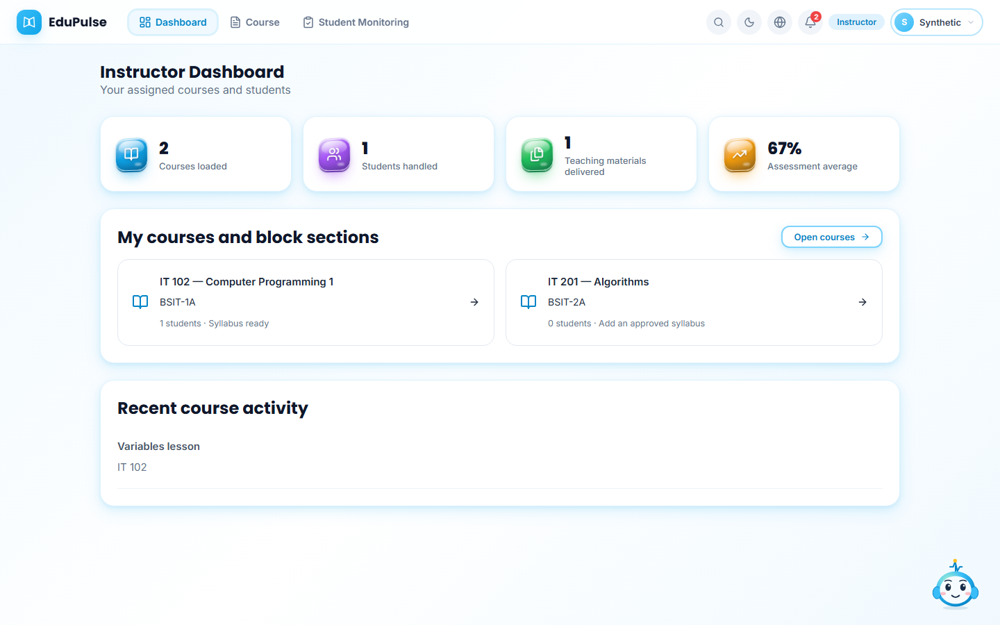
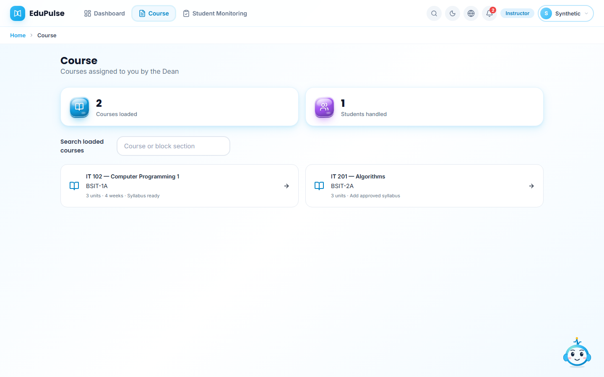
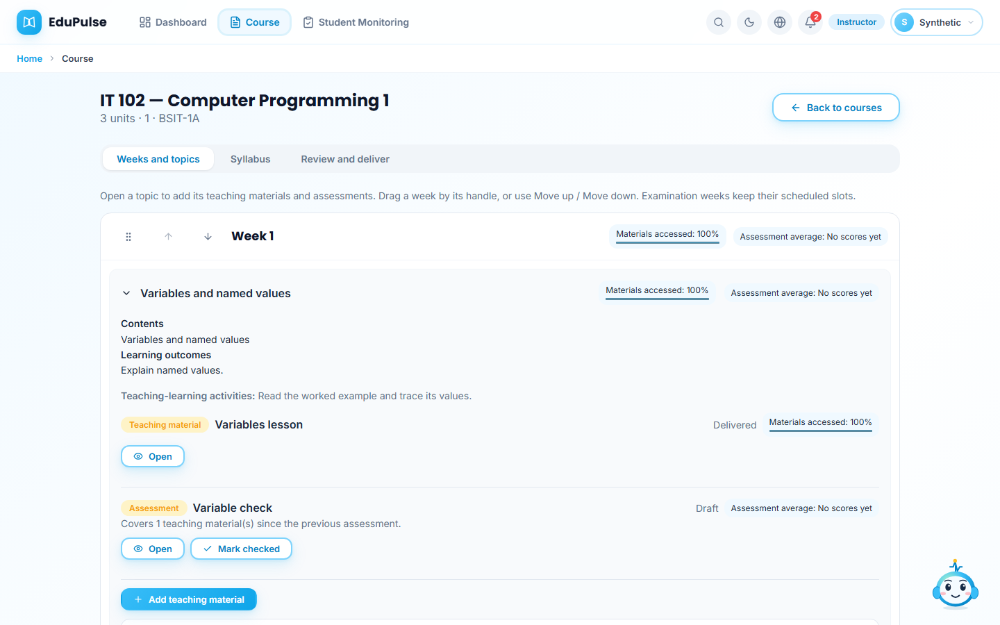
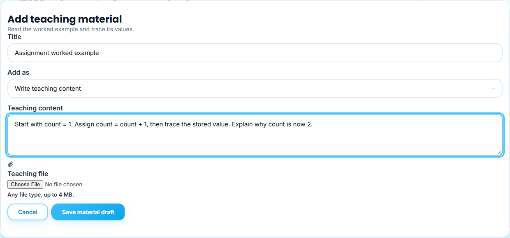
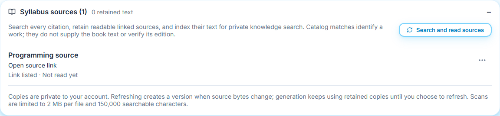
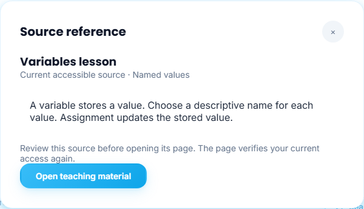
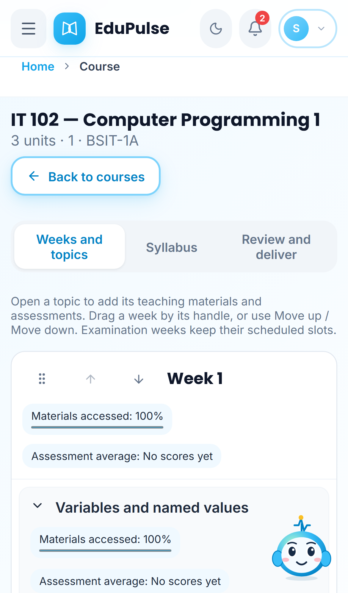

# 44 · Teach from the assigned course workspace

**Who:** a verified instructor, including a verified System Admin instructor support view. **Where:** **Dashboard**, **Course** and **Pulse**.

The signed-in Instructor navigation is **Dashboard**, **Course** and **Student Monitoring**. **Syllabus** is inside a selected course. Older `/syllabus` links redirect to **Course** and retain their requested syllabus tab or saved record; they do not add an unassigned course to the teaching load.

## Review the assigned courses and students

The dashboard uses the same summary-card component as the other academic roles. **Courses loaded** counts the current Dean-recorded course assignments, **Students handled** counts distinct active enrolled learners in those courses, and **Teaching materials delivered** counts their available non-assessment publications. **Assessment average** uses current-version marked assessment results from those enrolled students. Missing marks remain missing, and a genuine score of zero remains zero. Scripted/Admin demonstration rows do not become independent learner results.

**My courses and block sections** names the course and its loaded blocks. Select a course card or **Open courses**. The **Course** list includes only courses assigned to this instructor by the Dean, including assignments that do not yet have a syllabus. **Search loaded courses** filters by course or block. An old or unassigned course link shows the current assigned list with an explanation instead of displaying a different instructor's content.

## Add the approved syllabus for a loaded course

1. Open an assigned course. Until it has an active, unsuspended syllabus, **Weeks and topics** shows **Upload syllabi**. Drop an approved PDF or DOCX, or activate the browse area. The retained approved-file limit is 750 KB; this is separate from the teaching-file limit below.
2. Review the extracted course identity, weekly contents and warnings. **View syllabus** and the retained original allow comparison. The uploaded course code must match the selected loaded course. Reading and OCR do not verify signatures or invent missing weekly mappings.
3. Confirm the approved-copy acknowledgment and choose **Use syllabus for course**. Wait for the revision-checked save. Source reading, retention and readable-text indexing follow this explicit intake; an unread or inaccessible source remains disclosed.
4. Alternatively choose **Choose a shared syllabus from the system**. Select a received copy for the same loaded course, acknowledge that it is authorized, then choose **Use approved shared syllabus**. The server verifies the sender's retained approved file before adoption. Merely receiving a shared copy does not activate or publish it.

The upload area is absent from the ready **Weeks and topics** view. Use the course's **Syllabus** tab for its saved syllabus, received copies, optional draft builder, offline approval steps and sharing/removal controls. The builder stays scoped to the selected course. If that syllabus has saved prepared content before approval, **Review drafts** remains available with publication blocked. Saved suspension remains required before deletion; approval and publication remain separate.

## Work through weeks and topics

**Weeks and topics** lists the approved outline chronologically. Open a topic to see its extracted **Contents**, **Learning outcomes**, **Teaching-learning activities**, teaching materials and assessments. A topic corresponds to the outline's saved scope section; a week may have several sections and the same section may cover multiple weeks. The complete extracted contents remain visible within that scope.

The quick-context pills show **Materials accessed** and **Assessment average**. Access is the proportion of currently enrolled students who opened the available materials; opening is not proof of finishing or understanding. The score pill uses marked current-version attempts, not pending written responses, revoked memberships or earlier publication versions. **Not delivered** and **No scores yet** are honest states, not fabricated zeros.

### Add teaching content

Choose **Add teaching material**. The extracted activity or topic text is shown as context and as the field placeholder. Set a **Title**, then select **Add as**:

| Option | What to add |
| --- | --- |
| **Write teaching content** | Instructor-written text in **Teaching content** |
| **Upload a file** | An original **Teaching file**, any file type up to 4 MB; readable supported documents can contribute extracted text |
| **Add a link** | A complete HTTP/HTTPS **Resource link**, with explanatory teaching text where needed |
| **Generate content with AI** | Explicit **Generation instructions**, followed by **Generate draft** |

**Save material draft** creates a private draft and opens it in a separate reader. Binary uploads are private stored files, not public links or inline workspace blobs. A successful attachment does not mean every file type was read: unsupported or unreadable bytes remain downloadable but are not represented as source text for AI. Adding a teaching-resource link does not by itself establish that its contents were downloaded or read.

### Add an assessment after the relevant materials

Use **Add assessment after this material** or **Add assessment** after one or more materials. A regular assessment covers the teaching materials since the preceding regular assessment. The form names that coverage and shows the extracted assessment label/instructions as context. The final **Overall assessment** section is kept last and covers every teaching material in the topic.

An extracted assessment type preselects **Assessment type**. When generating without a specified type, leave **Choose automatically from the teaching content** or explicitly select Multiple choice, True or false, Enumeration, Identification, Essay, Matching type, or the single combined **Follow-along / Step-by-step documentation guide or criteria**. Manual authoring uses **Multiple choice (default)** when no type is selected. **Write assessment questions** opens the question editor; complete the question text and required choices, then **Save Assessment**. An incomplete assessment remains unsaved. Written formats retain instructor marking; they do not acquire automatic official grades.

**Generate content with AI** is optional. Assessment generation requires readable teaching content for its stated coverage and uses the approved topic and readable syllabus references. An attached file or URL without readable text cannot substitute for that context. Generated content starts in Draft; the model does not check or deliver it. If materials later change, review the displayed coverage warning before delivery.

### Review and deliver

Open and review the saved item. A private draft can be edited; **Mark checked** acknowledges review. **Deliver to students** opens delivery controls. Review release/due dates and, for assessments, allowed attempts and time limits. Changing assessment rules can return the item to Draft. **Deliver checked content** is explicit and remains subject to the active approved syllabus and the server's checked-before-publication rules. Future releases remain unavailable to students until their saved time.

The **Review and deliver** course tab retains the existing course/week review, generation, checking and publication tools. Published content is protected; a revision must return through the draft/check/delivery process. Existing attempts and publication history remain retained.

### Move teaching weeks

Drag a week by its handle, or use its labelled **Move week … up/down** buttons. Move the complete teaching scope rather than editing the week number. The displayed week slots stay chronological and examination weeks keep their scheduled slots. Topic IDs and their associated teaching content move together.

If delivered or hidden items would move, a confirmation explains that affected content will return to Draft and be unavailable to students until reviewed and delivered again. **Move weeks and prepare drafts** performs the explicit revision-checked save. Cancel or reload does not perform the move. Recorded assessment scores and history are retained.

## Read the syllabus sources at the end

**Syllabus sources** follows the complete weekly sequence. It collects the overall bibliography and references in the actual outline sections, deduplicating shared sections. The panel distinguishes readable retained text, unread/unavailable sources and catalog-only metadata. A catalog match identifies a work; it does not supply a book's full contents or verify an edition.

Approved-file intake checks/retains sources and indexes actual readable copies. Use **Search and read sources** to retry reading/indexing afterward. For the same link or book, open its source menu and choose **Attach readable copy** to add the matching readable PDF, DOCX, HTML, TXT or Markdown copy, up to 2 MB. Check the work and edition. This retained copy is the context for that citation; it is not a different substitute source. Existing saved copies can support later generation without a repeated download. **Search or read again** is an explicit refresh, and unread references cannot substantiate generated claims.

**View** opens the retained reading, provenance and original-copy download. Retained text is private to the actual account; shared syllabi do not automatically share its private source files. Keep a usable course file separate from the cited source copy when their roles differ. [Manual 31](../31-retained-syllabus-sources/README.md) covers reading limits, versioning, citation inspection and source selection.

## Use Pulse as system chat

Ordinary greetings, application questions, record searches and navigation use system rules and currently authorized EduPulse content. Keyword and bounded spelling matching do not rewrite IDs or authorize a record change. A miss offers clearer keywords or a target; it does not silently invoke a connected text model or search the Internet. A suggested navigation correction offers a button for confirmation. Explicit educational drafting or revision can use the connected provider or on-device model; web research requires an explicit request outside those authoring workflows.

Click a system-answer citation to open **Source reference**. The dialog checks the source again using the saved question and current authorization. Read the quoted passage and choose its **Open …** button to confirm navigation into EduPulse. Teaching-material references open a read-only reader; citation navigation does not record a learner open or start an assessment. A missing, changed or revoked source produces an unavailable explanation instead of displaying cached private text.

Source navigation stores only bounded conversation/message/source IDs. Reload may repeat the read-only authorized source lookup, never a model request, save, learner action, publication or assessment response. Ephemeral attachments that are no longer available cannot be reconstructed from a filename. The existing microphone/Stop recording/transcribe-to-draft flow and explicit **Send** remain unchanged.

## Phone and reload behavior

The same cards, topic controls and dialogs fit a phone. A keyboard alternative accompanies dragging. The selected course/tab, expanded topics, current reader, source dialog and unfinished action location restore only after fresh account and record checks. Unsaved form text and assessment answers are not navigation hints. Focus, timers and reconnects do not involuntarily reload a loaded workspace.

These captures use fictional academic records and controlled transport to exercise the real interface. They do not prove hosted sign-in, external approval, arbitrary-file extraction quality, protected-book access, paid inference quality or independent student achievement. The release validation records native/API/database and production checks separately.
