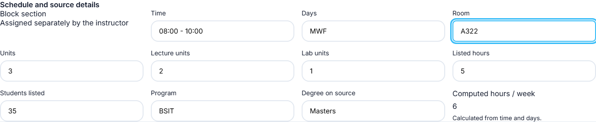
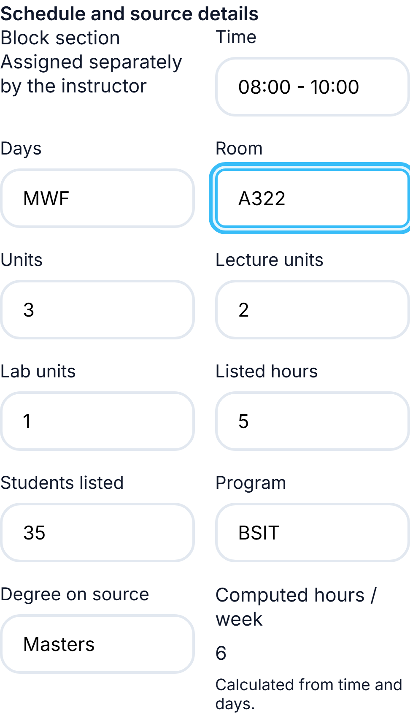
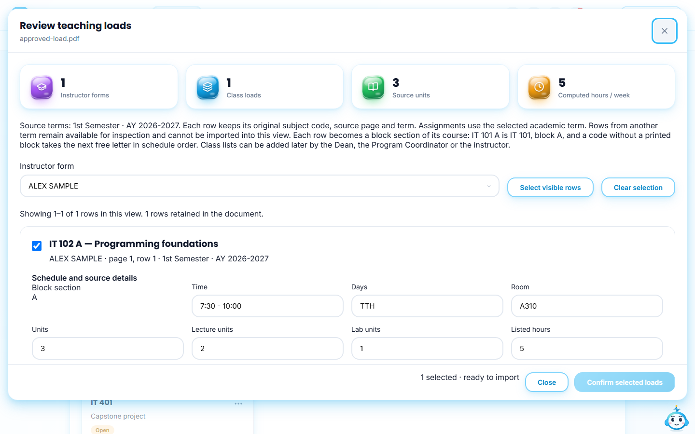
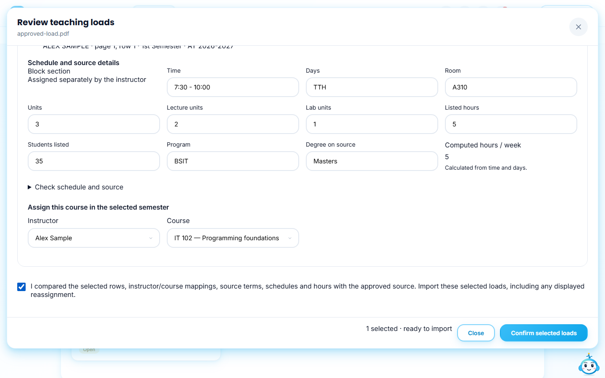
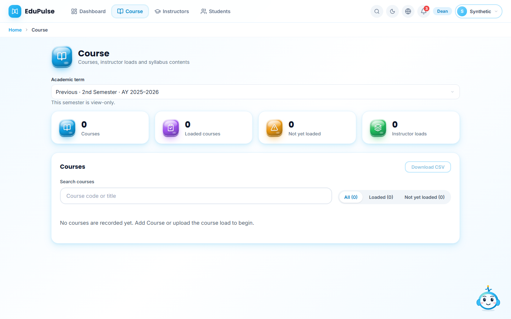

# 47 · Teaching-load documents and academic terms

The active directory includes the original students from all six departments. **Switch view → Student** and the instructor's registered-student picker start with **All departments** and retain department, program, year, search and pagination filters. Restoration reactivates preserved identities; it does not create new passwords or enroll students automatically.

The owner requested a fresh course-loading start on 17 November: 129 old loads and their 4,029 derived memberships were removed. The catalog, 417 block-roster records, accounts, passwords and workspace content were retained. Upload and review the actual loads to assign courses again.

## Read a PDF through Pulse

1. Open Pulse and attach or drop a teaching-load PDF. Up to three attachments may be read sequentially. Each file must be at most 4 MB; local PDF reading/OCR supports up to 60 pages per file. Larger documents require splitting, rather than silently omitting pages.
   A PDF without usable embedded text continues into on-device OCR even when the sandbox reports that it needs OCR. Account, rate-limit, network and unsupported-format errors still stop the upload and show their actual reason.
2. Ask to extract the teaching loads, then choose **Review extracted course loads**. This is a system extraction, not a model request. Its page modal shows the entire extracted table, instructor forms, units and computed schedule hours. Reading and previewing make no record changes.
3. Use **Instructor form** to focus one form, and choose which rows to import. The preview retains instructor name, highest degree, source subject code/title, semester/year, time, days, units, lecture/lab units, listed hours, computed schedule hours, room, student count, program, page and row. Wrapped cells remain in their original column. An unreadable page is explicitly identified.
4. Compare warnings and totals with the source. Multiple meetings on one day count as separate sessions. `TTH` means Tuesday/Thursday; a single interval on two days counts twice. AM/PM that is absent from the source remains unconfirmed. These times do not automatically become publication or assessment delivery schedules.
5. Map each selected row to a verified active instructor, recorded course and actual block. Retired instructor accounts are excluded; a current account ban or suspension prevents load assignment. Source section suffixes are retained but are not invented block assignments. Unmatched names/codes require a choice; no instructor or curriculum course is created from OCR. A source degree is retained per load and does not replace a current staff qualification automatically.
6. Check **I compared the selected rows…**, then **Confirm selected loads**. A Dean, Program Coordinator or System Admin can confirm; an Instructor can inspect an attached document but cannot assign a load. Invalid mappings, duplicate class/term targets or records changed since preview reject the transaction. At most 500 rows can be confirmed in one import.

The same PDF review is available from **Course → Upload course load**. Existing CSV/Excel intake remains available. Confirming a load does not approve a syllabus, generate courseware, publish materials, fabricate student activity or turn the source's headcount into student memberships. Current block rosters remain the source of actual students.

## Switch term records

**Academic term** appears on Course, Instructors and the Instructor's course list. The owner confirmed these labels:

| Filter | Record term |
| --- | --- |
| Current | 1st Semester · AY 2026–2027 |
| Next | 2nd Semester · AY 2026–2027 |
| Previous | 2nd Semester · AY 2025–2026 |

Other recorded terms, **Term not recorded** and **All terms** remain selectable. Term choices are URL references and survive reload without replaying an import. The instructor dashboard uses the current term. Historical/next-term imports remain separate records and do not create current enrollments. The current-term baseline is the owner's explicit designation, not an inferred date rollover.

Course and Instructor load details show schedule, room, units, lecture/lab units, listed and computed hours, source headcount/program/degree and source filename/page. The filename/page are retained with the record; this upload flow does not retain original PDF bytes or turn them into a public link. Unconfirmed upload forms and selections are not replayed after reload.

## Supplied-file inspection

The original First Semester AY 2026–2027 file contains 11 instructor forms and 56 rows. The Second Semester AY 2025–2026 file contains 12 forms and 66 rows. The latter is past loading, not next-semester loading. Source values and printed total discrepancies remain reviewable; the files were scanned without assigning their rows to live instructors. The owner subsequently authorized importing the previous-semester file on 18 November, as described below. Real names, signatures and source files remain outside public documentation captures.

The [release record](../../versions/2026-11-17-load-document-intake/README.md) separates source-file inspection, controlled browser checks and hosted database verification.

### Semester and assignment correction - 18 November 2026

Use the shared Academic term to choose the period. Only Current (First Semester AY 2026-2027) and Next (Second Semester AY 2026-2027) allow changes; completed periods are view-only. The selected term supplies course creation and loading context. A Dean assigns courses only. Original PDF schedule rows remain readable, but neither their subject suffix nor source headcount creates class membership. Instructors confirm actual blocks through Course > Block sections and choose registered students individually or upload their identifiers. Current/next class lists and overrides remain separate, including when course codes repeat. Pending classes expose course/instructor labels while awaiting teaching release. See [Course flow](../46-course-load-workspace/README.md).

## Approved previous-semester CIT loads - 18 November 2026

The owner explicitly authorized a maintenance import of the approved revised Second Semester AY 2025-2026 teaching-load document. Select **Academic term > Previous - 2nd Semester - AY 2025-2026** on Course or Instructors. The archived catalog contains 21 courses and 37 instructor-course assignments, retaining all 66 printed schedule rows from 12 instructor forms. Source subject suffixes remain source labels, not guessed home blocks or class lists. Printed headcounts do not enroll students.

Three absent staff identities were added as historical instructor accounts with sign-in disabled and no current assignment. Existing Instructor, Dean and Program Coordinator identities were reused, including their teaching rows, without changing live account roles, passwords, bans or current qualifications. Historical teacher cards identify themselves as **Historical teaching record**. The degree and master's indicator in that view come from that semester's approved form; returning to Current restores the current staff profile. Current profile edits cannot rewrite these archived degrees. Current sign-in dates are not presented as historical facts.

Open an instructor and expand **retained source schedule rows** for the printed course code/title, time/days, room, units, lecture/lab units, listed/computed hours, headcount, program, degree, source page and row. Instructor-form totals retain both printed and summed values. On one form the rows total 15 units while the printed footer says 18; both remain visible. Missing AM/PM remains as printed and does not establish a delivery schedule.

Previous semesters stay view-only for every normal application role. This owner-requested backfill is a privileged PostgreSQL maintenance operation with no JWT, not an enabled historical import/edit button or an exception for a client role. It creates no current/next load, class membership, syllabus, courseware or learner activity. [Validation](../../versions/2026-11-18-historical-cit-loads/validation/results.md).

## Correct extracted schedule and source details

For selected rows in a writable term, **Schedule and source details** provides inputs for **Time**, **Days**, **Room**, **Units**, **Lecture units**, **Lab units**, **Listed hours**, **Students listed**, **Program**, and **Degree on source**. Days and degree offer native suggestions while permitting the original/custom wording. Blank numeric cells remain unrecorded; a true zero remains zero. Student headcounts must be whole numbers from 0 to 2,000; units are bounded to 50 and listed hours to 168. Inline errors prevent confirmation.

**Computed hours / week** is a calculated output. Changing time or days recomputes it with the existing schedule parser; an unreadable schedule remains **Not recorded**. Source totals and extraction warnings remain comparisons against the original document, not recalculated approval evidence. Corrections clear **I compared the selected rows?**. Recheck the selected rows and explicitly confirm to save. No inference, student enrollment or publication is triggered by an edit. Historical periods and non-managing roles remain view-only. Unsaved corrections are local to this review and are not replayed after reload.

The extraction and confirmation steps remain visible in these fictional PDF captures:

### 19 November 2026 - Meeting-day selection

Reviewed load rows, manual instructor loads and new block schedules use a Monday through Saturday checkbox dropdown. Select one or two days: M, T, W, Th, F, S. Tuesday and Thursday save as TTh; the same stored codes drive computed contact hours and weekly delivery dates. Existing imported source strings remain visible until deliberately corrected; never silently truncate a source schedule. Do not regress Thursday into Tuesday or allow a third selected day in these editors. Historical source facts stay unchanged.

### 22 November 2026 - Course catalog table

Course cards and their course-detail modal are replaced by a single course/instructor table. Columns show code, title, units, status, instructor, block sections, retained schedule/source facts and student counts. Unloaded courses retain a row. The final Actions column uses the shared three-dot menu for catalog CRUD, instructor loading/edit/removal, block/class-list management and read-only syllabus inspection. Current/next-term permissions, past-term read-only access, confirmation dialogs and saved data boundaries remain unchanged. Do not recreate the course-detail modal or inline action-button strips.
