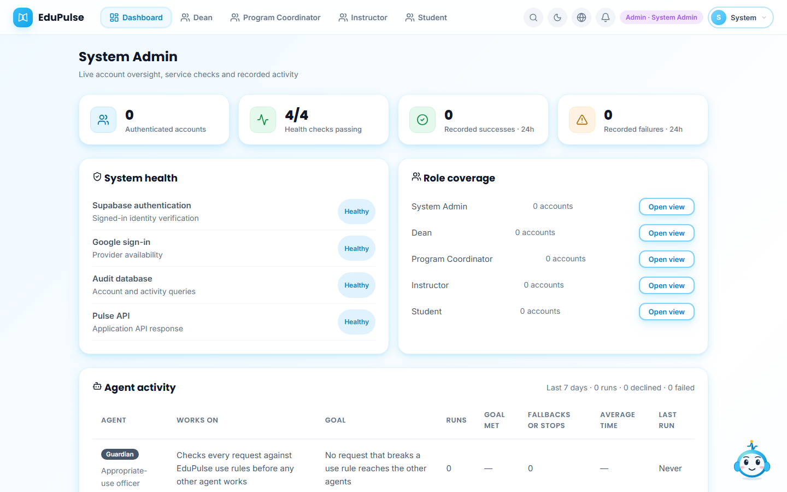
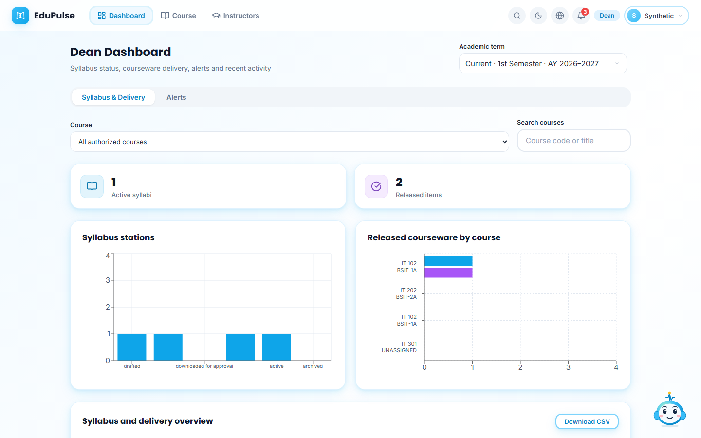
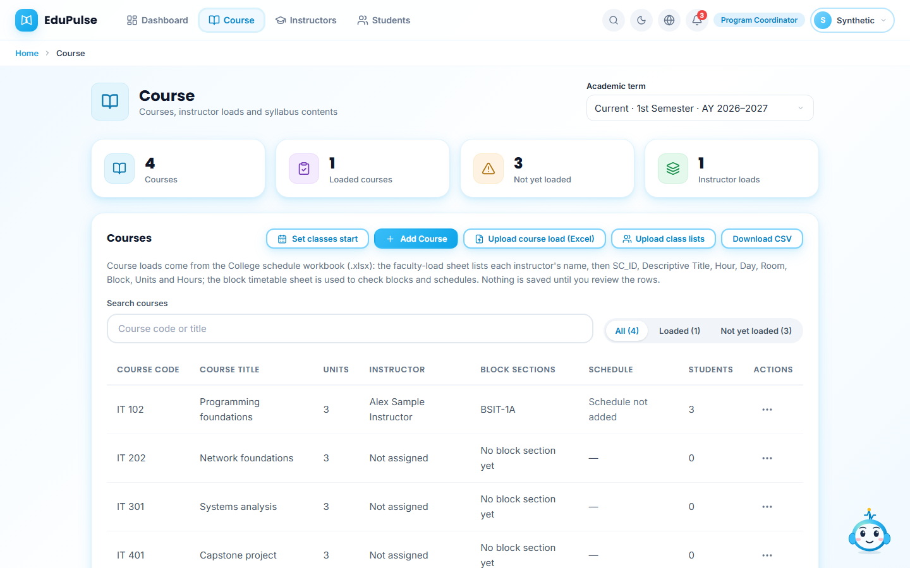
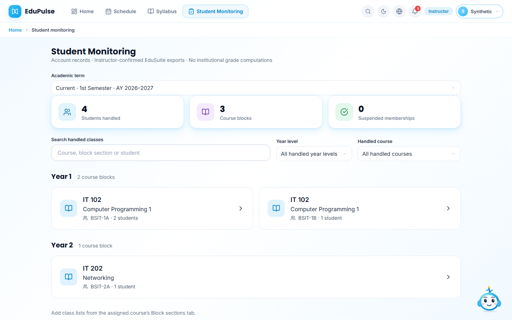
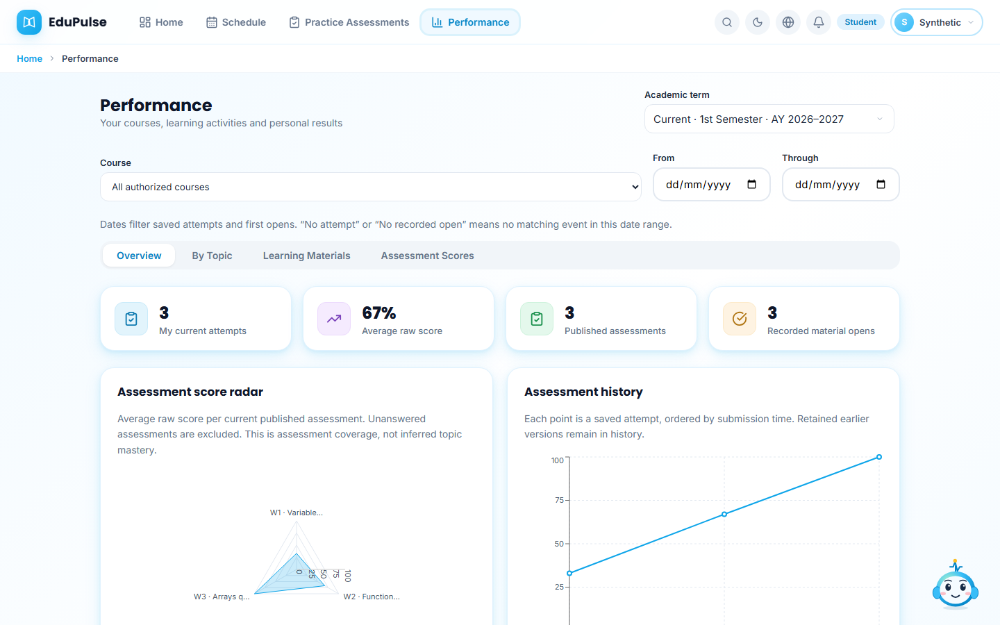
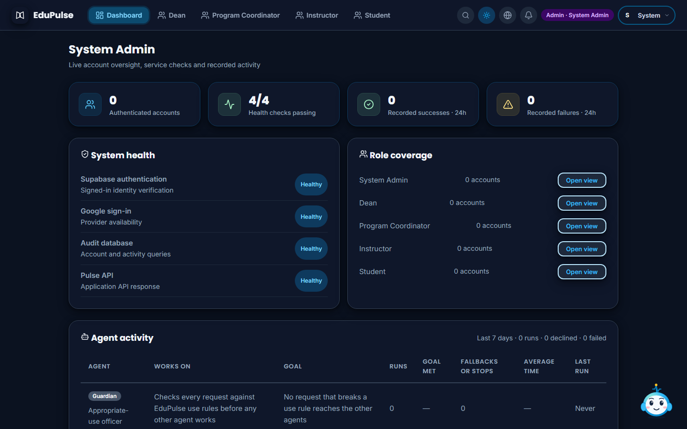
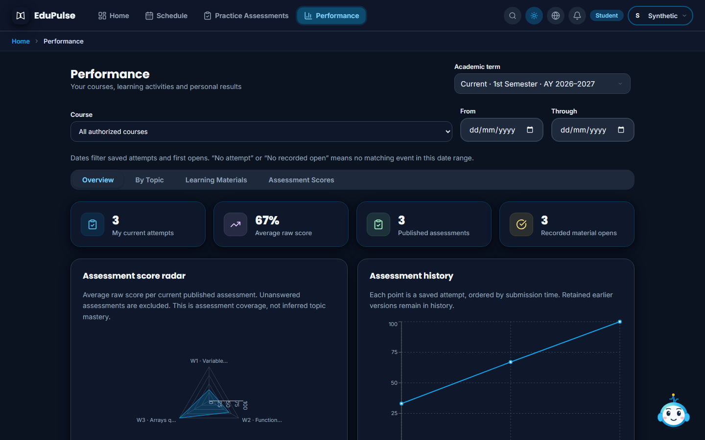
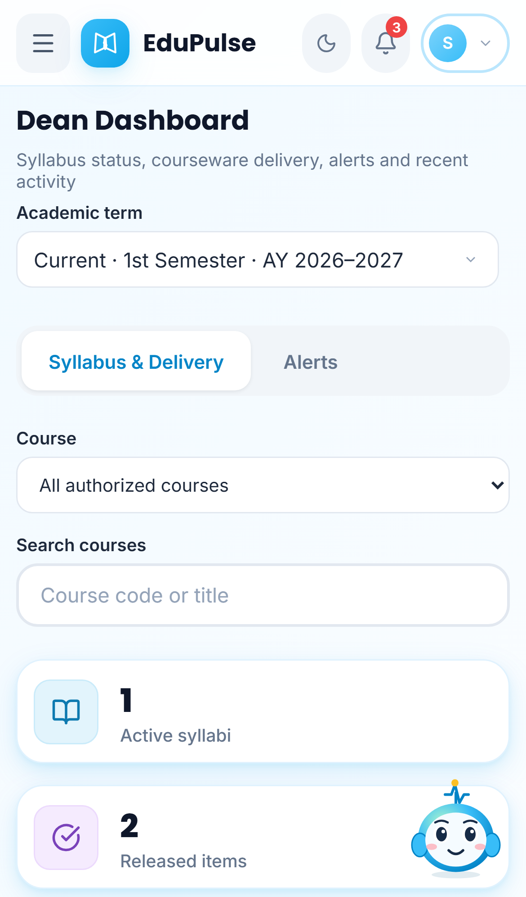
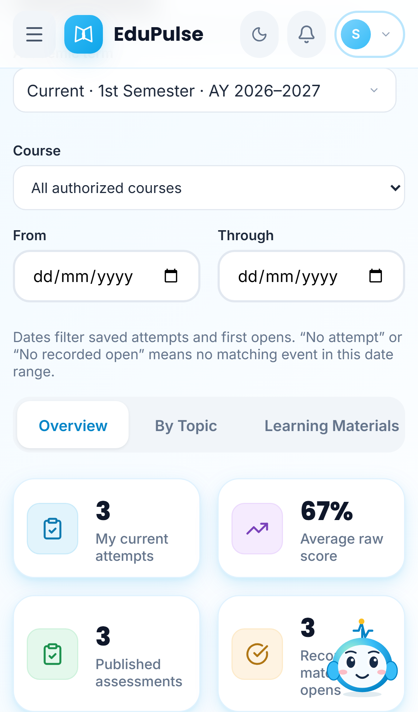

# 53 · Flat interface icons

EduPulse uses outline icons on flat, softly tinted tiles. The icons keep their original meaning and labels. Their size remains consistent across summaries, page headings and dialogs. Perspective tilt, glass highlights, extruded edges, cast shadows and icon lift effects are removed. Upload icons use solid status tints and remain still; Home shortcut buttons and public-page badges also use flat icon styling.

The same shared treatment applies to System Admin, Dean, Program Coordinator, Instructor and Student views, including Admin support views. Dark mode adjusts icon ink and tint through the existing theme colors. The examples below use fictional records and controlled transport. Displayed scores and health checks are sample UI values, not evidence of live learner results or service availability.

## Role views

System Admin dashboard summaries retain account, health and activity labels.

The Dean dashboard keeps its syllabus and delivery summaries.

Program Coordinator Course uses a flat page-heading icon and the same summary tiles.

Instructor Student Monitoring uses the same flat treatment for handled students, course blocks and suspended memberships.

Student Performance keeps its attempt, score, assessment and material-open summaries.

## Dark mode and phones

The icon foreground and background adapt together in dark mode. Shared summary-tile glyph contrast is checked at 3:1 or better, and meaning remains available in each tile's adjacent label.

On phones, tiles retain the same outline style and wrap with the existing summary layout.

## Audit coverage

The public feature card and syllabus upload area use solid icon surfaces as well.

| Role | Pages scanned |
|---|---|
| System Admin | Dashboard, Settings, Notifications |
| Dean | Dashboard, Course, Instructors, Students, Course Loading link, Performance, Settings, Notifications |
| Program Coordinator | Dashboard, Course, Instructors, Students, Course Loading link, Settings, Notifications |
| Instructor | Home, Schedule, Syllabus, Course link, Student Monitoring, Performance link, content editor, Settings, Notifications |
| Student | Home, Schedule, Practice Assessments, Performance, Settings, Notifications |

The scan also covers Landing, Features, How it works, Roles, Pulse, Impact, Colleges, Play, FAQ, Privacy, Terms and error pages. Legacy links follow their current authorized redirects. Shared icon styles are verified in each role and on reload; Admin support checks cover Dean, Program Coordinator, Instructor and Student. This presentation change does not alter account selection, permissions, academic data or business commands.
