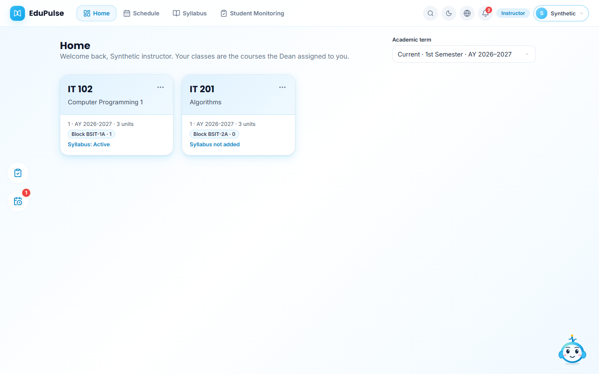
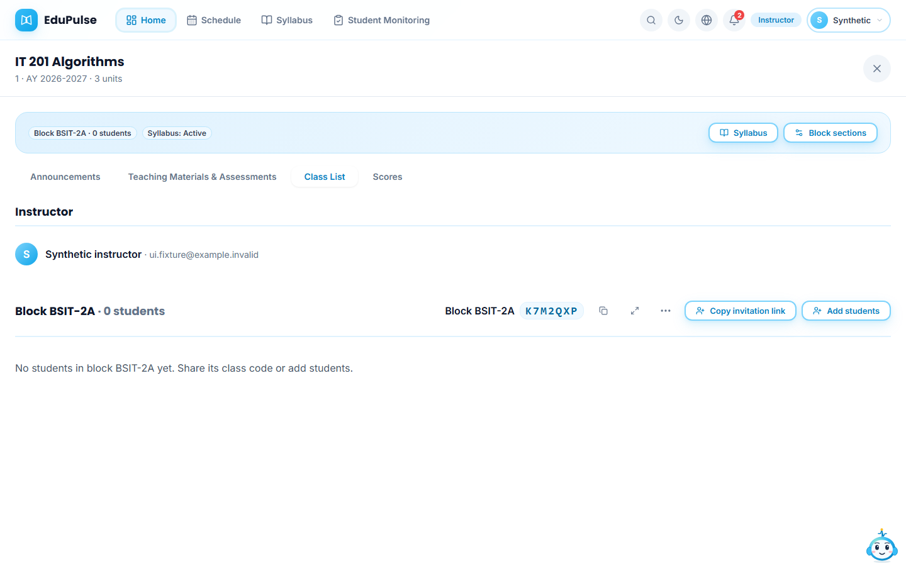
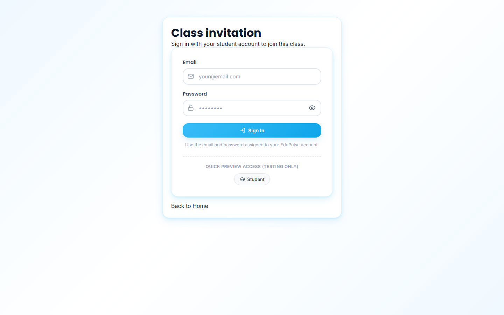
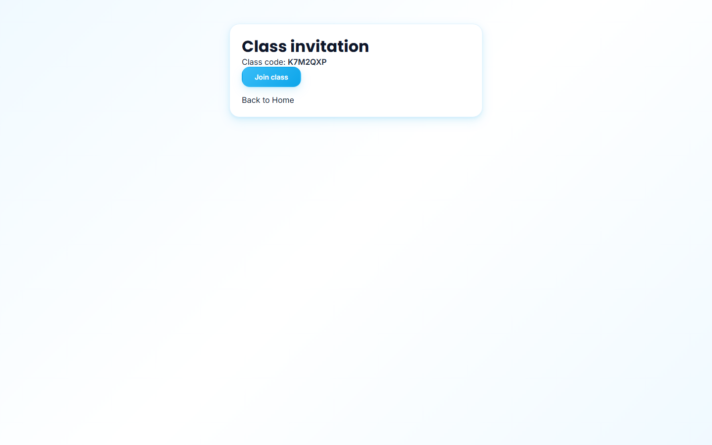
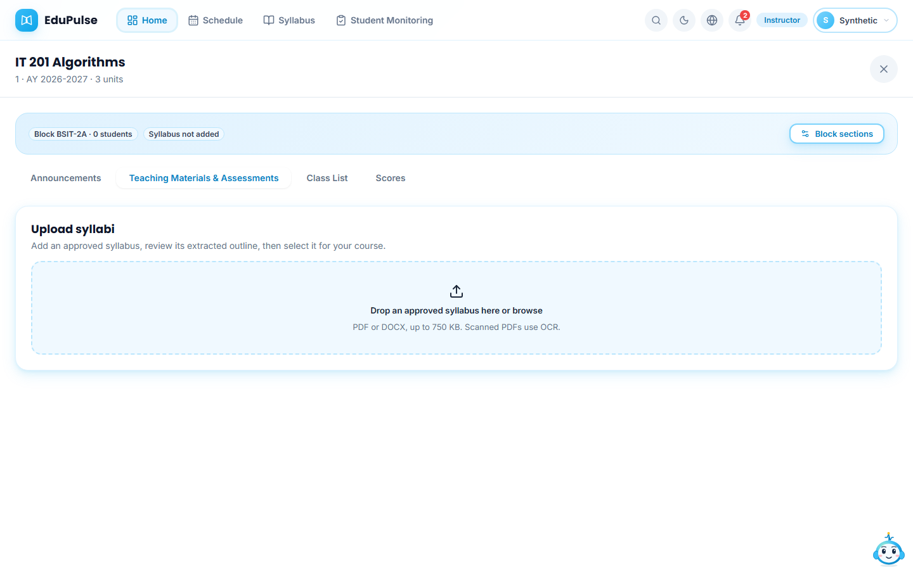
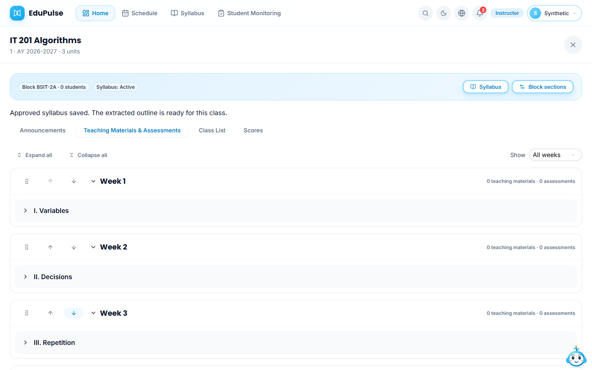
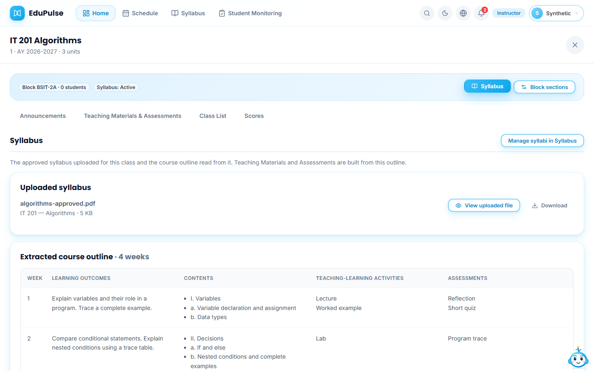
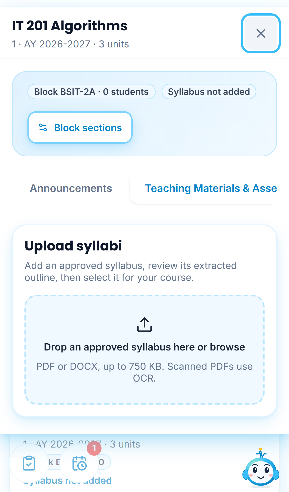
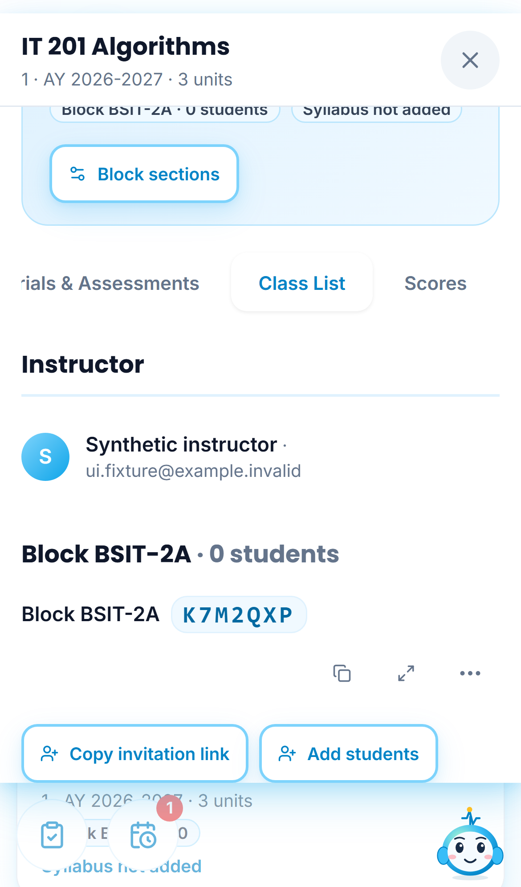

# 54 ? Management-loaded classes and approved syllabus intake

The Dean or Program Coordinator loads the course, instructor, block sections and class list. The assigned class appears automatically on Instructor Home and the enrolled student's Home, including classes awaiting an approved syllabus. Instructors do not create classes or new blocks.

## Add students to an existing class

Open the class and choose **Class List**. **Add students** offers an official class-list upload or **Choose individual students**. When an existing roster is present, its **Add students** action remains available. Confirming enrollment checks the current assignment, semester, workspace revision, official student identities and capacity. Existing class-list dialogs restore on reload after current authorization; reload does not submit them.

Share the active class code, or use **Copy invitation link**. The class card's three-dot menu also offers **Copy invitation link, block ?**. Copying issues no enrollment or code-creation command. A disabled code has no usable invitation until the instructor explicitly creates a new code for that existing class. Replacing a code invalidates its former links while preserving current students.

Students can enter the code through Home's **Join Class**, review the class and confirm. Following the invitation link automatically joins the student's own verified account and opens the class, or Home if its teaching outline is not yet available. Signed-out students first sign in with their student email and password. Instructor accounts and Admin support views cannot use the student enrollment action.

A browser reload never repeats automatic enrollment. An unfinished invitation stays at its URL and offers **Join class** as an explicit retry. Session or class-record verification failures preserve the destination and provide retry. Invalid, disabled, replaced, unavailable or full classes report the server's reason; a student in another block of the same course is not moved silently.

## Upload the approved syllabus inside the class

1. Open **Teaching Materials & Assessments**. When the class has no approved uploaded file, **Upload syllabi** provides a drop area and file picker. It stays inside the class and accepts one approved PDF or DOCX, up to 750 KB.
2. Compare the extracted identity and outline against the original using **View syllabus**. The course code and any printed academic year/semester must match the loaded class. A mismatch reports an error and saves nothing. Reading/OCR does not verify signatures.
3. Check the approved-copy acknowledgment, then choose **Use syllabus for course**. Only this action saves the retained original and approved teaching outline.
4. After the save, the upload area disappears and the header's **Syllabus** button appears. It presents the retained uploaded file and extracted outline. **View uploaded file** and **Download** use that original. The course does not offer another upload that could overwrite it.

Draft creation, draft editing, the personal library and sharing remain on the separate **Syllabus** page. A repository draft is never the class's approved teaching outline. Reload preserves the course/tab and reads the saved file without saving or enrolling again. Unsaved file previews and form contents are not navigation hints.

These screenshots use fictional records and controlled UI transport with real generated PDF bytes. Native database tests separately exercise persistent enrollment, role boundaries and rejection of instructor-created blocks. They do not certify a hosted student sign-in or external approval.
