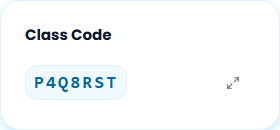
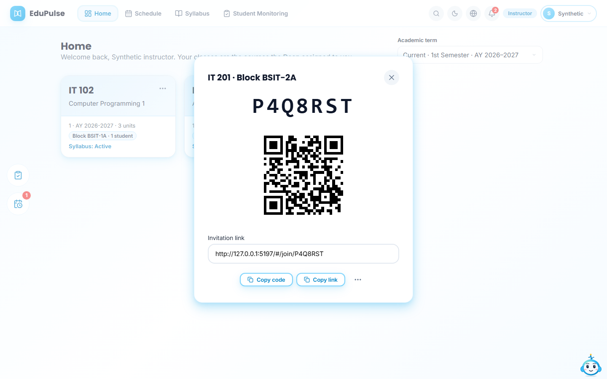
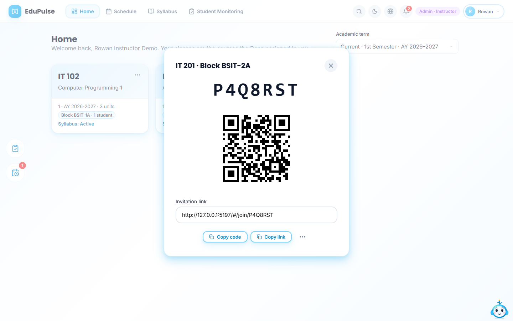
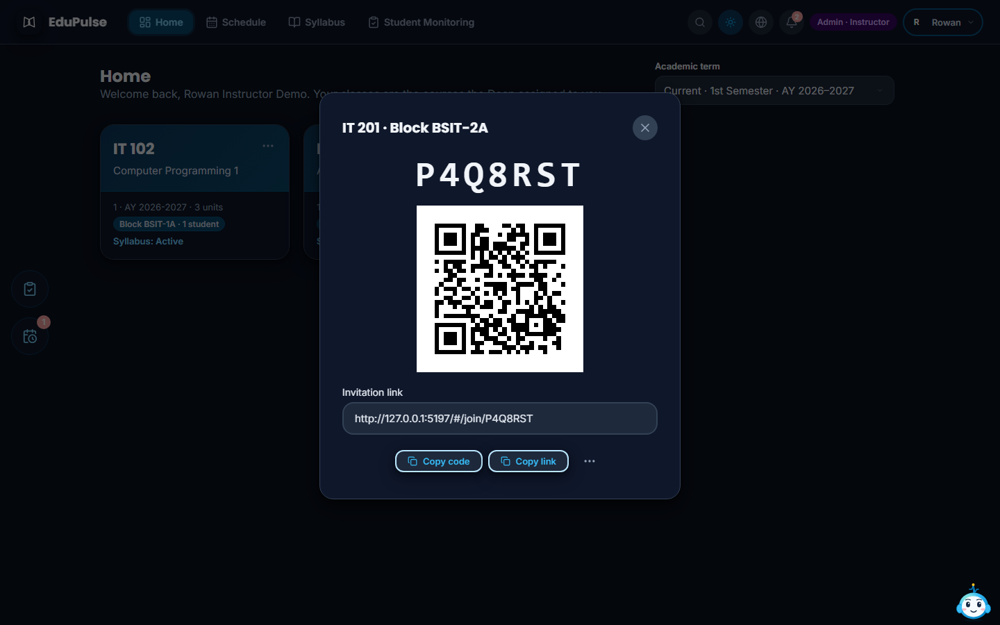
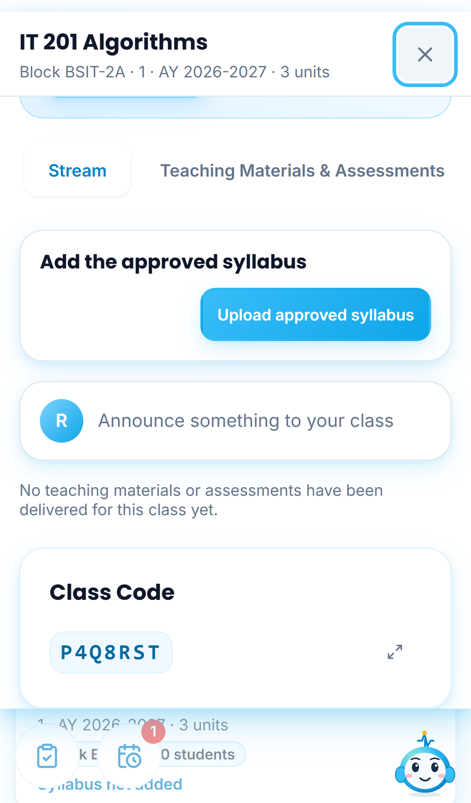
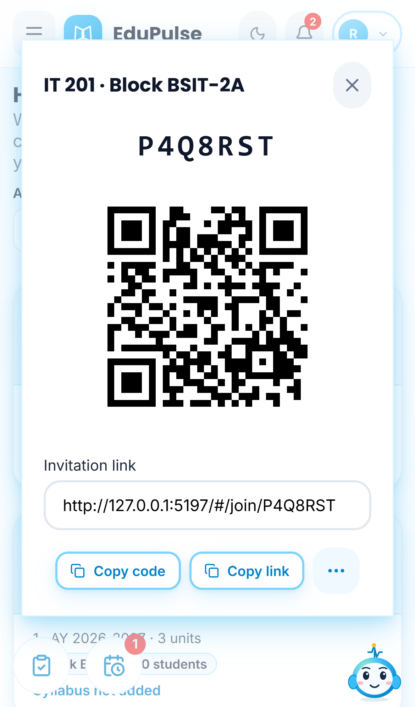

# 55 - Class Code and QR invitations

The Dean or Program Coordinator's confirmed course load creates its class and unique code together. When a reviewed import supplies block sections, those sections are used. A manual load without a section receives its initial section automatically, starting at A or the next unused letter for that course and semester. This names a course section; it does not invent a student roster, official student home block or meeting schedule. Existing loaded courses missing this class/code are repaired by the migration.

On **Stream**, the **Class Code** card contains the selected section's code and its enlarge icon.

Select the enlarge icon to open the class-code popover. It identifies the course and section and displays the enlarged code, a scannable QR code and an **Invitation link** field. Use **Copy code** or **Copy link**, or select and copy the link manually. The QR code opens that same invitation link. It is generated locally; no QR image service receives the class code.

The three-dot menu inside the popover retains **Replace code** and **Turn off code**, with confirmation. Code management and direct student additions also remain in **Class List**. An intentionally disabled code stays off when loading details change; the compact card does not silently create a replacement. Retired codes cannot enroll students. Completed semesters remain view-only; a future code does not bypass semester enrollment restrictions.

Reload restores the popover only after the current account, support subject, course and active code are verified again. It reads the current code and does not issue a creation, replacement or enrollment command. **Escape** and the close button return focus to the enlarge control. A changed or revoked code does not remain visible from cached navigation hints.

Students can still use **Join Class** and the code on Home, or follow the link/scan the QR. The invitation requires the student's own verified account, and prompts for sign-in when needed. Reload does not repeat enrollment. [Manual 54](../54-management-loaded-classes/README.md) describes that flow and existing-class roster additions.

These captures use fictional accounts and codes with controlled UI transport. The local capture origin in the sample invitation becomes the actual EduPulse origin when used on the live site. Browser tests independently decode the rendered QR pixels in both themes on desktop and phone. Native database tests check persistence, automatic assignment, explicit import sections, atomic rollback on code failure, disable, handover and maintenance backfill.
