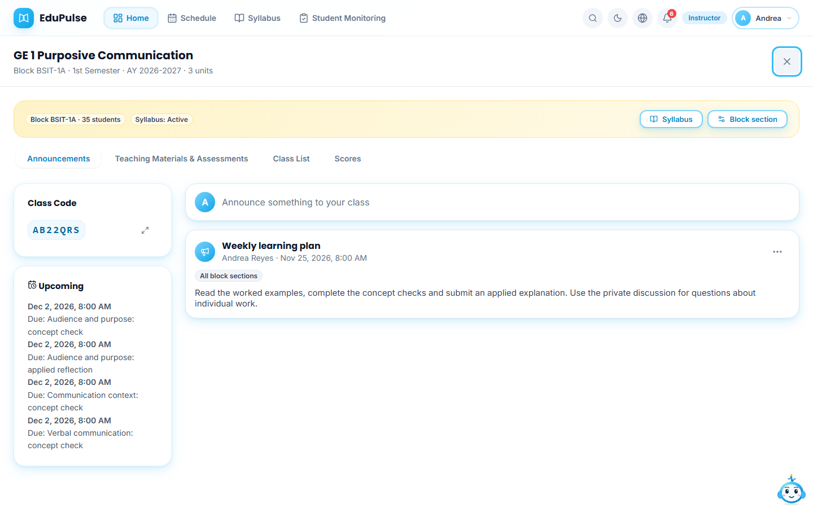
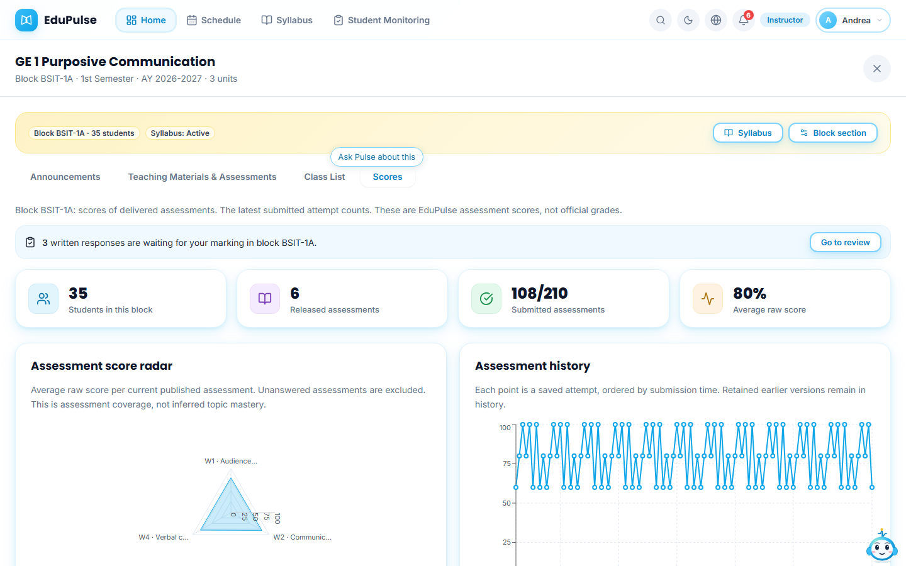
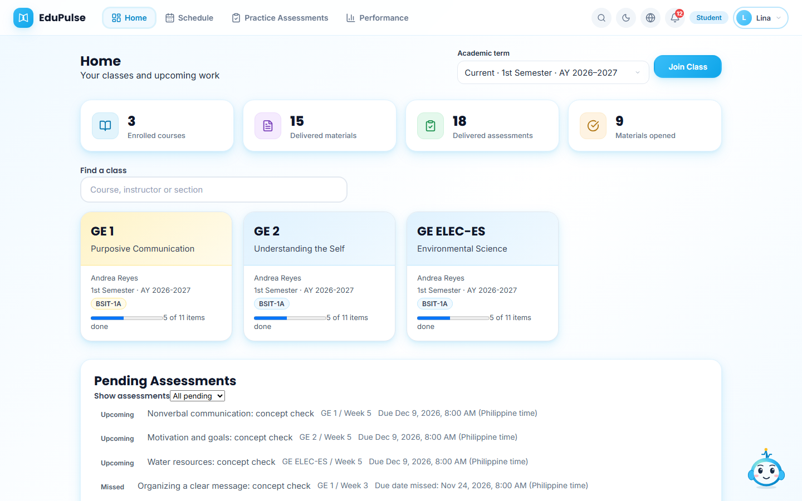
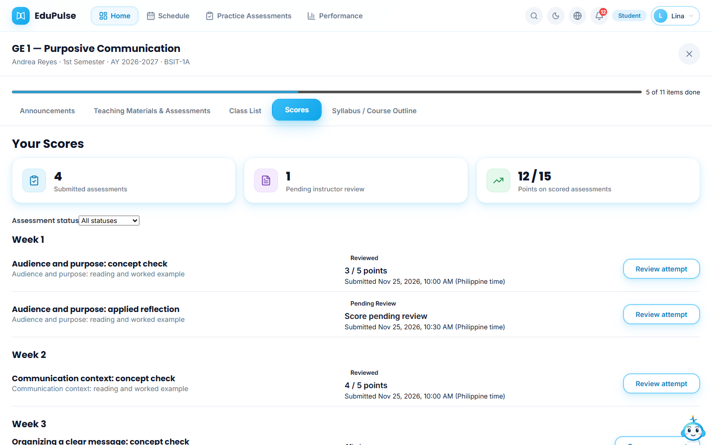
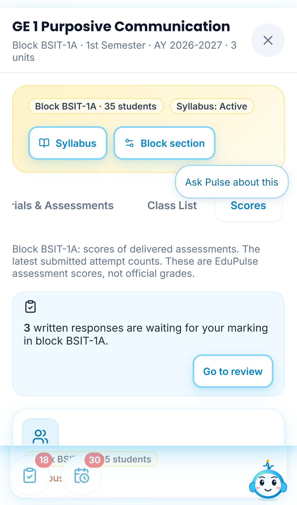
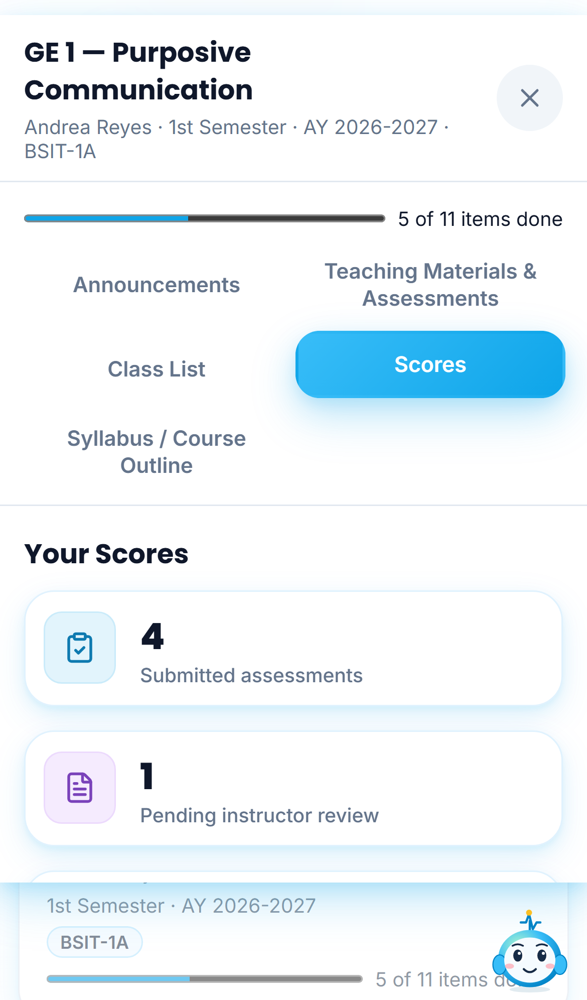

# 56 - Populated academic workspaces

The owner requested persistent teaching and learning records across the active instructor and student accounts. Suspended and disabled accounts retain their restrictions. Existing directory identities, uploaded originals, authored work and recorded results are preserved. These records use the application's database and normal course, publication, answer and review structures; they are not preview-persona results.

The current-term population follows the retained instructor loads: CIT students receive courses appropriate to their recorded year; CABM students receive the explicitly loaded GE ELEC-IT subject and CTELA students the explicitly loaded PROF ED 16 subject. Existing individual cross-department memberships remain. Five additional recorded first-semester general-education subjects are distributed across instructors rather than assigned to every instructor or student. Unrelated registered accounts are preserved and excluded. Classes remain limited to 35 registered students. New outlines contain 18 weeks; retained original outlines keep their existing rows. Authored course files contain no fabricated institutional signatures. Existing uploaded syllabus files remain unchanged. The first five weeks include delivered content; later weeks include checked teaching work and editable final-week drafts, so instructors can continue the delivery workflow.

Open **Home**, select a class, then choose **Teaching Materials & Assessments**, **Class List** or **Scores**. The Announcements tab retains the compact **Class Code** card and its QR/invitation popover. Shared syllabi and planning copies remain on **Syllabus**. Saved class schedules appear in **Schedule**.

Students in open classes have recorded reading progress and graded work, with further materials, assessments and attempts available. Saved future opening dates remain authoritative; three existing individually enrolled learners retain their not-yet-open state. Some written responses remain awaiting instructor marking. Practice records remain separate from official assessment results. Public discussion stays within the enrolled block; private discussion stays between its student and instructor. The topic submission bins contain written work and accept subsequent authorized submissions under their normal rules.

New answers are scored by the backend, and written answers require instructor review. Delivering a checked item makes its publication available only to its enrolled students under the class opening schedule. Reload restores the selected authorized view and does not submit answers, enroll students or deliver content again. A real score of zero and missing or pending marks retain their normal meaning.

The generated population history is recorded in private batch provenance, including its created row identifiers. It is included for the owner's interactive UI evaluation and is not evidence of independent human learning. Titles and user-facing indicators use ordinary course language. Passwords, account access restrictions and provider credentials are not replaced by the population.

These documentation images use fictional identities and controlled account transports with actual authored PDF bytes. They illustrate the populated interface while protecting real names and student records. They do not prove hosted sign-in, delivery or grading; the release validation records those checks separately.
