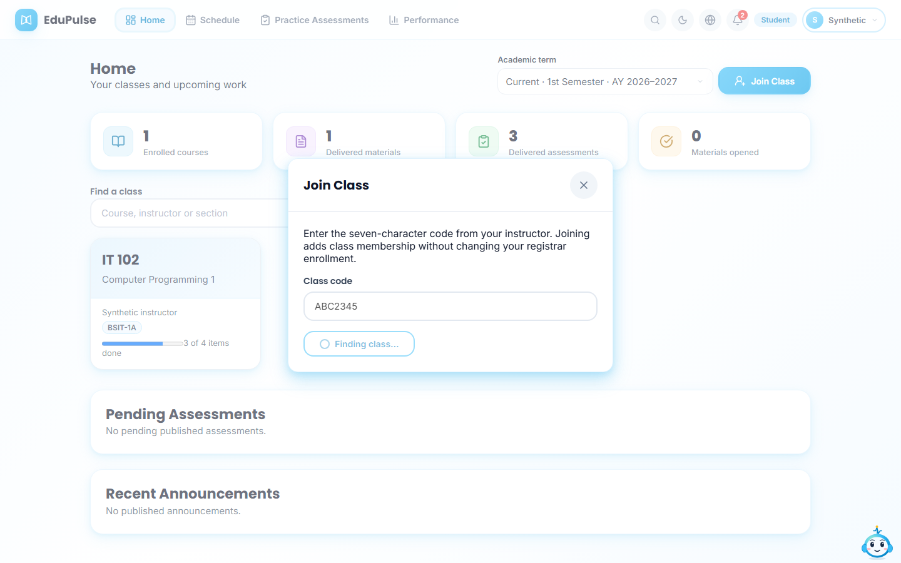
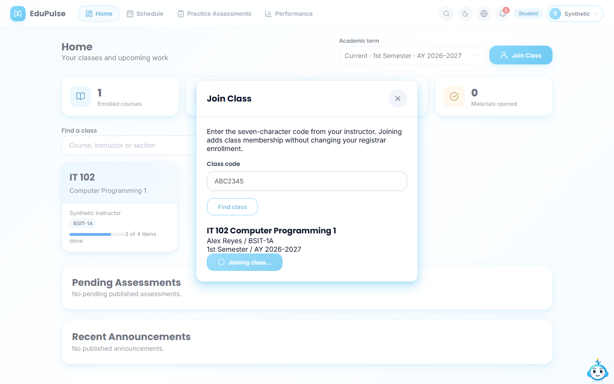
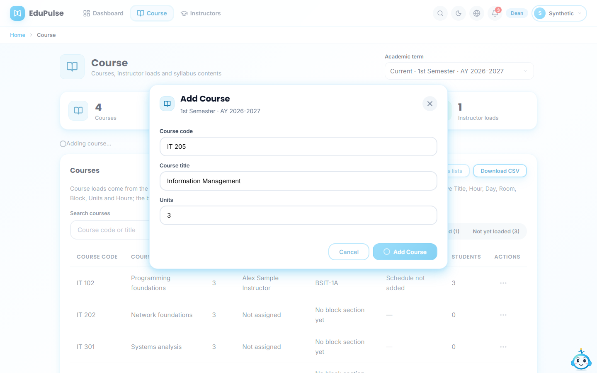
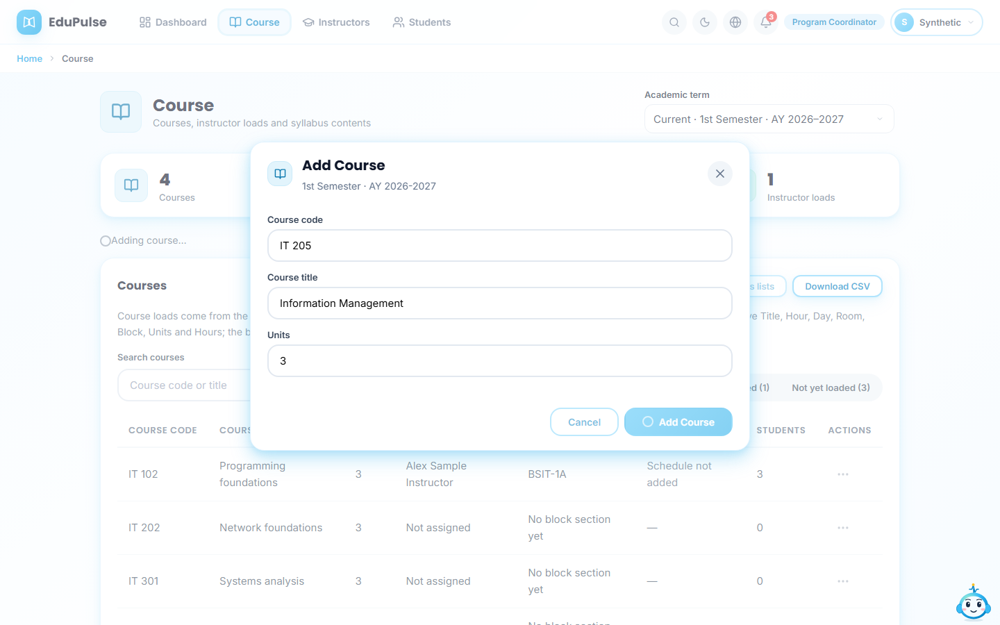
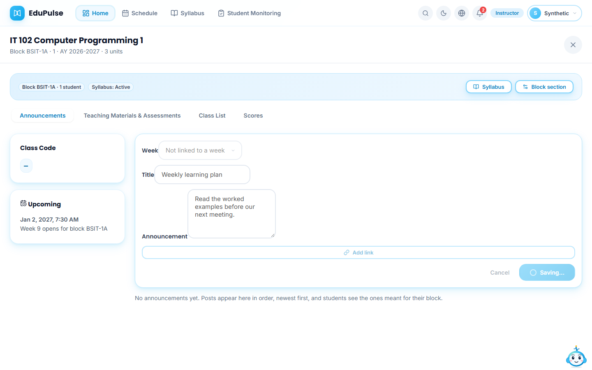
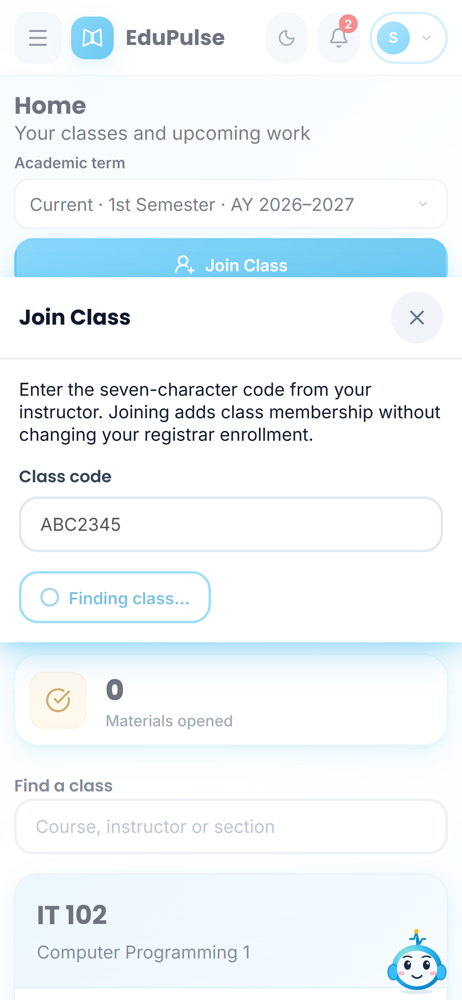
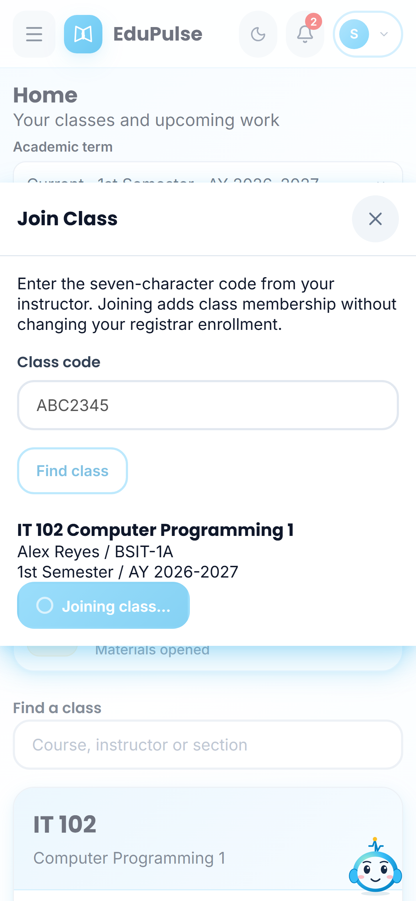
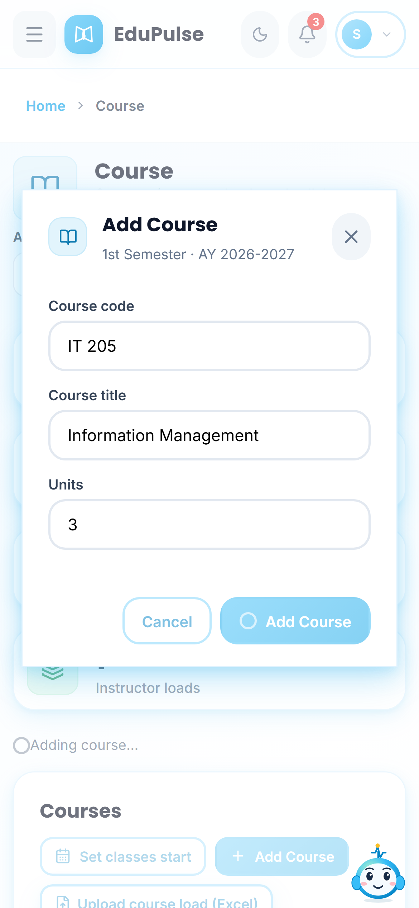
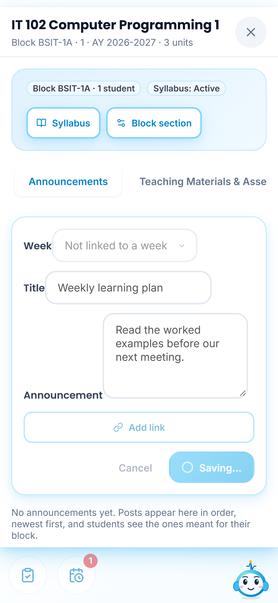

# 57 - Loading feedback across role dialogs

Pending reads, file processing and explicit saves use the existing themed spinner, skeleton or progress indicator. A disabled button caused by missing input is not a loading state. Reduced motion keeps the status and labels visible while stopping animation.

Student Home opens the **Join Class** dialog beside **Academic term**. The dialog shows a spinner while **Finding class...** or **Joining class...**. A failed join keeps the code for an explicit retry. Reload reopens the dialog with an empty code field.

Dean and Program Coordinator dialogs show a spinner during their save. Fields and errors remain available when the service rejects the request; a pending spinner never means the save succeeded. **Add Course** below demonstrates the shared treatment used by course, account, block, term and import confirmations.

An instructor announcement shows **Saving...** until its request finishes. A failed request keeps the title and announcement body. The same shared spinner is used by class-code changes, roster updates, comments, submissions, file operations and teaching-content saves. Initial practice reads show a skeleton; lazy class pages show an opening indicator instead of a blank area. Conversation and source popovers also show their pending states.

These images use fictional identities and held UI requests. The controlled failures verify loading, recovery and retained input; they do not represent hosted records, completed enrollment, publication or inference. No artificial production delays, automatic retries, data migrations or new save/reload commands are introduced.
