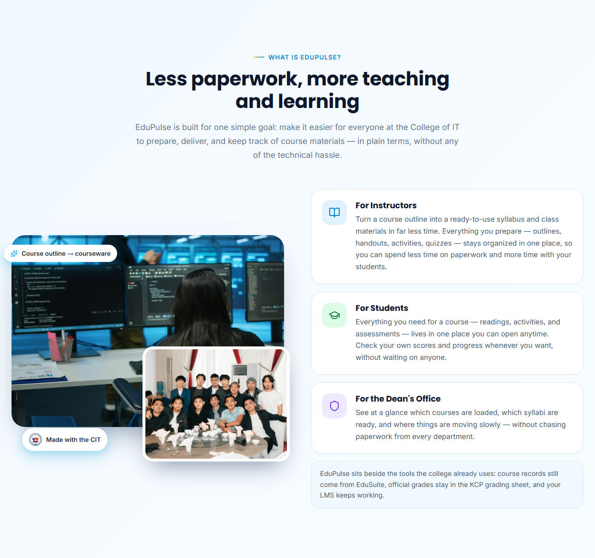
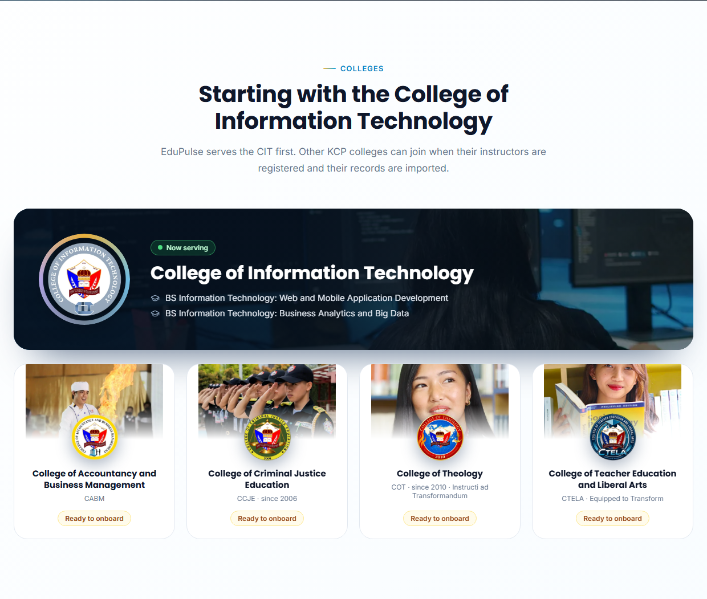
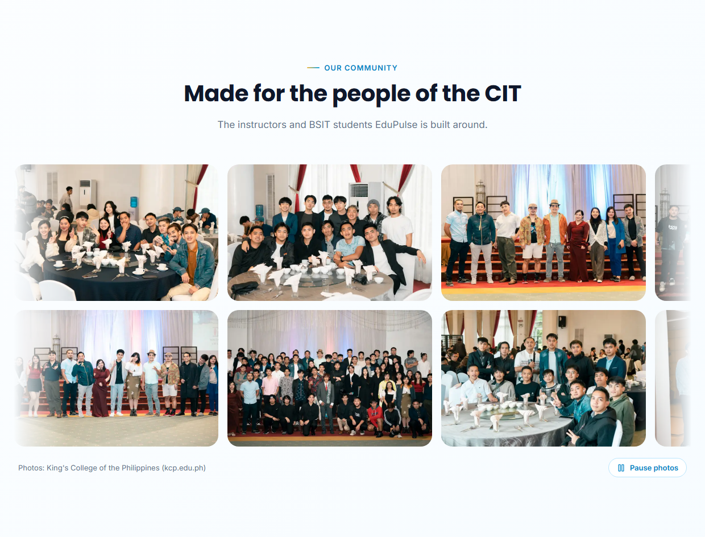
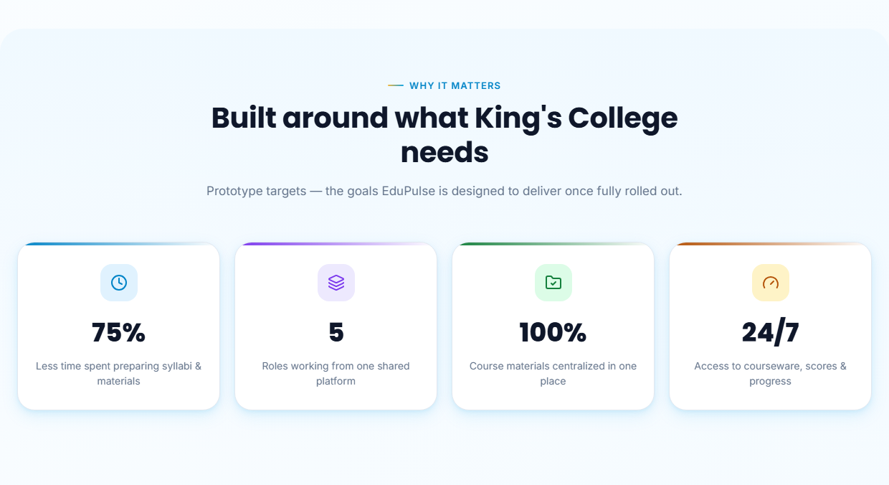

# 01 · Public site

These are the pages a visitor sees before signing in:
* `/`: the landing page, which scrolls through all its sections;
* `/privacy` and `/terms`: the legal pages;
* `/500`: the server error page.

The landing page focuses on the College of Information Technology (CIT) of King's College of the Philippines (KCP). The KCP crest and the five college emblems were supplied by the project owner. The photographs come from [kcp.edu.ph](https://kcp.edu.ph/): the CIT page and each college's card image on the KCP home page. They were downloaded on 28 October 2026 and are served from the app itself, so the page does not depend on the KCP site being available. The page credits them as **Photos: King's College of the Philippines (kcp.edu.ph)** and **Photos and emblems © King's College of the Philippines**.

Sections fade or slide in once as they scroll into view, the hero photograph moves more slowly than the page, and a soft light follows the mouse over the hero. With *reduce motion* turned on in the operating system, every section is shown at once and nothing drifts. The screenshots show each section after it has appeared.

## 1. Landing page: hero

- **Top bar:** the KCP crest, the EduPulse logo and *KCP · College of Information Technology*. Then **About**, **Features**, **How It Works**, **Roles**, **Colleges** and **FAQ**, which jump to their sections, and **Sign In**, which jumps to the sign-in panel. Over the hero the bar is transparent.
- **Background:** the CIT photograph from kcp.edu.ph (a student at a multi-monitor coding desk) under a dark navy shade and a faint grid.
- **Institution lockup:** the KCP crest and the CIT seal with *King's College of the Philippines* and *College of Information Technology · La Trinidad, Benguet*.
- **Headline:** “One shared home for syllabi, courseware & scores”, with the last three words in a moving colour gradient, then a one-paragraph summary.
- **Get Started** scrolls to sign-in; **See how it works** scrolls to the six phases (section 5).
- Three notes: **Built on the approved syllabus**, **Human review before anything is published** and **Role-based KCP accounts**.
- **Illustration, sample data** (right): floating cards for a sample syllabus (*IT 102 · Computer Programming 1*) whose status runs **Drafted → Checked → For approval → Active**, three Week 4 courseware drafts with **Review & publish**, a *Class progress* bar chart marked *Scoring sheet · visualization only*, and Pulse saying “Three drafts are ready for your review.” The cards drift gently and tilt with the mouse. They are not a screenshot of the app.
- **Scroll to explore** at the bottom jumps to the next section.

## 2. Landing navigation after scrolling

Once the page scrolls, the bar turns frosted white. The link for the section in view is underlined in gold (here **Features**), and a thin bar along the bottom edge shows how far down the page you are. After the first screen, a round **Back to top** button also appears at the lower right (it is left out of the section crops below).

## 3. What is EduPulse?

“Less paperwork, more teaching and learning”, with a photo collage: the CIT lab photograph and a CIT event photograph, tagged **Course outline → courseware** and **Made with the CIT**. Three cards summarise the benefit for each role:
* **For Instructors:** outline → syllabus → class materials.
* **For Students:** one place for readings, activities, assessments and their own scores.
* **For the Dean's Office:** which courses are loaded, which syllabi are ready, and where delivery is slow.

A note below them says EduPulse sits beside the tools the college already uses: course records still come from EduSuite, official grades stay in the KCP grading sheet, and the LMS keeps working.

## 4. Features

“Everything revolves around the approved syllabus”. Seven cards; each lifts and glows in its own colour on hover:
* **Syllabus Builder:** the seven KCP syllabus sections as numbered chips, with **5 Course outline** marked *mapping backbone*.
* **Pulse, the assistant:** asking, drafting, comparing documents and finding references, with a sample search showing **3 sources**.
* **Course Loading:** candidates ranked by master's degree, then specialization; the Dean or Associate Dean confirms.
* **Courseware from the outline:** sample weeks **W1–W3** with **Draft** items, and **W9** as the **Midterm examination** milestone.
* **Records intake:** EduSuite exports are confirmed before anything is saved.
* **Student Monitoring:** Completed and Missed, material access, class averages and reminders; scores are visualized, never turned into grades.
* **Performance by topic:** students see their own results, instructors per course, the Dean college-wide; the Associate Dean's views leave scores out.

## 5. How it works

“From EduSuite files to student results”: the six phases of the business flow, alternating left and right of a vertical line. Each card names the phase and who does it, then **AI** (what Pulse may do) and **People** (who decides):
* **Phase 0 · Records intake** (Dean · Associate Dean);
* **Phase 1 · Course loading** (Dean · Associate Dean);
* **Phase 2 · Syllabus building** (Instructor), including the signatures outside EduPulse: Dean review, CAO approval and EVP noting;
* **Phase 3 · Courseware generation** (Instructor);
* **Phase 4 · Student access** (Students);
* **Phase 5 · Monitoring** (Everyone).

The line fills from gold to violet as you scroll, and each phase's circle lights up when its card appears. The screenshot shows the line filled.

## 6–7. Roles

“Five roles, one platform”. The tabs **Instructor**, **Student**, **Dean**, **Associate Dean** and **System Admin** switch the panel below; a white pill slides to the selected tab, and the arrow keys, **Home** and **End** move between tabs. Each panel has a short summary, four tasks with check marks and a small app window showing that role's top-bar sections and three main views:
* **Instructor** (image 6): **Dashboard**, **Syllabus**, **Courseware**, **Student Monitoring** and **Performance**; views **Syllabus Builder**, **Courseware Builder** and **Student Monitoring**.
* **Student** (image 7): **Dashboard**, **My Courses**, **Assessments** and **Performance**; views **My Materials**, **My Assessments** and **Performance**. A yellow note reads “Pulse will not answer or hint at assessment items.”
* **Dean**: **Dashboard**, **Records**, **Course Loading**, **Monitor** and **Performance**.
* **Associate Dean**: **Dashboard**, **Records**, **Course Loading** and **Monitor**, with the note “Performance scores and approval authority stay with the Dean.”
* **System Admin**: **Dashboard** only, with **Manage accounts**, **Audit activity** and **Agent activity**.

## 8. Pulse, the AI assistant

A dark band, “Pulse assists. People decide.”, with six principles: **Nothing publishes itself**, **Guide, never answer**, **Sources you can check**, **Asks before acting**, **Scores, not grades** and **Private to each role**. On the right, the Pulse character (its eyes follow the mouse) in an illustrated student chat. The student asks “Give me the answers to quiz 2.”, Pulse declines and points to an unopened Week 4 reading, and the tag reads **Declined · appropriate-use rule**. The caption labels it *Illustration*.

## 9. Colleges

“Starting with the College of Information Technology”. The CIT card, over the CIT lab photograph, shows its seal in a slowly turning ring, **Now serving**, and the two BSIT tracks listed on kcp.edu.ph: *Web and Mobile Application Development* and *Business Analytics and Big Data*. Below, four KCP colleges are shown with their emblem and kcp.edu.ph photograph, each marked **Ready to onboard**:
* **College of Accountancy and Business Management** (CABM);
* **College of Criminal Justice Education** (CCJE · since 2006);
* **College of Theology** (COT · since 2010 · *Instructi ad Transformandum*);
* **College of Teacher Education and Liberal Arts** (CTELA · *Equipped to Transform*).

Years and mottos come from the emblems. The section says other colleges can join when their instructors are registered and their records are imported. Oversight stays scoped to the CIT (FR-REV-08).

## 10. Community photos

“Made for the people of the CIT”: two rows of CIT event photographs from kcp.edu.ph that drift slowly in opposite directions. They stop while the pointer is over a row or a control inside has focus, and **Pause photos** (**Play photos** when paused) stops them entirely. With reduced motion the rows stand still and scroll sideways instead. The credit reads **Photos: King's College of the Philippines (kcp.edu.ph)**.

## 11. Why it matters

These are the prototype's design targets, labelled as targets rather than measured results:
* 75% less preparation time;
* 5 roles (system admin, Dean, Associate Dean, instructor and student) working from one shared platform;
* 100% of course materials centralised in one place;
* access 24/7.

The numbers count up when the section scrolls into view; the screenshot shows their final values.

## 12. Frequently asked questions

Seven questions; one answer is open at a time, and it opens and closes smoothly. The first, **Who can sign in to EduPulse?**, is open in the screenshot. The others cover whether EduPulse replaces the LMS or the official grading sheet, whether the AI publishes on its own, whether Pulse answers assessments, whether the syllabus is approved inside EduPulse, where courses, loads and class lists come from, and the other KCP colleges.

## 13. Sign-in panel (hosted site)

On the left, a CIT group photograph with the CIT seal, **Welcome to EduPulse**, “Sign in with the account your system administrator created. Your role decides what you see.” and the five role names. On the right, **Get started · Sign in to EduPulse** and the panel:
- **Email** and **Password**, then **Sign In**, for an account the administrator has created. The hint below reads “Use the email and password assigned to your EduPulse account.”
- **Sign in with Google**, with the note “System admin: choose your Google account. Other roles use email and password.” The button works only when Google sign-in is enabled for the project; otherwise the panel says Google sign-in is temporarily unavailable.
- Each account has one assigned role: system admin, Dean, Associate Dean, instructor or student. An account without a role is signed out with the message “This account has no EduPulse role. Contact the administrator.”

## 14. Preview personas (local development and documentation capture only)

**Quick preview access (testing only)** appears below the sign-in panel in two builds only:
* the local development app;
* the documentation capture build (`npm run build:capture`).

The hosted production build does not include it, and the deployment check enforces that. **System Admin**, **Dean**, **Assoc. Dean**, **Instructor** and **Student** open the app as that role, with sample data and no account. The rest of this walkthrough was captured with these personas.

## 15. Footer

A navy footer with a gold top edge. On the left, the KCP crest and EduPulse logo, a one-line description and the KCP vision, quoted from kcp.edu.ph. Then three columns: **Explore** (the six section links), **Legal** (**Privacy** and **Terms**) and **King's College of the Philippines** (Km5 Pico Rd, La Trinidad, 2601 Benguet, and **kcp.edu.ph**, which opens the official site in a new tab). The bottom line reads *Prototype v4.0 — College of Information Technology* and *Photos and emblems © King's College of the Philippines*.

## 16. Privacy policy

`/privacy` opens from the landing page footer. **Back to Home** returns to the landing page, and the effective date sits under the title. The numbered sections cover the introduction (operated by King's College of the Philippines – Benguet under the Data Privacy Act of 2012), the information collected, how it is used, retention, your rights and the Data Protection Officer contact. The screenshot shows the top of the page.

## 17. Terms of use

`/terms` opens from the landing page footer and has the same layout: **Back to Home**, the effective date, then numbered sections. These cover acceptance, eligibility (authorised KCP deans, instructors and students only), account responsibilities and acceptable use.

## 18. Server error page

`/500` appears when the app cannot complete a request. It shows **500 · Server Error** and a short apology, with **Go to Dashboard** and **Retry**.

*Changed on 28 October 2026:* the landing page was redesigned around the CIT, with KCP photographs and the college emblems. It gained the navigation menu and reading progress, the features, six-phase, roles, Pulse, colleges, community photos and FAQ sections, a sign-in welcome panel and a fuller footer. Images were renumbered in page order; the sign-in panel and preview personas are now images 13 and 14.
