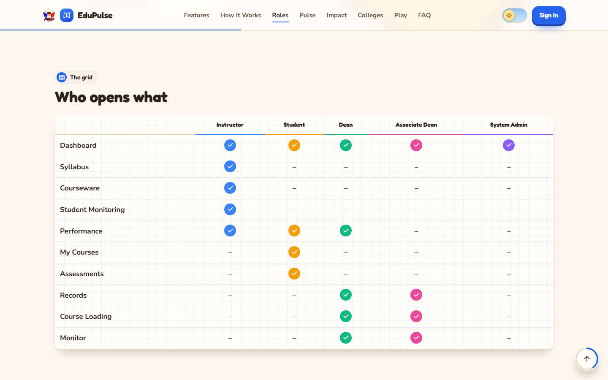
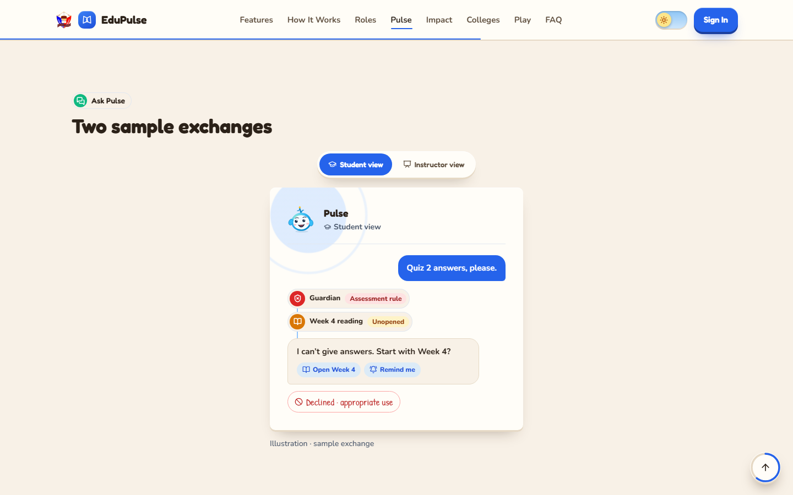
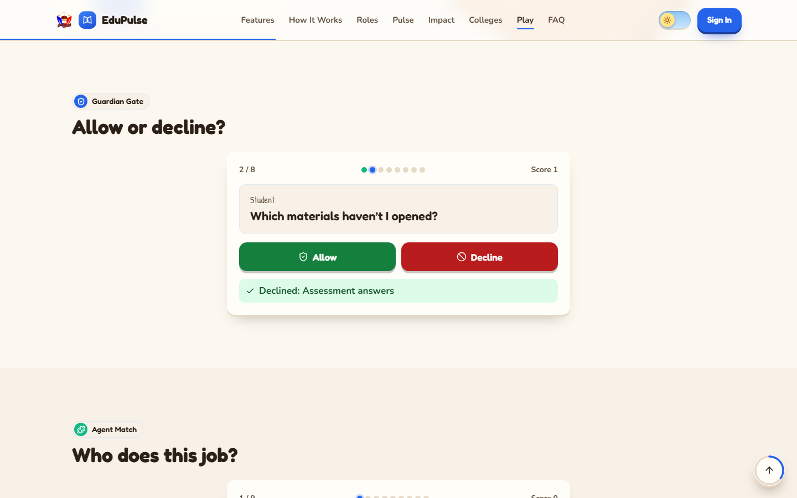

# 01 · Public site

These are the pages a visitor sees before signing in:
* `/`: the home page, a walk through a 3D school with one section on each surface;
* `/features`, `/how-it-works`, `/roles`, `/pulse`, `/impact`, `/colleges`, `/play` and `/faq`: the eight pages in the top bar, each a themed classroom in 3D;
* `/privacy` and `/terms`: the legal pages;
* `/500`: the server error page.

The site focuses on the College of Information Technology (CIT) of King's College of the Philippines (KCP). The KCP crest and the five college emblems were supplied by the project owner. The photographs come from [kcp.edu.ph](https://kcp.edu.ph/): the CIT page, each college's card image on the KCP home page and the KCP building. They were downloaded on 28 October 2026 and are served from the app itself, so the site does not depend on the KCP site being available. The pages credit them as **Photos: King's College of the Philippines (kcp.edu.ph)** and **Photos and emblems © King's College of the Philippines**. The product screens are the EduPulse prototype with sample data.

The site is a school: cream paper, oak frames, cork boards and green chalkboards, with headings in rounded bold Fredoka, text in Nunito and handwritten notes in Patrick Hand.

**What the screenshots show.** Images 1 to 18 were captured with *reduce motion* turned on: the home page is then complete and still, in the same classroom style drawn without 3D. Images 19 to 44 were captured with motion allowed, on a large screen: the walk through the school (19 to 29), the eight pages (30 to 41) and night (42 to 44). With motion allowed, the site also moves; none of this appears in the images:
* **Opening.** The home page always starts with the opening: whenever it loads at the top, a reload included, the EduPulse logo and name appear while geometric planes and 3D facets assemble around them, with **Scroll to explore** below. Scrolling about one screen opens the planes outward like an aperture and reveals the hero; scrolling back up closes it again. A keyboard user who presses Tab into the hero plays the opening forward to its end. Back and Forward, links to a section (for example `#/?section=faq`), later returns within the same visit and reduced motion start without it.
* **3D hero.** As the opening clears, the emblem becomes 3D: the blue Pulse ring tips back like a halo, and the KCP crest and the CIT seal are porcelain medallions that turn in from edge-on, float and tilt with a mouse pointer, while white and blue planes drift around them.
* **The walk.** On a large screen the page then walks through the school. The camera flies from room to room as you scroll, and each section rests square on its surface when it arrives: the hero on the campus lawn, *Why EduPulse* on the corridor bulletin board, *Features* on the classroom blackboard, *How it works* on the class seats, Roles with the classmates, Pulse at the teacher's end of the classroom, *Why it matters* in frames along the gallery wall, Colleges on the front stage, the photographs on lines above the KCP building, the FAQ in an open notebook and sign-in on the door of the study. A room's items pop into place as the walk arrives, and keyboard focus brings a room to the screen. The agents section and the agent workspace hold the screen on their own between Pulse and *Why it matters*.
* **Phones.** On a phone or a portrait screen the school stays behind the page and the sections scroll as ordinary content in front of it.
* **Speed dial.** Once the hero is reached, a round button with an arrow appears at the lower right, its ring filling as you go down the page. It opens a list of the page's parts: on the home page **Back to top** and the rooms of the school, on another page **Back to top**, its room and its sections. **Pause room motion** stops the 3D rooms; **Play room motion** starts them again.
* **Agents.** The agents section holds the screen while scrolling travels inward ring by ring on its round chalkboard, neighbouring rings turning in opposite directions. A pinned index card names each agent in turn (**01 / 09** to **09 / 09**) with its keywords, that agent's ring lights up and its portrait pops into the lens at the centre, waving with its own gesture. After the ninth, the core opens while all nine wave together and the screen clears into the agent workspace.
* **Agent workspace.** The studio fills the screen on its own and assembles: the floor settles, the walls rise, the furniture drops in and the nine agents hop to their places. They work at their stations, mugs steam and a cat sleeps on the rug. A tapped agent, or its button along the bottom, stands up, turns to the camera and waves while its line types out in a bubble above it. **Pause motion** stops all of it.
* **Pages.** In each page's room the view sways a little with the mouse pointer and leans toward the prop you pick; the robots work and the cat sits, sleeps or walks.
* **Photographs.** The two rows of community photographs drift slowly in opposite directions. **Pause photo movement** stops them until **Play photo movement** is pressed. Hovering, keyboard focus or a tap also stops them.
* **Day and night.** The sun and moon switch beside **Sign In** turns the whole site to night and back (images 42 to 44). It is the same setting as **Settings → Appearance → Dark Mode**, so the choice is kept.

**Skip to main content**, the first stop when you press Tab, moves focus past the navigation and the hero.

## 1. Home page: hero

- **Top bar:** the KCP crest and the EduPulse logo, which lead to the home page, then **Features**, **How It Works**, **Roles**, **Pulse**, **Impact**, **Colleges**, **Play** and **FAQ**, which open the eight pages (images 30 to 37). On the right, the sun and moon switch (here the sun: day) and the blue **Sign In** button, which goes to the sign-in panel. At the top of the page the bar has no background of its own.
- **Institution line:** *King's College of the Philippines* above *College of Information Technology*.
- **Headline:** “One shared home for syllabi, courseware & scores”, in heavy dark rounded type.
- **Actions:** **Get started** goes to sign-in; **See how it works** goes to the six phases (section 5).
- **Emblem, on the right:** the blue Pulse ring as a halo around the KCP crest and the CIT seal, each on a white disc, the CIT seal a little in front and lower.
- **KCP building:** a photograph of the KCP building runs along the bottom edge.

## 2. Top bar after scrolling

Once the page scrolls, the bar turns solid cream with a thin rule beneath it, and a blue line along its bottom edge shows how far down the page you are. On the home page no link is underlined, because the links name pages; on one of the eight pages its own link is underlined (images 30 to 37).

## 3. Why EduPulse

A cork bulletin board in an oak frame. The heading **Why EduPulse** and one line, “Every lesson should follow the approved syllabus. Today, the pieces drift apart.”, sit on a paper note held by tape. Below it, a switch (**Today** | **With EduPulse**) and five sticky notes, yellow, green and pink, each held by a red or blue pin, with a blue icon, an area, one phrase and a handwritten *With EduPulse*. As captured, **With EduPulse** is selected; **Today** turns each note over to how it is done today:
* **Syllabus:** recycled from earlier versions → official seven-section KCP format.
* **Materials:** rushed, or pasted from AI chats → grounded in the syllabus and your files.
* **Delivery:** split between Moodle and paper → one place for every block.
* **Oversight:** unseen after course loading → every course’s status at a glance.
* **Performance:** checked by hand → scores by syllabus topic.

A white pill with a shield icon closes the board: “AI drafts. Instructors review and approve every item.” Screen readers hear both states of each note.

## 4. Features

A green chalkboard in an oak frame. **Features** · “From the syllabus to every class”: “Four parts, one approved syllabus. Prototype screens with sample data.” As captured (reduced motion), the four parts follow one another, each with its number and roles handwritten in yellow chalk, a heading, one line, two short points and its prototype screen in a white frame with a caption naming the screen:
* **01 · Dean · Associate Dean: Records and course loading** (*Records page*). “EduSuite stays the system of record. Upload its exports, check them, confirm.” *Loads by rule: master's degree, then specialization. Pulse suggests instructors; people decide.*
* **02 · Instructor: The Syllabus Builder** (*Syllabus Builder*). “Build the seven-section KCP syllabus, upload one, or co-write it with Pulse.” *AI drafts wait for your check. Signed outside EduPulse; its outline maps the rest.*
* **03 · Instructor: Courseware from the course outline** (*My Courseware list*). “Each outline week becomes materials and assessments, drawn from your sources first.” *By week, by term or the whole outline. Only published items reach students.*
* **04 · Students · Instructors · Dean: Performance by syllabus topic** (*My Performance page*). “Mastery by topic for students, missed work for instructors, delivery for the Dean.” *Reminders for unopened and missed work. Scores shown; grades stay official.*

## 5. How it works

On the left, a paper card: **How it works** · “Six phases. People decide each one.” and “From EduSuite files to student results. The AI assists; it never finalizes.” On the right, a timeline: blue numbered squares **00** to **05** joined by a blue line, each beside a card. A card shows the phase's icon on a blue disc, its name, who works in it as small chips, one line on what happens, and the hand-over: a light-blue **AI** box (the draft) with an arrow to a yellow **People** box (the decision):
* **Records intake** (Dean, Associate Dean). Upload the EduSuite exports. AI: reads and previews them → People: confirm before saving.
* **Course loading** (Dean, Associate Dean). Load each course to an instructor. AI: ranks by master's degree, then specialization → People: confirm every assignment.
* **Syllabus building** (Instructor). Build or upload the seven-section syllabus. AI: co-writes each section → People: check, then sign outside EduPulse.
* **Courseware generation** (Instructor). Turn each outline week into courseware. AI: drafts from the approved syllabus → People: review, edit and publish.
* **Student access** (Students). Open materials, answer assessments. AI: reminders and missed work only → People: Pulse never answers assessment items.
* **Monitoring** (Everyone). Scores, delivery progress and notices. AI: summarizes the charts → People: no grades: the KCP sheet stays official.

## 6-7. Roles

**Roles** · “Five roles, one platform”: “One role per account. Each sees only its own pages.” The tabs on the left (**Instructor**, **Student**, **Dean**, **Associate Dean** and **System Admin**) switch the panel on the right; the selected tab is blue with white text. The arrow keys, **Home** and **End** move between tabs. Each panel opens with the role's icon on a blue disc beside a handwritten label and a heading, then a one-line summary, the role's four tasks as tiles with icons, its **Top bar** drawn in miniature (the role's pages, **Dashboard** underlined) and one benefit:
* **Instructor** (image 6), *Prepare and deliver*: “Teach from one organized place”: build the syllabus, generate courseware, publish it, follow every student. Tasks: loaded courses and syllabus status; build or upload the syllabus; review, edit and publish drafts; scores and access per student. Top bar: **Dashboard**, **Syllabus**, **Courseware**, **Student Monitoring** and **Performance**. Benefit: less repetitive preparation; you keep control (SDG 4.c).
* **Student** (image 7), *Learn*: “Everything for your courses, in one place”: materials, assessments and your own progress, together. Tasks: **My Materials**, ready to open; **My Assessments** and results; mastery by topic; reminders for missed work. A yellow line with a shield icon reads “Pulse will not answer or hint at assessment items.” Top bar: **Dashboard**, **My Courses**, **Assessments** and **Performance**. Benefit: syllabus-aligned courseware (SDG 4.3 and 4.4).

The Dean, Associate Dean and System Admin tabs use the same layout (not shown).

## 8. Pulse, the AI assistant

**Pulse, the AI assistant** · “Grounded in your documents. Decided by you.”: “On every page. It drafts from your approved sources and stops at the college’s limits.” Six principles follow as sticky notes, each with a blue icon and one short line: **Grounded first** (drafts start from the approved syllabus and your files), **Sources you can check** (every answer names the passages it used), **Nothing publishes itself** (drafts wait until an instructor publishes them), **Guide, never answer** (students get reminders, never assessment answers), **Asks before acting** (records change only after you confirm) and **Scores, not grades** (official grades stay in the KCP grading sheet).

On the right, a chat card in keywords and icons, headed by Pulse's face and *Student view*:
* the request, in a blue bubble: “Quiz 2 answers, please.”;
* what Pulse checked, joined by a thin line: **Guardian** with the red tag *Assessment rule*, and **Week 4 reading** with the amber tag *Unopened*;
* the reply, “I can't give answers. Start with Week 4?”, with two next steps, **Open Week 4** and **Remind me**;
* the outcome, in a red pill: **Declined · appropriate use**.

The caption reads *Illustration · a student asks Pulse for quiz answers*.

## 8b. The agents behind Pulse

**Inside Pulse** · “The agents behind every answer”: “Pulse is nine named agents sharing one workflow. A request passes only the agents it needs, and the Guardian always checks it first.” Below it, a round green chalkboard in a wooden frame: nine rings of chalk capitals around a pale core, one ring per agent, each naming the agent and its job (the outer ring reads *GUARDIAN · CHECKS APPROPRIATE USE*). Then the nine agents, numbered in the order a request meets them, each with a small portrait: a white robot with a dark face screen, its ears, antenna and chest panel in the agent's own colour, holding up its prop:
* **01 Guardian:** checks every request against the college’s appropriate-use rules first, and declines what breaks them, such as asking for assessment answers.
* **02 Planner:** works out what the request needs and plans the searches that will answer it.
* **03 Researcher:** runs several searches at once over the approved syllabus and your files, and public web sources when a request needs them.
* **04 Librarian:** finds readings and references in open catalogs when you ask for them.
* **05 Ranker:** weighs what the searches found, keeps the most relevant passages and stops when nothing relevant turns up.
* **06 Comparator:** lines up passages from different documents when a request compares them.
* **07 Writer:** writes the answer or draft from the ranked passages, quoting them directly when it has to.
* **08 Verifier:** checks each claim in a written answer against its sources before you see it.
* **09 Corrector:** fixes the citations the Verifier flags, or replaces an answer it cannot verify.

As captured (reduced motion), the rings stand still and the list is shown. With motion, the list is read out to screen readers but replaced on screen by the turning rings, a pinned index card with the current agent's keywords and its waving portrait at the centre (see the top of this page).

## 8c. The agent workspace

**Agent workspace** · “Tap an agent. It answers.”: “A scripted example, not live AI.” The section is a 3D studio on its own, filling the screen, where the agents, the robots from the section above, work. In this capture the camera has moved in on the Comparator: around it are a honey-oak floor, a rug, a sofa with a blanket and a cushion, a coffee table with a book, a blue pouf and plants. Behind, the Librarian reads in an armchair by a full bookshelf, and the Researcher and the Ranker sit at desks with glowing monitors; in front, the Verifier and the Corrector sit at their desks. A numbered name tag floats above each agent in view, and **Show all** and **Pause motion** sit in the top corner (on a phone, just above the agent buttons).

The same studio is the room in Pulse’s own **Workspace buddies** window (see [the illustrated office guide](../../system-manual/11-workspace-buddies/README.md)), where the six buddies take the places.

One button per agent (**Guardian** to **Corrector**) runs along the bottom of the screen, each with its icon on a disc in the agent's colour; on a narrow screen the row scrolls sideways. As captured, **Comparator** has been pressed (by its button; tapping the robot does the same): the Comparator stands by the sofa on a pink ring and a bubble above it shows **Comparator**, the label *Scripted example*, the question “Compare my syllabus with last year’s.” and the answer “I’ll line them up: what is shared, what is related and what only one of them has.” **Show all** returns the camera to the whole studio.

Every answer is scripted from what the agents do in Pulse, one per agent. For example, the **Guardian** answers “Can you give me the quiz answers?” with “No. That breaks the assessment rule, so I stop the request here and no other agent runs.” The same answer is also read out by screen readers. Without WebGL, a grid of the agents' icons stands in for the studio and the buttons still work.

## 9. Why it matters

A paper card: **Why it matters** · “Preparation takes time. The research agrees.”: “Cited in the EduPulse study. They describe the problem, not EduPulse results.” Three findings in thick oak frames, each with an icon (a clock, a falling trend line, a timer), the figure, what it measures and its source:
* **7.4 h** a week preparing lessons, the OECD teacher average (OECD, *Results from TALIS 2024*, 2025);
* **31%** less lesson-planning time with generative AI, quality unchanged (Education Endowment Foundation, 2024), with an oak-coloured meter filled to 31% of its track;
* **5.9 h** recovered weekly by educators who use AI regularly (Gallup & Walton Family Foundation, 2025).

The findings come from different studies, so each stands in its own frame and they are not compared. Below them, a pale yellow card lists the Sustainable Development Goals the study supports, each with an icon on a blue disc: **SDG 4.3** (equitable access to quality tertiary education), **SDG 4.4** (technical skills for employment), **SDG 4.c** (well-supported teachers) and **SDG 9** (industry, innovation and infrastructure).

## 10. Colleges

**Colleges** · “Built for the CIT first”: “The study covers the CIT. Other KCP colleges are planned; each joins once its instructors and records are in.”

The CIT card shows its seal inside blue arcs, a green **Now serving** badge, the two BSIT tracks listed on kcp.edu.ph (*Web and Mobile Application Development* and *Business Analytics and Big Data*) and the CIT lab photograph. Below, four KCP colleges, each with a kcp.edu.ph photograph, its emblem and a dashed **Planned** tag:
* **College of Accountancy and Business Management** (CABM);
* **College of Criminal Justice Education** (CCJE · since 2006);
* **College of Theology** (COT · since 2010 · *Instructi ad Transformandum*);
* **College of Teacher Education and Liberal Arts** (CTELA · *Equipped to Transform*).

Years and mottos come from the emblems.

## 11. Community photographs

A paper card: **Our community** · “Made for the people of the CIT”: the instructors and BSIT students EduPulse is built around. Two rows of CIT event photographs from kcp.edu.ph, printed with white borders and set a little askew. As captured (reduced motion), the rows stand still and scroll sideways; the last photograph in each row is cut at the edge. The credit reads **Photos: King's College of the Philippines (kcp.edu.ph)**. With motion, the rows drift, and **Pause photo movement** appears beside the credit (image 27).

## 12. Frequently asked questions

A ruled notebook page with a blue edge. On the left, **FAQ** · “Questions people ask”: how EduPulse fits the college's process, and what the AI may and may not do. On the right, eight questions; one answer is open at a time, and its plus sign turns into a minus. The first, **Who can sign in to EduPulse?**, is open in the screenshot: “Anyone with an account the system administrator created: the Dean, the Associate Dean, and the instructors and students of the College of Information Technology. Each account has one role, and that role decides which pages you see.” The others ask whether EduPulse replaces the LMS or the official grading sheet, how the AI stays accurate, whether the AI publishes materials on its own, whether Pulse answers assessments for students, whether the syllabus is approved inside EduPulse, where courses, loads and class lists come from, and about the other KCP colleges.

## 13. Sign-in panel (hosted site)

One card. On the left, a CIT group photograph with the KCP crest, **Welcome to EduPulse**, “Sign in with the account your system administrator created. Your role decides what you see.” and the five role names. On the right, **Get started** · **Sign in to EduPulse**, “Use your EduPulse account to continue.” and the panel:
- **Email** and **Password**, then the blue **Sign In** button, for an account the administrator has created. The hint below reads “Use the email and password assigned to your EduPulse account.”
- **Sign in with Google**, with the note “System admin: choose your Google account. Other roles use email and password.” The button works only when Google sign-in is enabled for the project; otherwise the panel says Google sign-in is temporarily unavailable.
- Each account has one assigned role: system admin, Dean, Associate Dean, instructor or student. An account without a role is signed out with the message “This account has no EduPulse role. Contact the administrator.”

## 14. Preview personas (local development and documentation capture only)

**Quick preview access (testing only)** appears below the sign-in panel in two builds only:
* the local development app;
* the documentation capture build (`npm run build:capture`).

The hosted production build does not include it, and the deployment check enforces that. **System Admin**, **Dean**, **Assoc. Dean**, **Instructor** and **Student** open the app as that role, with sample data and no account. The rest of this walkthrough was captured with these personas.

## 15. Footer

A green chalkboard footer under an oak rail. On the left, the KCP crest and EduPulse logo, “An AI-powered syllabus and course builder with performance monitoring, made for the College of Information Technology.” and the KCP vision, quoted from kcp.edu.ph, in a card with a yellow rule and the label *KCP vision*. Then three columns: **Explore** (the eight pages: **Features**, **How It Works**, **Roles**, **Pulse**, **Impact**, **Colleges**, **Play** and **FAQ**), **Legal** (**Privacy** and **Terms**) and **King's College of the Philippines** (Km5 Pico Rd, La Trinidad, 2601 Benguet, and **kcp.edu.ph**, which opens the official site in a new tab). A large faint *EduPulse* wordmark runs across the footer. The bottom line reads *A BSIT capstone project · College of Information Technology · Prototype v4.0* and *Photos and emblems © King's College of the Philippines*.

## 16. Privacy policy

`/privacy` opens from the footer. **Back to Home** returns to the home page, and the effective date sits under the title. The numbered sections cover the introduction (operated by King's College of the Philippines – Benguet under the Data Privacy Act of 2012), the information collected, how it is used, retention, your rights and the Data Protection Officer contact. The screenshot shows the top of the page.

## 17. Terms of use

`/terms` opens from the footer and has the same layout: **Back to Home**, the effective date, then numbered sections. These cover acceptance, eligibility (authorised KCP deans, instructors and students only), account responsibilities and acceptable use.

## 18. Server error page

`/500` appears when the app cannot complete a request. It shows **500 · Server Error** and a short apology, with **Go to Dashboard** and **Retry**.

## 19-29. The walk through the school

Images 19 to 29 show the home page with motion allowed on a large screen, each room at rest once the walk has arrived. The bar stays on top and the round speed dial button sits at the lower right.

**19. Campus.** The hero stands in the sky above the campus lawn, the 3D emblem with blue and white planes floating around it. Below, the KCP building, with a blue entrance, a flag, lamp posts, rounded trees, a hedge and a plank fence closing the left end of the building picture. Small robots walk the path.

**20. Corridor.** *Why EduPulse* (section 3) is the cork bulletin board on the corridor wall, under a string of lights.

**21. Classroom blackboard.** *Features* is written on the blackboard under a row of paper pennants, beside a wall clock. On the walk the board shows one part at a time: the step tabs **01** to **04** (here **01 Records and course loading**), the part's roles, heading and points, and on the right its prototype screen in a browser window labelled *edupulse-prototype.vercel.app*. Scrolling changes the part; the teacher robot's head shows at the bottom.

**22. Class seats.** Seen from above, *How it works* is laid out on six desks, one phase card per desk with its number, and a robot student in each seat. The heading runs across the top on a long paper strip.

**23. Classmates.** Five robot classmates, one per role, stand at their tier behind the five role tabs under the sign *Five roles, one platform*, with windows and pennants behind them. The selected role's panel (here **Instructor**) opens in a blue frame below.

**24. Teacher's end.** Pulse's section at the front of the classroom: the six principles on the left, the Pulse robot standing in front, a wall clock, the chat card on a dark board on the right and a vase of flowers in the corner.

**25. Gallery.** The three findings hang in oak frames along the gallery wall, the SDG card on a shelf below them and potted plants at both ends.

**26. Front stage.** Colleges is on the stage, under a gold valance between blue curtains: the heading on a sign, the CIT card in an oak frame and the four college cards hanging on wires.

**27. Courtyard.** The community photographs hang like prints on two lines in the sky above the KCP building, among clouds, with the credit and **Pause photo movement** below them.

**28. Notebook.** The FAQ is an open notebook on a wooden desk, with a pencil, an apple, a mug and a stack of books around it: the heading and a large question mark on the left page, the questions on the right.

**29. Door.** The sign-in panel is the door of the study, with an oak frame, hinges and a knob, and a plant on each side. In this capture build the panel also shows **Quick preview access (testing only)** (section 14).

## 30-37. The pages

Each page in the bar is a themed classroom in 3D, seen from one corner. A paper card at the top left names the room, the page's heading and what to do; a label floats over each prop that stands for something, and the card at the lower left shows the one picked (below the room on a phone, where the labels become a row of chips). Clicking a label or the prop itself picks it. Robots and a cat live in every room. The bar underlines the current page's link.

**30. Features: Science lab.** “Five stations, one syllabus.” · *Tap a station.* Five labelled stations: **Records** (a filing cabinet), **Syllabus**, **Courseware**, **Scores** (bar books) and **Pulse** (a robot at the bench), around lab benches with a flask, a microscope and test tubes under a periodic table; an orange cat walks the floor. Picked here: **Syllabus**, so the card shows *Instructor* · **The Syllabus Builder** with the chips *7-section KCP format*, *Co-write with Pulse* and *You check*, and a picture of the Syllabus Builder.

**31. How It Works: Physics room.** “Six stations, one run.” · *Follow the marble.* Six pedestals labelled **0 · Records** to **5 · Monitor**, joined by a rail a marble runs along, with a Newton's cradle on a table, a board reading *F = ma* and *E = mc²*, a wall clock, two robots and a black cat. The card shows *Phase 0 · Dean · Associate Dean* · **Records intake**, with **AI**: reads and previews them, and **People**: confirm before saving.

**32. Roles: Math room.** “Five roles, five shapes.” · *Tap a shape.* Each role is a shape on a plinth: **Instructor** a blue cube, **Student** an orange sphere, **Dean** a green pyramid and **Associate Dean** a pink cylinder; the System Admin's purple ring is just out of view on the right. A chalkboard of formulas (*a² + b² = c²*, *π ≈ 3.14*, *Σn = n(n+1)/2*) and a curve, a protractor, an abacus on a desk, building blocks, a robot and two cats complete the room. Picked here: **Student** (*Sphere · Learn*), with its four tasks as chips and the line “Pulse will not answer or hint at assessment items.”

**33. Pulse: Computer lab.** “Nine agents, one answer.” · *Tap an agent.* The nine agents work at desks with laptops, each labelled (**Guardian**, **Planner**, **Researcher**, **Librarian**, **Ranker**, **Comparator**, **Writer**, **Verifier** and **Corrector**), beside a server rack and a board with nine coloured dots on one line. The card shows *Agent 1 of 9* · **Guardian** with *Checks first*, *Appropriate use* and *Stops what breaks rules*.

**34. Impact: History room.** “Then, now, and why.” · *Tap an exhibit. Findings from cited studies, not EduPulse results.* Exhibits on plinths: **7.4 h** (an hourglass), **31%** (scales), **5.9 h** (a clock) and **SDGs** (a globe on a red rug), under a timeline on the wall. Picked here: **SDGs**, so the card shows *UN Sustainable Development Goals* · **The goals it serves** with **SDG 4.3**, **SDG 4.4**, **SDG 4.c** and **SDG 9**.

**35. Colleges: Gallery.** “Five colleges, CIT first.” · *Tap a picture.* Framed pictures of the five colleges, labelled **CTELA**, **COT**, **CABM**, **CIT** (the largest) and **CCJE**, with a rope barrier, a bench where a black cat sits, an easel and a robot. The card shows *Now on EduPulse* · **College of Information Technology**, its two BSIT tracks and the CIT seal.

**36. Play: Game room.** “Three games. Learn by playing.” · *Pick a cabinet.* Three arcade cabinets, **Guardian Gate** (blue), **Agent Match** (green) and **Quick Quiz** (orange), under a *PLAY* sign, with a bean bag, a round rug, a low table, two robots and a cat. The card shows *Game* · **Guardian Gate** with *Be the Guardian*, *Allow or decline* and *8 requests*, and a **Play** button that scrolls to the game (image 40).

**37. FAQ: Library.** “Eight questions, eight books.” · *Pick a book.* Eight books stand pulled out of the shelves, one per question, labelled **LMS & grades**, **Sign-in**, **Publishing**, **Syllabus approval**, **AI accuracy**, **Assessments**, **Other colleges** and **Records**, around a reading table with an open book, a lamp, an armchair where a grey cat sleeps and a robot. The card shows *Question 1 of 8* · **Who can sign in to EduPulse?** with *Accounts from the admin* and *One role each*, and **Full answer**, which opens the whole answer.

## 38-41. Below the room

Under its room, each page has a few short sections. Three of them:

**38. Roles: the grid.** **The grid** · “Who opens what”: the pages down the side (**Dashboard**, **Syllabus**, **Courseware**, **Student Monitoring**, **Performance**, **My Courses**, **Assessments**, **Records**, **Course Loading** and **Monitor**) and the five roles across the top, each in its own colour. A tick in the role's colour marks a page the role opens; a dash marks one it does not.

**39. Pulse: Ask Pulse.** **Ask Pulse** · “Two sample exchanges”: a switch between **Student view** (shown) and **Instructor view**, and the chat card from the home page (section 8), captioned *Illustration · sample exchange*.

**40. Play: Guardian Gate.** **Guardian Gate** · “Allow or decline?”: one request at a time, as the Guardian would see it. The card shows the count (**2 / 8**), a dot per request and the score (**Score 1**), who asks (*Student*) and the request (“Which materials haven't I opened?”), then the green **Allow** and red **Decline** buttons. After an answer, a line says what the last request was and whether it was right (here *Declined: Assessment answers*). **Agent Match** (“Who does this job?”) and **Quick Quiz** follow below; each game keeps a score and offers **Play again** at the end.

**41. Speed dial.** The round button at the lower right, opened on the Play page: **Pause room motion**, **Back to top**, **Game room**, **Guardian Gate**, **Agent Match** and **Quick Quiz**, each beside a round icon; the button itself has turned into a close button marked X. Choosing a part glides to it and stops just under the bar.

## 42-44. Night

The sun and moon switch beside **Sign In** turns the site to night; the switch then shows the moon and the bar turns dark.

**42. A page at night.** The science lab after dark: a starry navy sky behind the walls, stars and the moon in the windows, and dark cards with light text (here **Records and course loading** picked).

**43. The campus at night.** The hero over the campus under a navy night sky, the moon behind the emblem, the medallions dimmed and the lamp posts glowing in front of the KCP building.

**44. The teacher's end at night.** The classroom in lamplight, with the principles and the chat card as dark cards.

*Changed on 7 November 2026:* the public site became a school you walk through. Images 1 to 15 were recaptured in the classroom style; images 19 to 44 were added (the walk, the eight pages, the speed dial and night); images 16 to 18 are unchanged. The bar now opens pages instead of jumping to sections, the round speed dial replaces the **Back to top** button, Pulse's chat is in keywords and icons, and the agents' rings are a round chalkboard with pinned index cards.

*Changed on 6 November 2026:* the agent workspace is the 3D studio alone on the screen, without the **Try a request** panel, its three requests and the conversation; each agent answers in a bubble in the room. Section cards now ease in from a side instead of being built from 3D pieces. Image 8c was recaptured.

*Changed on 2 November 2026:* *How it works*, Roles and *Why it matters* show their content as pictures rather than lines of text (phase cards with a hand-over from the AI to people, role avatars with task tiles and a miniature top bar, finding tiles with icons and a meter). Images 5, 6, 7 and 9 were recaptured.

*Changed on 30 October 2026:* the landing page was redesigned with a once-per-tab opening, a 3D ring and geometric section motion. Images 1 to 15 were recaptured and images 16 to 18 are unchanged. The agents section and its image (8b) were added on the same day.

Official-list student accounts use the existing email/password sign-in panel. The administrator distributes credentials privately. After sign-in, the imported student identity fields appear in [Settings Account](../../system-manual/16-student-directory/README.md#4-student-profile). Directory membership alone does not grant access to course materials.
