# 01 · Public site

These are the pages a visitor sees before signing in:
* `/`: the landing page, which scrolls through all its sections;
* `/privacy` and `/terms`: the legal pages;
* `/500`: the server error page.

The landing page focuses on the College of Information Technology (CIT) of King's College of the Philippines (KCP). The KCP crest and the five college emblems were supplied by the project owner. The photographs come from [kcp.edu.ph](https://kcp.edu.ph/): the CIT page and each college's card image on the KCP home page. They were downloaded on 28 October 2026 and are served from the app itself, so the page does not depend on the KCP site being available. The page credits them as **Photos: King's College of the Philippines (kcp.edu.ph)** and **Photos and emblems © King's College of the Philippines**. The product screens in the hero and the Features section are the EduPulse prototype with sample data.

The page is white and light blue, with headings in Sora and text in DM Sans.

**What the screenshots show.** The landing images were captured with *reduce motion* turned on, so every section is complete and still. With motion allowed, the page also moves; none of this appears in the images:
* **Opening.** On the first visit to the landing page in a browser tab, the EduPulse logo and name appear on a white and light-blue field while blue geometric planes and 3D facets assemble around them, with **Scroll to explore** and **Skip intro** below. Scrolling about one screen opens the planes outward like an aperture and reveals the hero; scrolling back up closes it again. **Skip intro**, or moving keyboard focus past it, removes the opening at once. It plays once per tab: reloads, Back and Forward, links to a section (for example `#/?section=faq`), later returns to the landing page and reduced motion all skip it.
* **3D ring.** In the hero, a 3D blue ring takes the place of the flat ring in image 1 and follows a mouse pointer slightly. Without WebGL the flat ring stays.
* **Section entrances.** Section headings rise line by line, the comparison table opens from its centre, the phase timeline draws its line as you scroll, the Pulse example opens in a circle and its messages appear one at a time, the arcs around the CIT seal draw in and the sign-in photograph opens from a rectangle. Each plays once.
* **Agents.** The agents section holds the screen while scrolling travels inward ring by ring, with neighbouring rings turning in opposite directions. A card names each agent in turn (**01 / 09** to **09 / 09**) and that agent's ring turns blue. After the ninth, the blue core opens until the screen is white, and *Why it matters* follows.
* **Features on a desktop.** The section holds still while its four parts change beside one framed prototype screen. The step number, heading, screen, caption and the step buttons **01** to **04** always change together, scrolling up or down; a step button scrolls to its part.
* **Photographs.** The two rows of community photographs drift slowly in opposite directions. **Pause photo movement**, under the rows, stops them until **Play photo movement** is pressed. Hovering, keyboard focus or a tap also stops them (a second tap starts them again), and they stop off screen and in a hidden tab.
* **Links.** Section links glide to their section and stop just under the top bar; scrolling yourself stops the glide. **Privacy** opens with a rectangular reveal and **Terms** with a diagonal one.

On a phone the sections stack and nothing is held in place while scrolling. **Skip to main content**, the first stop when you press Tab, moves focus past the navigation and the hero to *Why EduPulse*.

## 1. Landing page: hero

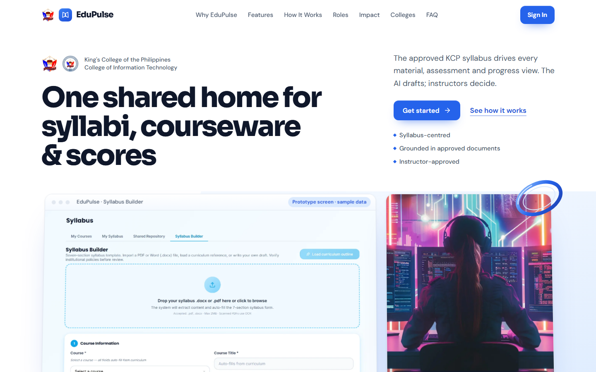

- **Top bar:** the KCP crest and the EduPulse logo, then **Why EduPulse**, **Features**, **How It Works**, **Roles**, **Impact**, **Colleges** and **FAQ**, which jump to their sections, and the blue **Sign In** button, which jumps to the sign-in panel. At the top of the page the bar has no background of its own.
- **Institution line:** the KCP crest and the CIT seal with *King's College of the Philippines · College of Information Technology*.
- **Headline:** “One shared home for syllabi, courseware & scores”, in heavy dark type.
- **On the right:** “EduPulse turns the official KCP syllabus into the learning materials, assessments and progress views that follow from it. The AI drafts; the instructor reviews and decides.” **Get started** scrolls to sign-in; **See how it works** scrolls to the six phases (section 5). Three notes follow: **Syllabus-centred**, **Grounded in approved documents** and **Instructor-approved**.
- **Product preview:** a window titled *EduPulse · Syllabus Builder*, tagged **Prototype screen · sample data**, showing the Syllabus Builder tab.
- **Ring and photograph:** a blue ring on the right and, below it, the CIT photograph from kcp.edu.ph (a student at a multi-monitor coding desk), cut off by the bottom of the screen.

## 2. Landing navigation after scrolling

Once the page scrolls, the bar turns solid white with a thin rule beneath it. The link for the section in view is underlined in blue (here **Features**), and a blue line along the bottom edge shows how far down the page you are. After the first screen, a square **Back to top** button with rounded corners also appears at the lower right (it is left out of the section crops below).

## 3. Why EduPulse

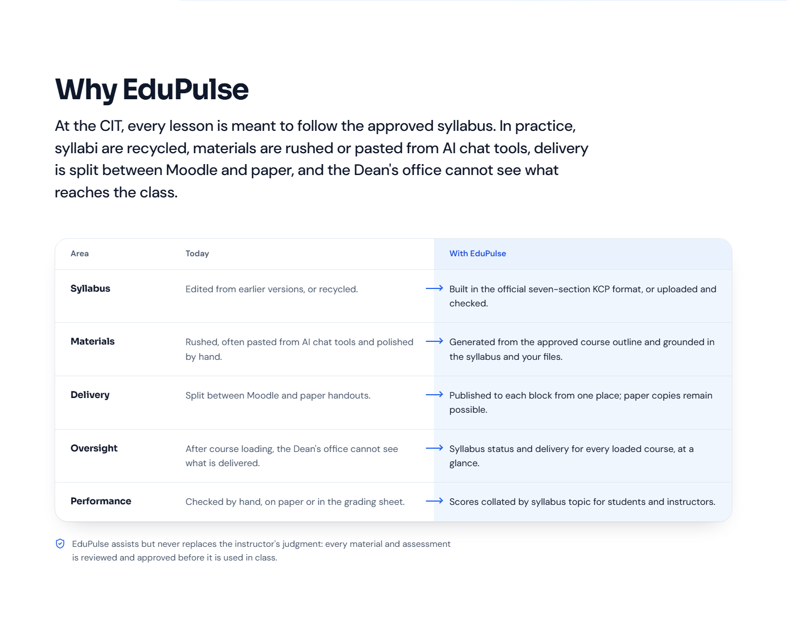

The heading **Why EduPulse** and a statement: “At the CIT, every lesson is meant to follow the approved syllabus. In practice, syllabi are recycled, materials are rushed or pasted from AI chat tools, delivery is split between Moodle and paper, and the Dean's office cannot see what reaches the class.”

Below it, a table compares **Today** with **With EduPulse** (shaded light blue, an arrow leading into each row) in five areas:
* **Syllabus:** edited from earlier versions, or recycled → built in the official seven-section KCP format, or uploaded and checked.
* **Materials:** rushed, often pasted from AI chat tools and polished by hand → generated from the approved course outline and grounded in the syllabus and your files.
* **Delivery:** split between Moodle and paper handouts → published to each block from one place; paper copies remain possible.
* **Oversight:** after course loading, the Dean's office cannot see what is delivered → syllabus status and delivery for every loaded course, at a glance.
* **Performance:** checked by hand, on paper or in the grading sheet → scores collated by syllabus topic for students and instructors.

A note with a shield icon closes the section: EduPulse assists but never replaces the instructor's judgment; every material and assessment is reviewed and approved before it is used in class.

## 4. Features

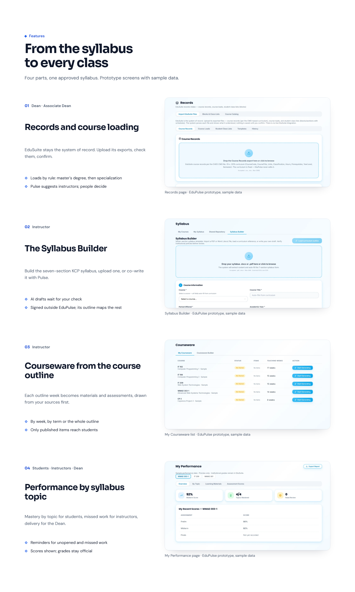

**Features** · “From the syllabus to every class”: “Four parts of one workflow, each starting from the approved KCP syllabus. The screens are the EduPulse prototype with sample data.” As captured (reduced motion), the four parts follow one another, each with its prototype screen and a caption naming the screen:
* **01 · Dean · Associate Dean: Records and course loading** (*Records page*). EduSuite stays the system of record; its exported course records, course loads and block class lists are uploaded, checked and confirmed, and courses are loaded to instructors by the college's rule, a master's degree first, then specialization. *Nothing is saved until the Dean's office confirms. Pulse can suggest instructors; people decide.*
* **02 · Instructor: The Syllabus Builder** (*Syllabus Builder*). Build the official seven-section KCP syllabus, upload one you already have, or let Pulse co-write it section by section; AI drafts stay Drafted until you check them. *Signed outside EduPulse: Dean review, CAO approval, EVP noting. The approved Section 5 course outline becomes the map for everything else.*
* **03 · Instructor: Courseware from the course outline** (*My Courseware list*). Each outline week becomes learning materials and assessments; generation retrieves from the approved syllabus and your own files first, so drafts stay aligned with the course. *Generate by week, by term or for the whole outline. Review, edit and publish; only published items reach students.*
* **04 · Students · Instructors · Dean: Performance by syllabus topic** (*My Performance page*). Students see which topics they have mastered and what to review, instructors see completed and missed work and unopened materials, and the Dean's office follows delivery across the college. *Reminders for unopened materials and missing activities. Scores are visualized; official grades stay outside EduPulse.*

## 5. How it works

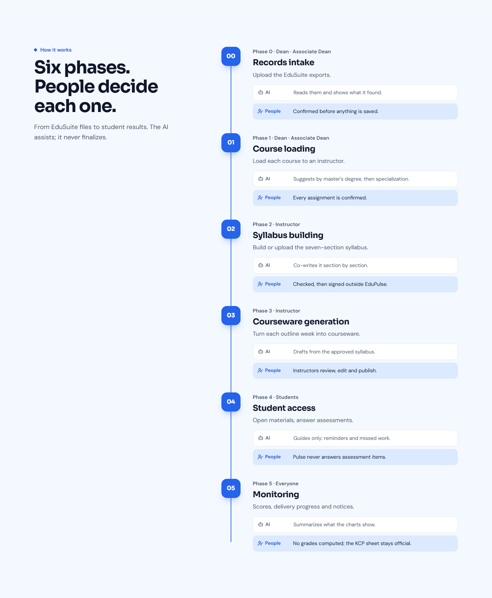

A light-blue section. On the left, **How it works** · “Six phases. People decide each one.” and “From the EduSuite files to student results. The AI assists inside every phase and never finalizes one.” On the right, a timeline: blue numbered squares **00** to **05** joined by a blue line. Each phase names who does it and what happens, then an **AI** row (what Pulse may do) and a shaded **People** row (who decides):
* **Phase 0 · Dean · Associate Dean: Records intake.** Upload the EduSuite exports: course records, course loads and block rosters. AI: reads the files and shows what it understood. People: the Dean or Associate Dean confirms before anything is saved.
* **Phase 1 · Dean · Associate Dean: Course loading.** Load each released course to an instructor. AI: suggests or proposes instructors, master's degree first, then specialization. People: every assignment is confirmed before it takes effect.
* **Phase 2 · Instructor: Syllabus building.** Build the seven-section syllabus, or upload a ready-made one. AI: co-writes section by section, or drafts the whole syllabus as Drafted. People: checked, then signed outside EduPulse (Dean review, CAO approval, EVP noting); the approved file is uploaded and its course outline extracted.
* **Phase 3 · Instructor: Courseware generation.** Turn each outline week into learning materials and assessments. AI: drafts by week, by term or for the whole outline, grounded in the approved syllabus. People: the instructor reviews, edits and publishes; only published items reach students.
* **Phase 4 · Students: Student access.** Open published materials and answer assessments for the block's courses. AI: guides only (reminders, missed activities and finding the way). People: Pulse never answers, reviews or hints at assessment items.
* **Phase 5 · Everyone: Monitoring.** A scoring sheet for instructors, delivery progress for the Dean's office and notices for students. AI: summarizes what the charts show. People: no grades are computed; the KCP grading sheet stays official.

On a desktop the heading stays beside the timeline while it scrolls past. The screenshot shows the timeline finished.

## 6–7. Roles

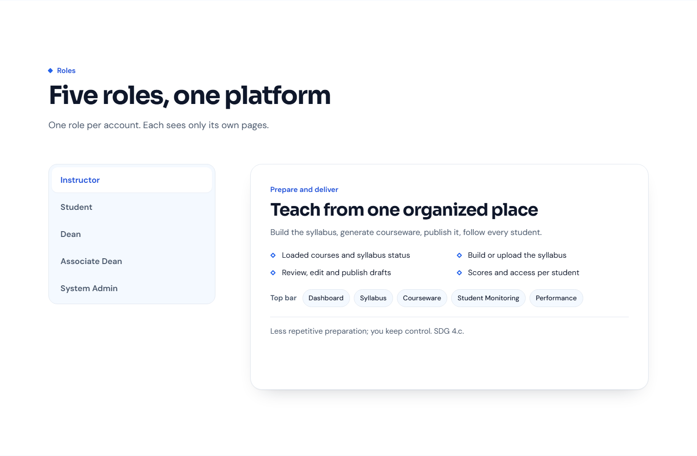

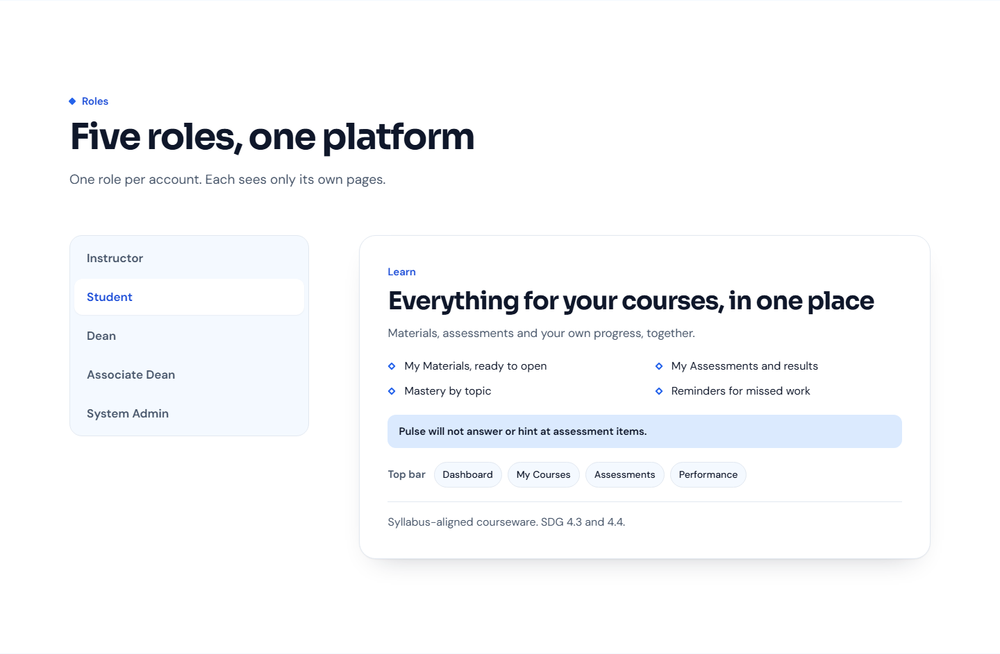

**Roles** · “Five roles, one platform”: “Each account has one role, and the top bar shows only that role's sections.” The tabs on the left (**Instructor**, **Student**, **Dean**, **Associate Dean** and **System Admin**) switch the panel on the right; the selected tab is white with blue text. The arrow keys, **Home** and **End** move between tabs, and every panel keeps the same height. Each panel has a short label, a heading, a summary, four tasks, the role's **Top bar** sections and one benefit:
* **Instructor** (image 6), *Prepare and deliver*: “Teach from one organized place”. Top bar: **Dashboard**, **Syllabus**, **Courseware**, **Student Monitoring** and **Performance**. The benefit names SDG 4.c, well-supported teachers.
* **Student** (image 7), *Learn*: “Everything for your courses, in one place”, with **My Materials**, **My Assessments**, **Performance** and reminders. A shaded line reads “Pulse will not answer or hint at assessment items.” Top bar: **Dashboard**, **My Courses**, **Assessments** and **Performance**. The benefit names SDG 4.3 and 4.4.

The Dean, Associate Dean and System Admin tabs use the same layout (not shown).

## 8. Pulse, the AI assistant

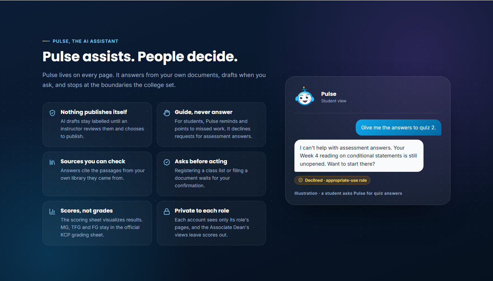

A light-blue band. **Pulse, the AI assistant** · “Grounded in your documents. Decided by you.”: Pulse lives on every page; it retrieves from the approved syllabus and your files, drafts when you ask, and stops at the boundaries the college set. Six principles follow, each with an icon: **Grounded first**, **Sources you can check**, **Nothing publishes itself**, **Guide, never answer**, **Asks before acting** and **Scores, not grades**.

On the right, an illustrated chat labelled *Student view · sample conversation*. The student asks “Give me the answers to quiz 2.”; two chips show what Pulse checked (*Appropriate-use rule · assessments* and *Week 4 reading · conditional statements, unopened*); Pulse replies “I can't help with assessment answers. Your Week 4 reading on conditional statements is still unopened. Want to start there?” The tag reads **Declined · appropriate-use rule**, and the caption labels the chat *Illustration*.

## 8b. The agents behind Pulse

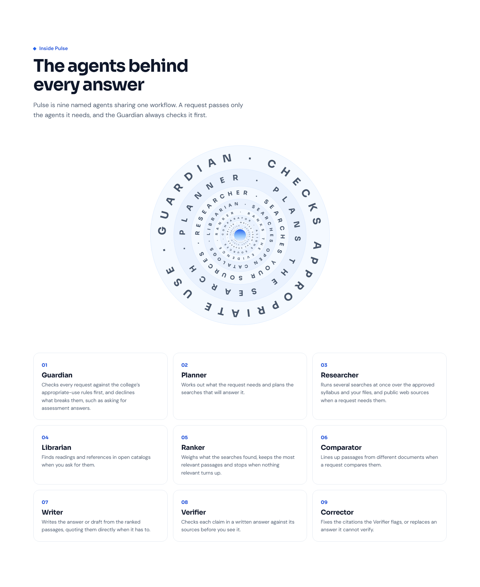

**Inside Pulse** · “The agents behind every answer”: “Pulse is nine named agents sharing one workflow. A request passes only the agents it needs, and the Guardian always checks it first.” Below it, nine concentric rings of capital letters around a blue core, one ring per agent, each naming the agent and its job (the outer ring reads *GUARDIAN · CHECKS APPROPRIATE USE*). Then the nine agents, numbered in the order a request meets them:
* **01 Guardian:** checks every request against the college’s appropriate-use rules first, and declines what breaks them, such as asking for assessment answers.
* **02 Planner:** works out what the request needs and plans the searches that will answer it.
* **03 Researcher:** runs several searches at once over the approved syllabus and your files, and public web sources when a request needs them.
* **04 Librarian:** finds readings and references in open catalogs when you ask for them.
* **05 Ranker:** weighs what the searches found, keeps the most relevant passages and stops when nothing relevant turns up.
* **06 Comparator:** lines up passages from different documents when a request compares them.
* **07 Writer:** writes the answer or draft from the ranked passages, quoting them directly when it has to.
* **08 Verifier:** checks each claim in a written answer against its sources before you see it.
* **09 Corrector:** fixes the citations the Verifier flags, or replaces an answer it cannot verify.

As captured (reduced motion), the rings stand still and the list is shown. With motion, the list is read out to screen readers but replaced on screen by the moving rings and a card for the current agent (see the top of this page).

## 9. Why it matters

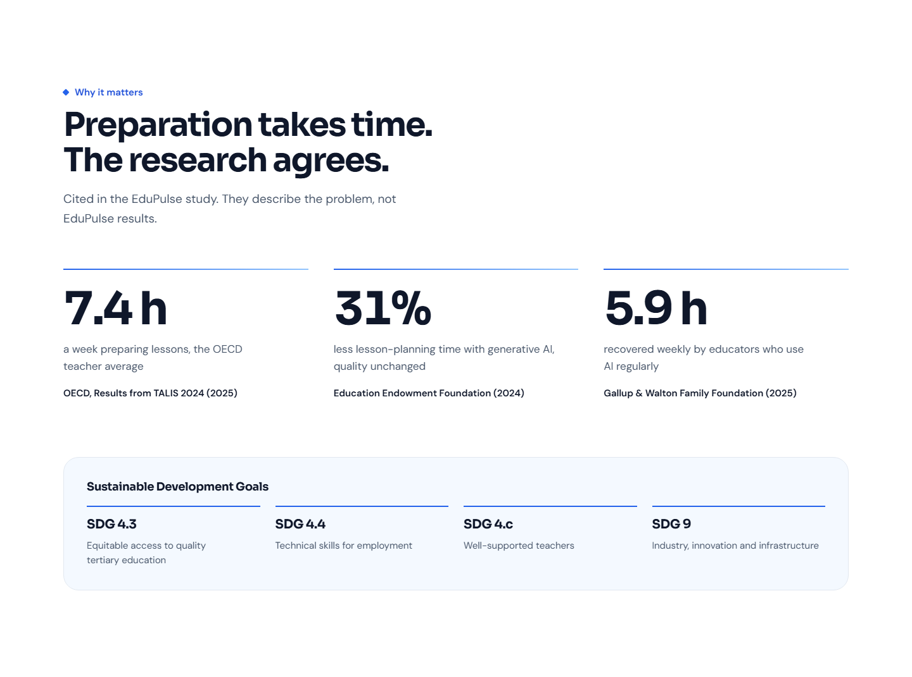

**Why it matters** · “Preparation takes time. The research agrees.” Three findings cited in the EduPulse study, each under a blue rule and labelled as describing the problem EduPulse addresses, not measured EduPulse results:
* **7.4 h** a week spent preparing lessons, on average, by teachers across OECD countries (OECD, *Results from TALIS 2024*, 2025);
* **31%** less lesson-planning time for teachers using generative AI, with no measurable drop in lesson quality (Education Endowment Foundation, 2024);
* **5.9 h** of work recovered each week by educators who use AI tools regularly (Gallup & Walton Family Foundation, 2025).

Below them, a light-blue panel lists the Sustainable Development Goals the study supports: **SDG 4.3** (equitable access to quality tertiary education), **SDG 4.4** (technical skills for employment), **SDG 4.c** (well-supported teachers) and **SDG 9** (industry, innovation and infrastructure).

## 10. Colleges

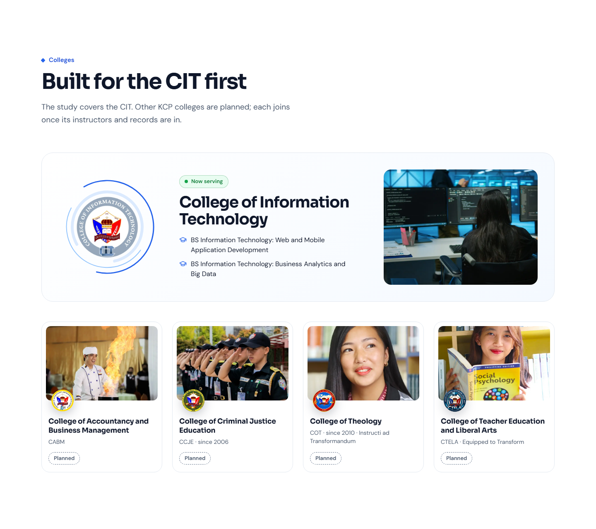

**Colleges** · “Built for the CIT first”: the study is scoped to the College of Information Technology, and adoption by the other KCP colleges is planned future work. A college joins when its instructors are registered and its records are imported.

The CIT card shows its seal inside blue arcs, a green **Now serving** badge, the two BSIT tracks listed on kcp.edu.ph (*Web and Mobile Application Development* and *Business Analytics and Big Data*) and the CIT lab photograph. Below, four KCP colleges, each with a kcp.edu.ph photograph, its emblem and **Planned**:
* **College of Accountancy and Business Management** (CABM);
* **College of Criminal Justice Education** (CCJE · since 2006);
* **College of Theology** (COT · since 2010 · *Instructi ad Transformandum*);
* **College of Teacher Education and Liberal Arts** (CTELA · *Equipped to Transform*).

Years and mottos come from the emblems.

## 11. Community photographs

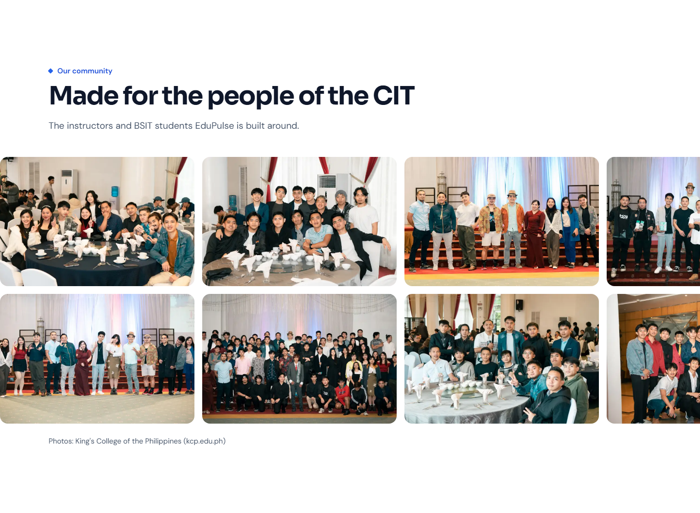

**Our community** · “Made for the people of the CIT”: the instructors and BSIT students EduPulse is built around. Two rows of CIT event photographs from kcp.edu.ph. As captured (reduced motion), the rows stand still and scroll sideways; the last photograph in each row is cut at the edge. The credit reads **Photos: King's College of the Philippines (kcp.edu.ph)**. With motion, the rows drift, and the **Pause photo movement** button appears beside the credit (see the top of this page).

## 12. Frequently asked questions

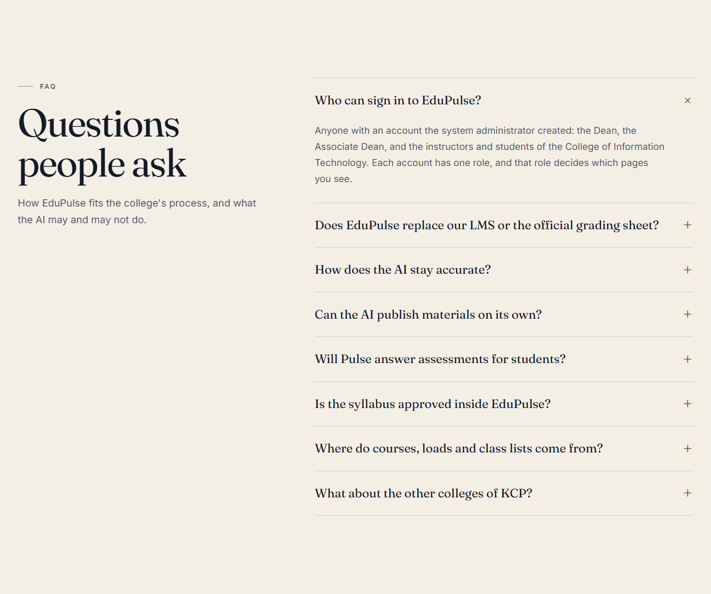

**FAQ** · “Questions people ask”: how EduPulse fits the college's process, and what the AI may and may not do. The heading sits on a slanted light-blue plane. Eight questions; one answer is open at a time, and its plus sign turns into a minus. The first, **Who can sign in to EduPulse?**, is open in the screenshot. The others ask whether EduPulse replaces the LMS or the official grading sheet, how the AI stays accurate, whether the AI publishes materials on its own, whether Pulse answers assessments for students, whether the syllabus is approved inside EduPulse, where courses, loads and class lists come from, and about the other KCP colleges.

## 13. Sign-in panel (hosted site)

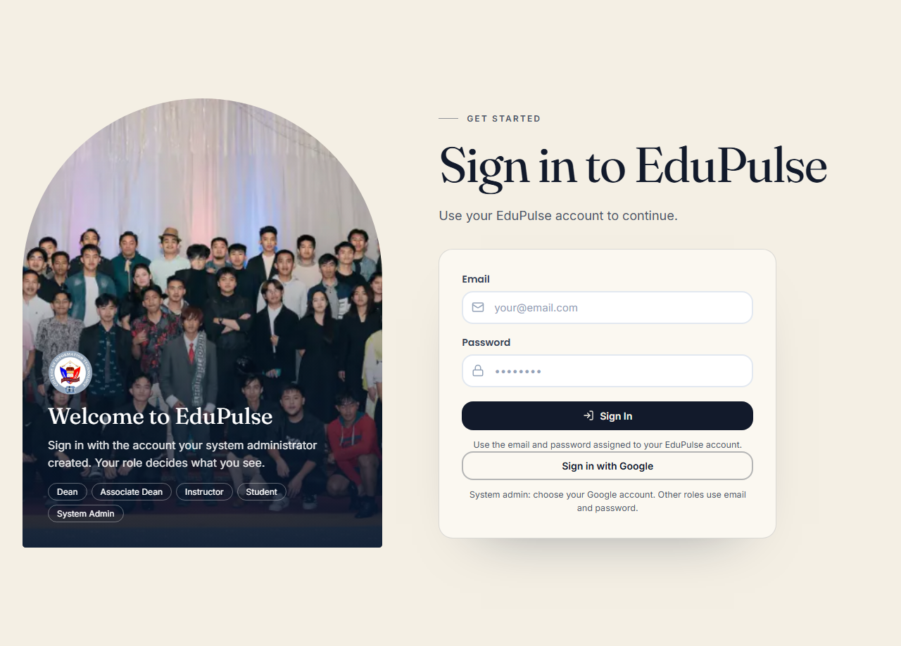

One card. On the left, a CIT group photograph with the CIT seal, **Welcome to EduPulse**, “Sign in with the account your system administrator created. Your role decides what you see.” and the five role names. On the right, **Get started** · **Sign in to EduPulse**, “Use your EduPulse account to continue.” and the panel:
- **Email** and **Password**, then the blue **Sign In** button, for an account the administrator has created. The hint below reads “Use the email and password assigned to your EduPulse account.”
- **Sign in with Google**, with the note “System admin: choose your Google account. Other roles use email and password.” The button works only when Google sign-in is enabled for the project; otherwise the panel says Google sign-in is temporarily unavailable.
- Each account has one assigned role: system admin, Dean, Associate Dean, instructor or student. An account without a role is signed out with the message “This account has no EduPulse role. Contact the administrator.”

## 14. Preview personas (local development and documentation capture only)

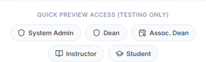

**Quick preview access (testing only)** appears below the sign-in panel in two builds only:
* the local development app;
* the documentation capture build (`npm run build:capture`).

The hosted production build does not include it, and the deployment check enforces that. **System Admin**, **Dean**, **Assoc. Dean**, **Instructor** and **Student** open the app as that role, with sample data and no account. The rest of this walkthrough was captured with these personas.

## 15. Footer

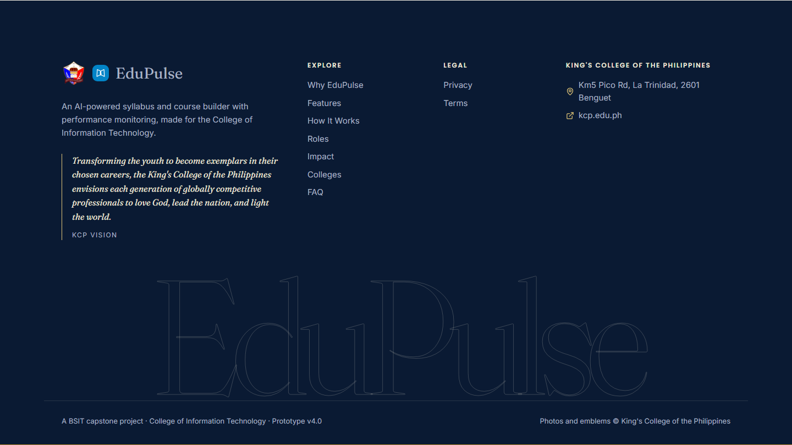

A light-blue footer. On the left, the KCP crest and EduPulse logo, “An AI-powered syllabus and course builder with performance monitoring, made for the College of Information Technology.” and the KCP vision, quoted from kcp.edu.ph, in a card with a blue rule and the label *KCP vision*. Then three columns: **Explore** (the seven section links), **Legal** (**Privacy** and **Terms**) and **King's College of the Philippines** (Km5 Pico Rd, La Trinidad, 2601 Benguet, and **kcp.edu.ph**, which opens the official site in a new tab). A large pale *EduPulse* wordmark runs across the footer. The bottom line reads *A BSIT capstone project · College of Information Technology · Prototype v4.0* and *Photos and emblems © King's College of the Philippines*.

## 16. Privacy policy

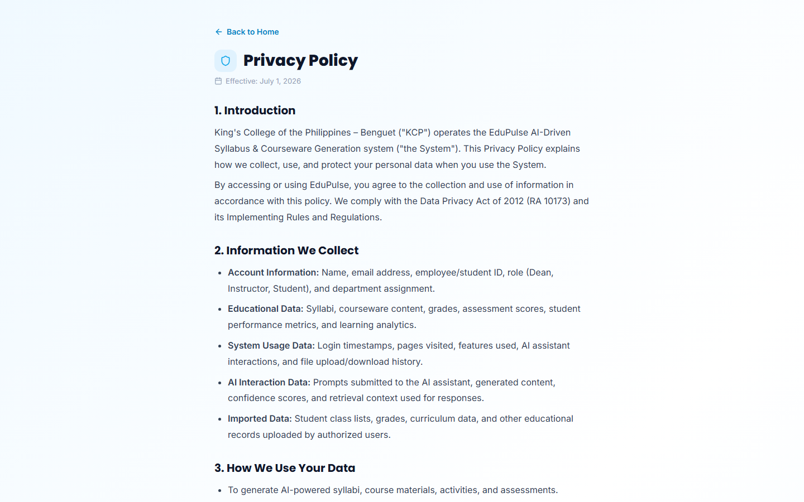

`/privacy` opens from the landing page footer. **Back to Home** returns to the landing page, and the effective date sits under the title. The numbered sections cover the introduction (operated by King's College of the Philippines – Benguet under the Data Privacy Act of 2012), the information collected, how it is used, retention, your rights and the Data Protection Officer contact. The screenshot shows the top of the page.

## 17. Terms of use

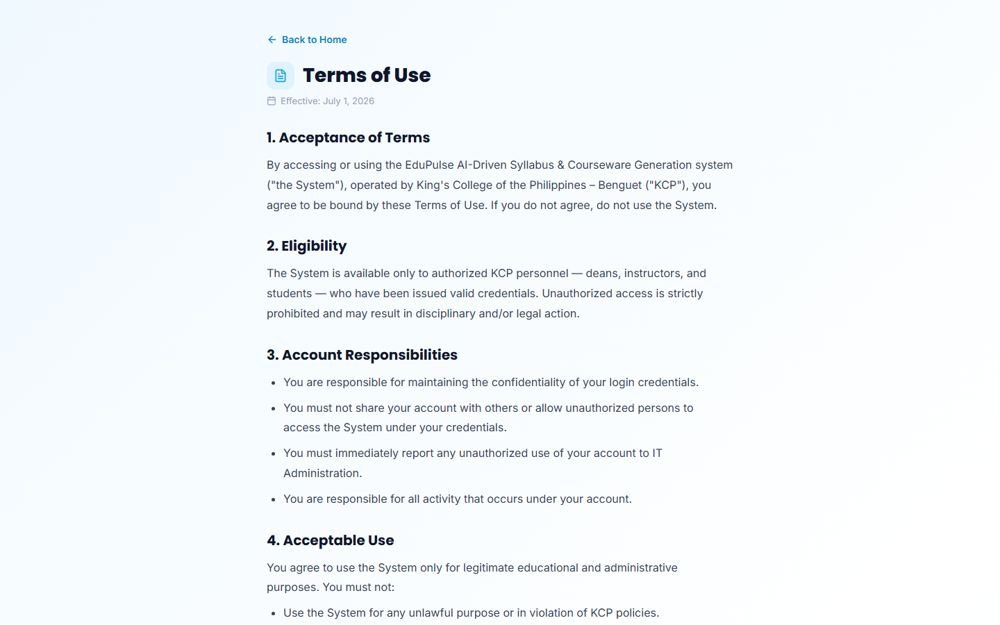

`/terms` opens from the landing page footer and has the same layout: **Back to Home**, the effective date, then numbered sections. These cover acceptance, eligibility (authorised KCP deans, instructors and students only), account responsibilities and acceptable use.

## 18. Server error page

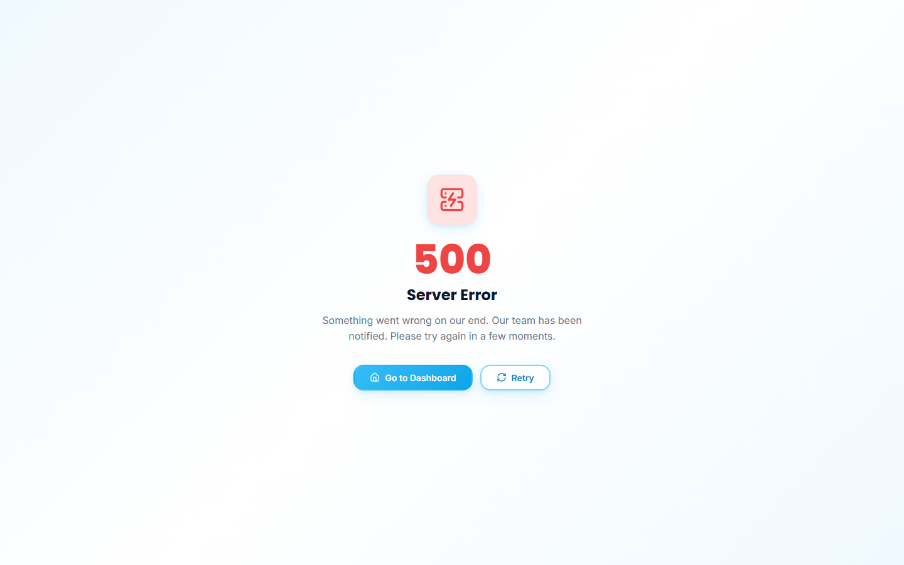

`/500` appears when the app cannot complete a request. It shows **500 · Server Error** and a short apology, with **Go to Dashboard** and **Retry**.

*Changed on 30 October 2026:* the landing page was redesigned in white and light blue, with Sora headings, DM Sans text, a once-per-tab opening, a 3D ring and geometric section motion. Images 1 to 15 were recaptured and images 16 to 18 are unchanged. The agents section and its image (8b) were added on the same day.
