# 03 - Dean and Program Coordinator

The Dean and Program Coordinator use separate accounts and permissions. Dean navigation is **Dashboard**, **Course**, **Instructors** and **Students**. Program Coordinator retains **Dashboard**, **Records**, **Course Loading** and **Monitor**. These images show preview samples; authenticated pages use authorized records without sample fallback. [Manual 36](../../system-manual/36-dean-activity-records/README.md) illustrates the current account interface.

## 1. Dean dashboard

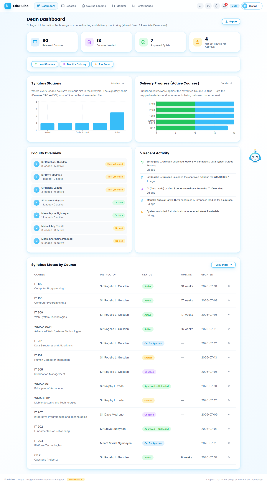

Summary cards link to course records, loads, approved syllabi and not-yet-routed syllabi. **View Course**, **Monitor Delivery** and **Ask Pulse** remain below. **Syllabus Stations**, **Delivery Progress (Active Courses)**, **Faculty Overview**, **Recent Activity** and **Syllabus Status by Course** remain. Offline review, CAO approval and EVP noting are unchanged. Preview numbers and names are sample data.

## 2. Course loads

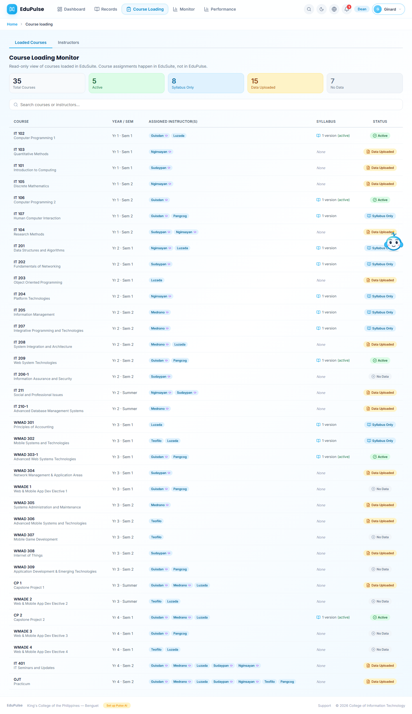

The old Course Loading address opens **Course → Course loads**, listing saved course/instructor assignments and recorded blocks, students, releases and submissions. Summary cards use the dashboard design and open matching records. Dean imports and loading-proposal forms no longer appear.

## 3. Instructors

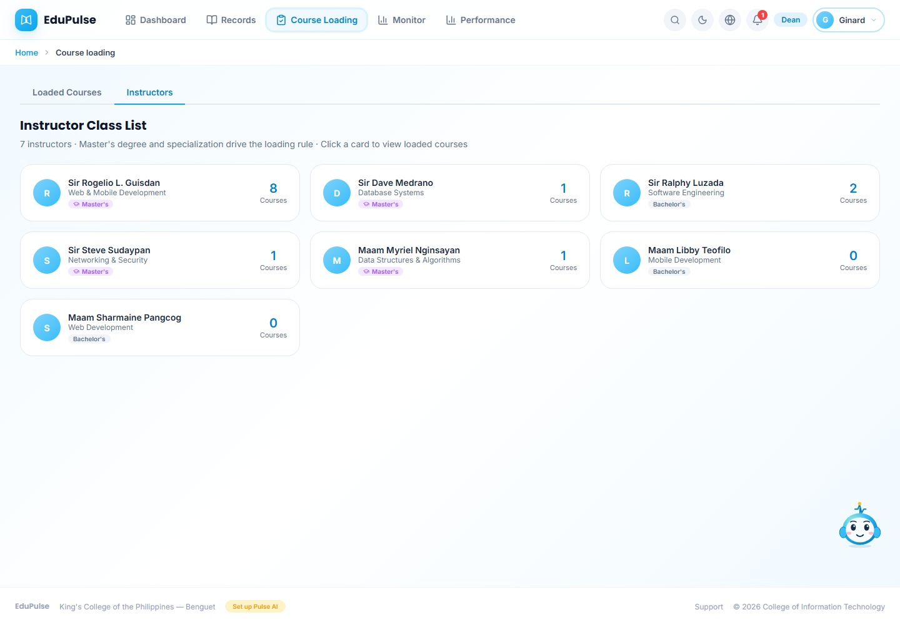

**Instructors** contains searchable cards. Selecting one opens the instructor's saved courses, syllabus statuses and recorded activity.

## 4-7. Syllabus and delivery oversight

Open **Course → Syllabus & Delivery** or **Monitor Delivery**. Oversight and alerts retain their functions without adding a fifth main navigation item.

| View | Capture | Content |
| --- | --- | --- |
| **Syllabus & Delivery** | 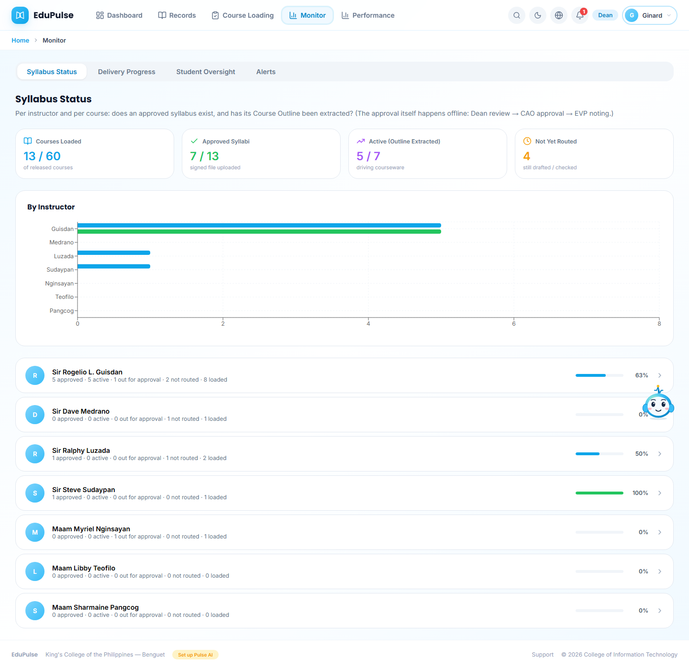 | Syllabus-status and delivery sections share one view; stations and publication coverage remain distinct measures. |
| **Student Oversight** | 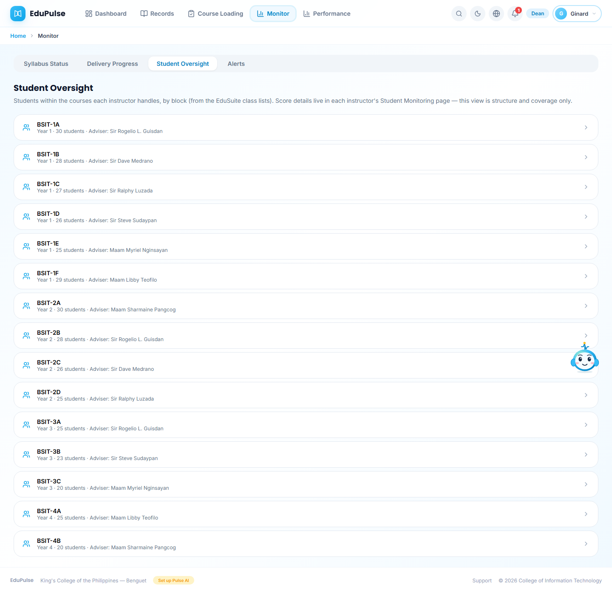 | Retained block, enrollment and class-list oversight. The main Students page provides year-grouped block dialogs. |
| **Alerts** | 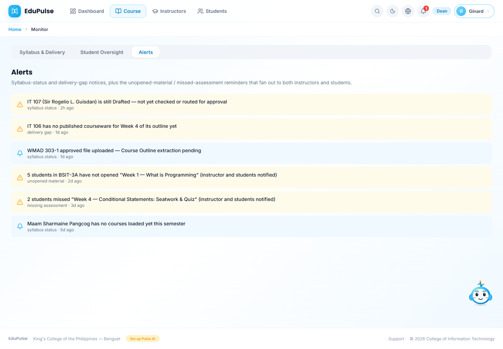 | Readiness and delivery gaps supported by available records. |

## 8-10. Course records and blocks

| View | Capture | Content |
| --- | --- | --- |
| **Course records** | 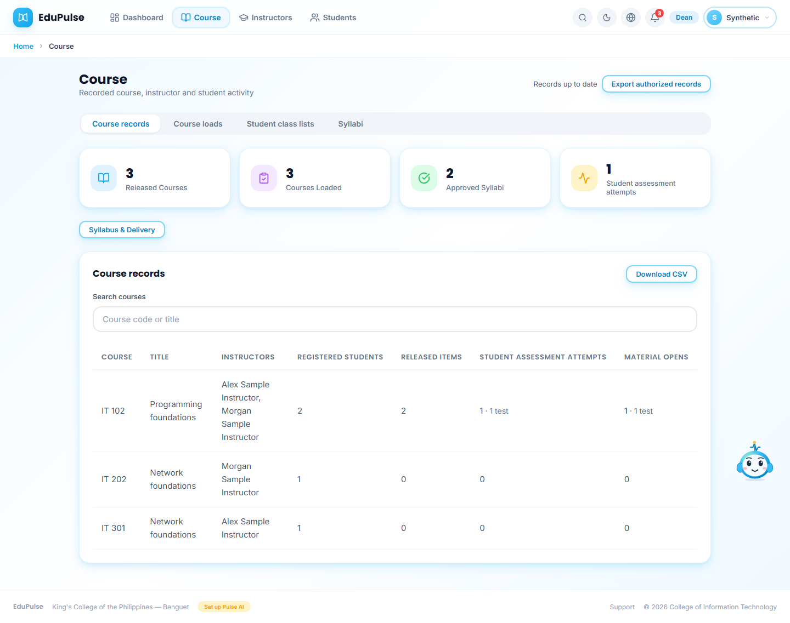 | Read-only course/instructor/student activity, summary links and CSV. |
| **Students** | 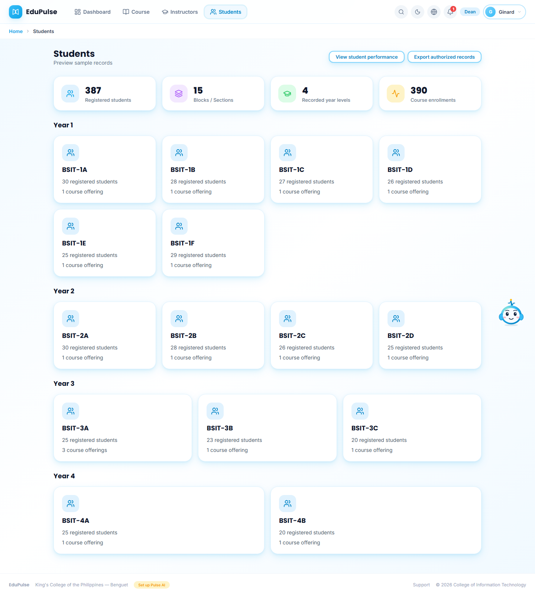 | Summary cards, year categories and block cards; dialogs download registered students. |
| **Syllabi** | 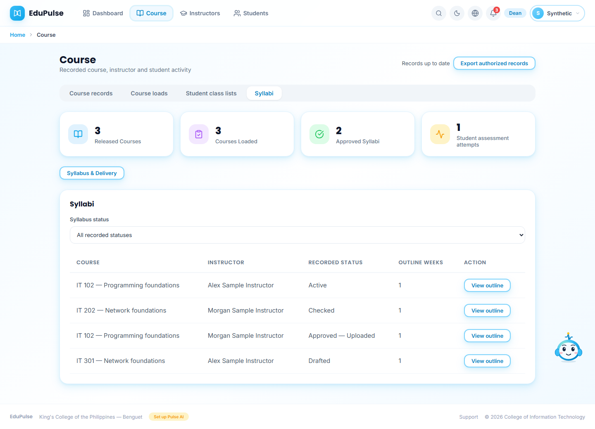 | Recorded status, outline week count and **View outline**. |

Dean Course also retains **Student class lists**. File Import, Templates, History and block-edit controls are removed from Dean pages at the owner's request. Saved institutional records are retained. Old sections/loading links redirect to the new pages.

## 11. Pulse guidance

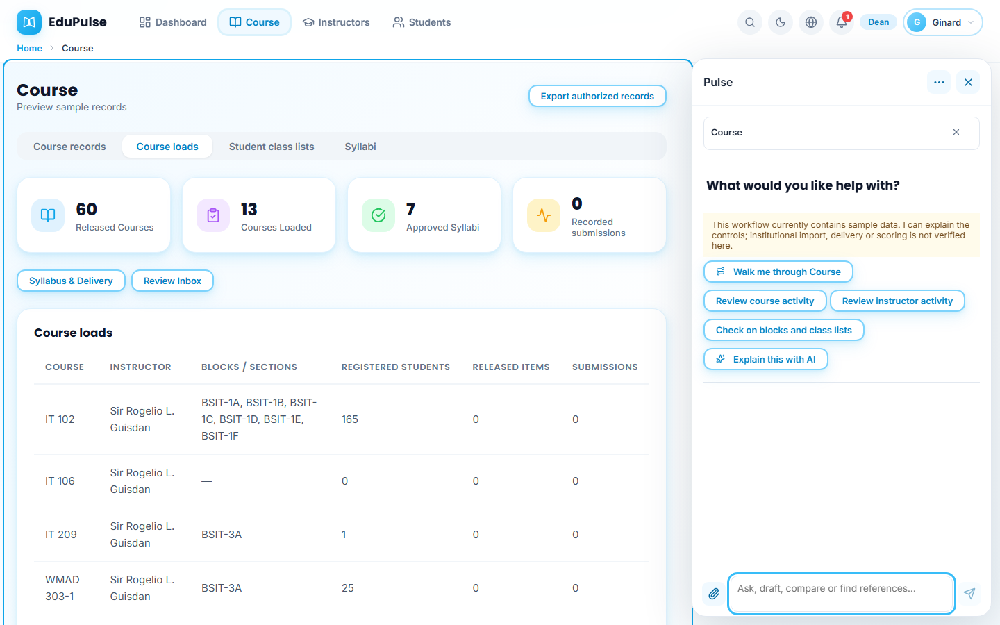

Page guidance explains Dean read-only activity records. Preview guidance identifies sample data. Program Coordinator guidance retains shared file-intake instructions.

## 12. Program Coordinator dashboard

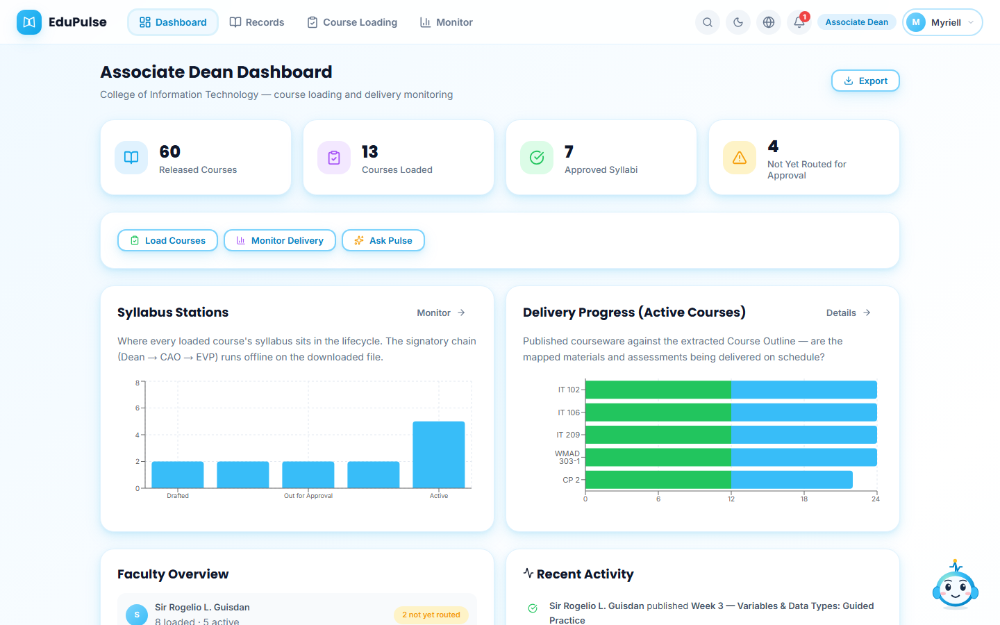

The Program Coordinator retains Records/Course Loading/Monitor navigation, CSV confirmation, loading proposals, templates, history and block correction under existing permissions. The [account role guide](../09-restored-role-pages/README.md) shows those controls with synthetic records.

## 13. Performance access boundary

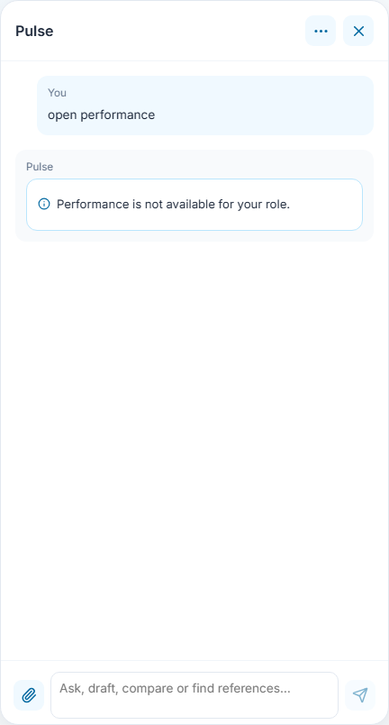

Program Coordinator direct Performance navigation returns to Dashboard, and Pulse reports it unavailable. Dean read-only Performance remains reachable through **Students → View student performance** and existing links. No Dean authoring, marking or electronic approval was added. See [ADR-001](../../backend-system/decisions/001-role-and-approval-boundaries.md) and the [combined oversight guide](../../system-manual/29-combined-oversight/README.md).

## Assigned curriculum loads

**Course loads** now includes curriculum units/year/period. Assessment counts explicitly identify student attempts; the instructor does not submit a syllabus for online approval. The course-record and syllabus images are refreshed using fictional Dean records. [Population guide](../../system-manual/38-curriculum-population/README.md).

Dean record counts no longer append test suffixes. Assessment/access tables omit the Activity origin column. These display changes preserve stored scores, dates, grading, provenance and the Program Coordinator score boundary.
