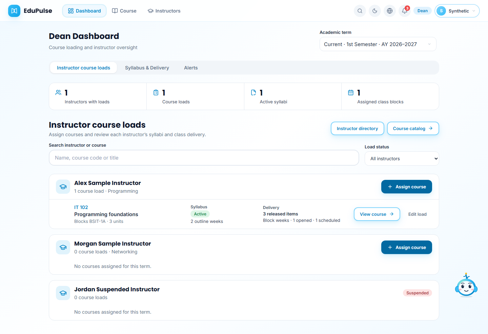
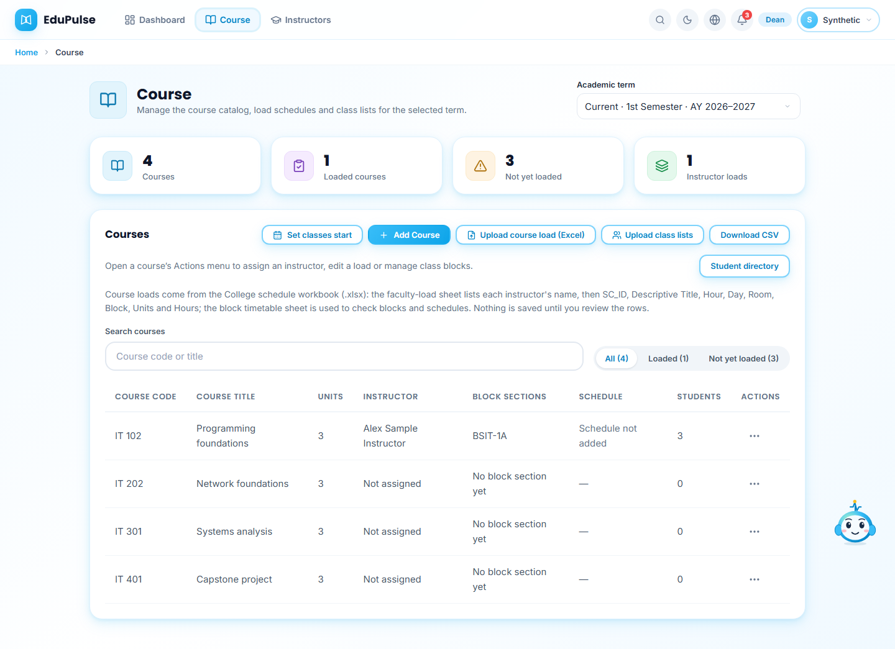
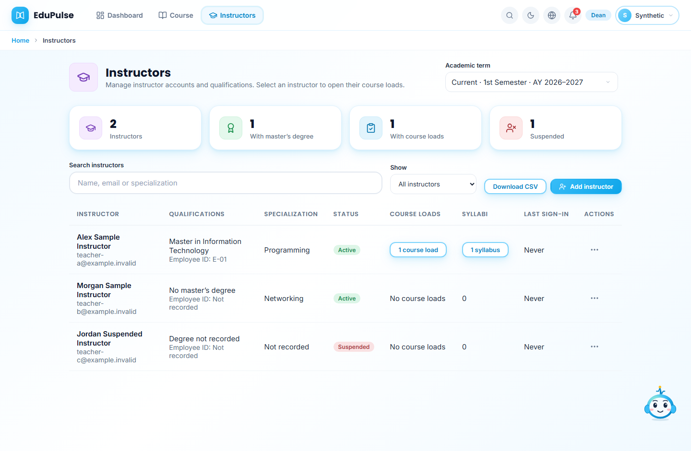
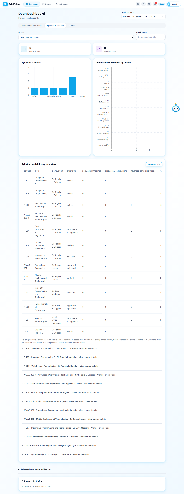
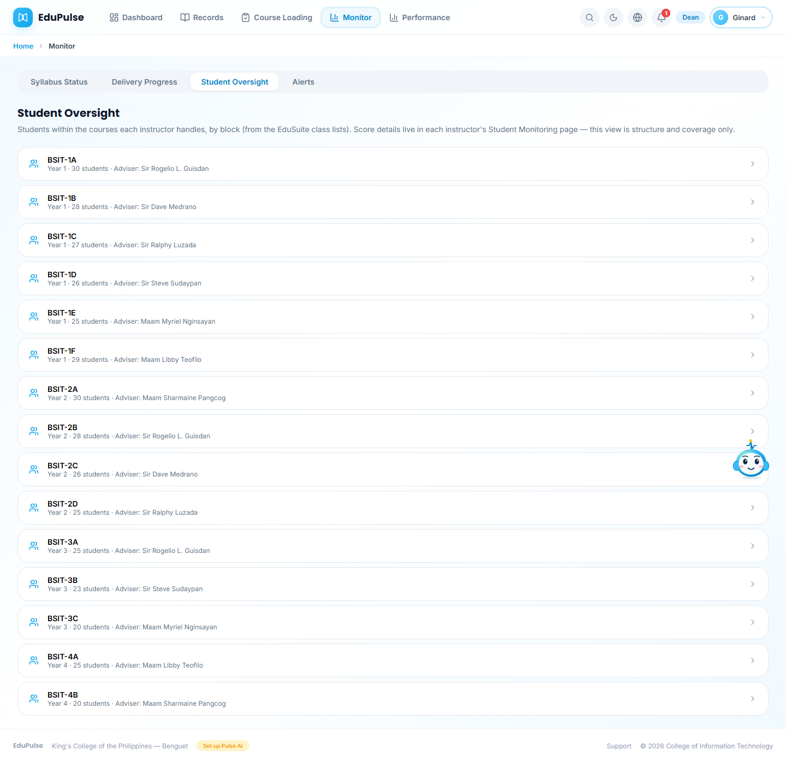
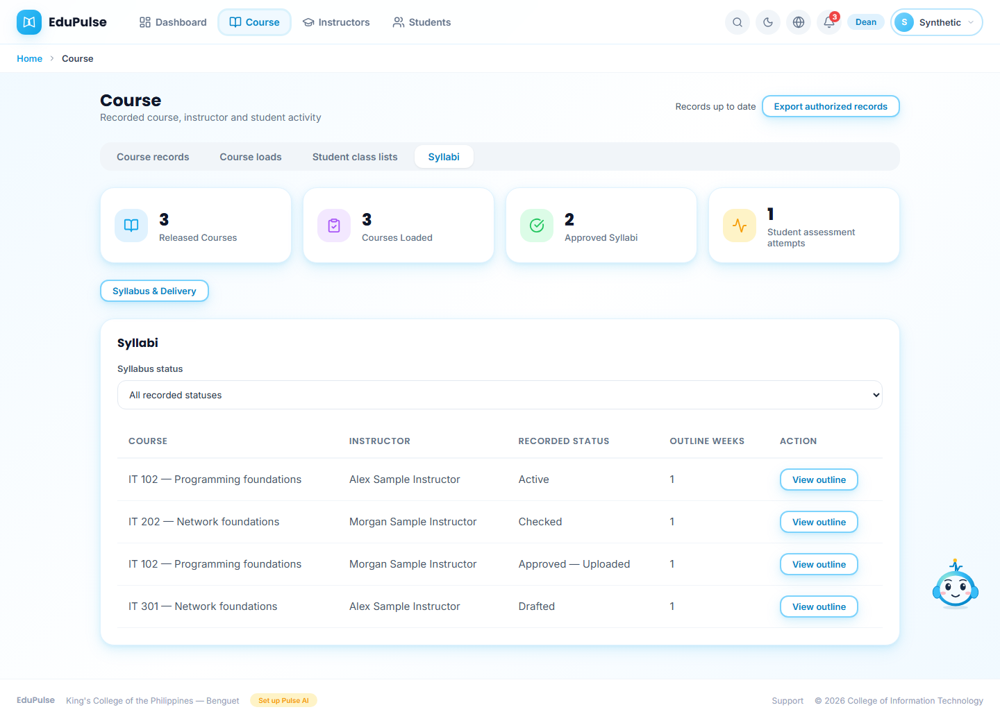
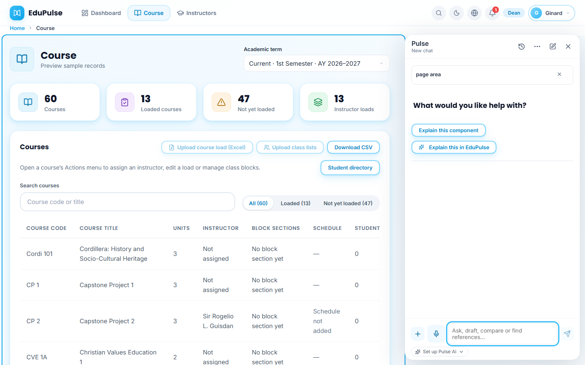
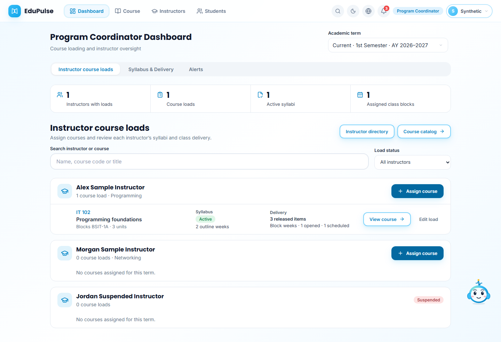
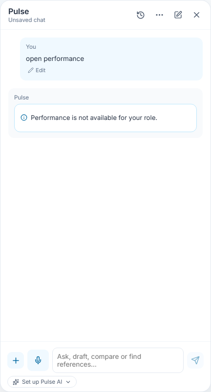

# 03 - Dean and Program Coordinator

The Dean and Program Coordinator use separate accounts and permissions. Dean navigation is **Dashboard**, **Course**, **Instructors** and **Students**. Program Coordinator retains **Dashboard**, **Records**, **Course Loading** and **Monitor**. These images show preview samples; authenticated pages use authorized records without sample fallback. [Manual 36](../../system-manual/36-dean-activity-records/README.md) illustrates the current account interface.

## 1. Dean dashboard

Summary cards link to course records, loads, approved syllabi and not-yet-routed syllabi. **View Course**, **Monitor Delivery** and **Ask Pulse** remain below. **Syllabus Stations**, **Delivery Progress (Active Courses)**, **Faculty Overview**, **Recent Activity** and **Syllabus Status by Course** remain. Offline review, CAO approval and EVP noting are unchanged. Preview numbers and names are sample data.

## 2. Course loads

The old Course Loading address opens **Course → Course loads**, listing saved course/instructor assignments and recorded blocks, students, releases and submissions. Summary cards use the dashboard design and open matching records. Dean imports and loading-proposal forms no longer appear.

## 3. Instructors

**Instructors** contains searchable cards. Selecting one opens the instructor's saved courses, syllabus statuses and recorded activity.

Current authenticated Course cards include a three-dot action menu and the top-right **Add Course** button. Instructor cards place editing and suspension/reactivation/removal inside the same menu pattern. Removal is available only after suspension. These controls apply equally to Dean and Program Coordinator, including an authorized Admin account view. Catalog actions preserve existing teaching files and learner records. The current flow is described in [Manual 46](../../system-manual/46-course-load-workspace/README.md); the older images above predate these controls. Broad screenshot publication remains owner-paused, and the targeted capture assertions cover both menus.

## 4-7. Syllabus and delivery oversight

Open **Course → Syllabus & Delivery** or **Monitor Delivery**. Oversight and alerts retain their functions without adding a fifth main navigation item.

| View | Capture | Content |
| --- | --- | --- |
| **Syllabus & Delivery** |  | Syllabus-status and delivery sections share one view; stations and publication coverage remain distinct measures. |
| **Student Oversight** |  | Retained block, enrollment and class-list oversight. The main Students page provides a full directory with department, year and block filters. |
| **Alerts** |  | Readiness and delivery gaps supported by available records. |

## 8-10. Course records and blocks

| View | Capture | Content |
| --- | --- | --- |
| **Course records** |  | Read-only course/instructor/student activity, summary links and CSV. |
| **Students** |  | Unified directory: summary cards, search and department/year/block filters; choosing a department reveals section cards that filter the same table. CSV exports every filtered match. |
| **Syllabi** |  | Recorded status, outline week count and **View outline**. |

Dean Course also retains **Student class lists**. File Import, Templates, History and block-edit controls are removed from Dean pages at the owner's request. Saved institutional records are retained. Old sections/loading links redirect to the new pages.

## 11. Pulse guidance

Page guidance explains Dean read-only activity records. Preview guidance identifies sample data. Program Coordinator guidance retains shared file-intake instructions.

## 12. Program Coordinator dashboard

The Program Coordinator retains Records/Course Loading/Monitor navigation, CSV confirmation, loading proposals, templates, history and block correction under existing permissions. The [account role guide](../09-restored-role-pages/README.md) shows those controls with synthetic records.

## 13. Performance access boundary

Program Coordinator direct Performance navigation returns to Dashboard, and Pulse reports it unavailable. Dean read-only Performance remains reachable through **Students → View student performance** and existing links. No Dean authoring, marking or electronic approval was added. See [ADR-001](../../backend-system/decisions/001-role-and-approval-boundaries.md) and the [combined oversight guide](../../system-manual/29-combined-oversight/README.md).

## Assigned curriculum loads

**Course loads** now includes curriculum units/year/period. Assessment counts explicitly identify student attempts; the instructor does not submit a syllabus for online approval. The course-record and syllabus images are refreshed using fictional Dean records. [Population guide](../../system-manual/38-curriculum-population/README.md).

Dean record counts no longer append test suffixes. Assessment/access tables omit the Activity origin column. These display changes preserve stored scores, dates, grading, provenance and the Program Coordinator score boundary.

### Assigned instructor details and class continuity

The Instructor detail modal's teaching rows follow current Dean/Coordinator loads in the selected academic term. Repository ownership alone leaves these sections empty. Course → Edit switches a block's instructor while continuing its syllabus, content, delivery window and recorded student history independently. Course → Remove retains a package for a later same-class replacement. The original instructor's other blocks remain unchanged; the replacement's existing work is not overwritten. [Course loading guide](../../system-manual/46-course-load-workspace/README.md).

### Teaching-load PDF review and term records - 17 November 2026

Course and Instructors include Academic term for current, next, previous and other recorded terms. Course PDF upload and Pulse attachments open a full page extraction review with source columns, checked totals, verified instructor/course/block mappings and explicit confirmation. Saved load details show schedules, units, lecture/lab, hours, room and source provenance. Student account selection/directory covers all six preserved departments. [Guide](../../system-manual/47-teaching-load-documents/README.md).

### Semester-scoped courses - 18 November 2026

The shared Academic term selection follows this account across dashboards and academic pages. Current and next semesters allow changes; previous and All terms are view-only. Add/Edit Course use code, title and units only. Dean course assignments have no block selector. The instructor adds actual block class lists from Course > Block sections, by upload or individual registered-student selection across departments. Class years follow their students. Each term keeps separate roster, source and learner history. See [Manual 46](../../system-manual/46-course-load-workspace/README.md).

### Department home blocks - 18 November 2026

The current directory includes all six departments and groups home blocks by program and recorded year, independently of course enrollment. Use Department to narrow the unified Students list and reveal its section cards. Department selection stays in the URL on reload. A block card shows its actual directory members even when it has no courses. The 2027-x-xxxx intake is Year 1; other IDs retain their recorded year. The owner-confirmed allocation places 2,286 existing active students into 109 blocks of at most 35. It creates no teaching load, course enrollment or learner activity.

The student Dashboard shows its own recorded home block and size before any syllabus or course is assigned. Individual registered students, including students from other blocks/departments, remain selectable by the assigned instructor. No nationality is inferred from IDs or names.

### Unified Students page - 18 November 2026

**Students** is one page for the complete authorized student directory across all departments. There are no Student list / Blocks / Sections tabs. The summary cards precede **Search students**, **Department**, **Year level**, **Block section** and **Status** filters. With **All departments** selected, the table includes every matching department; no section cards are shown yet.

Choose a department to display its section cards grouped by recorded year. Choose a card to filter the same Student list table, or use the Block section selector. Changing department or year clears the previous block filter. Search matches name, student number or email; the filters combine. **Clear filters** restores the full directory. Pagination shows 25 students per page; **Download CSV** exports the complete filtered set, including matches on other pages, with spreadsheet-formula escaping.

Department, year, block, search, status and page remain in the URL across reload. Student details recheck the current authorized records before restoration; withdrawn records show **Record unavailable**. Filtering and reload issue no account, enrollment or learner-activity writes. Current/next semester account/import actions and previous-semester viewing restrictions remain. Instructor class-list selection and students' own home-block summaries are unchanged.

The earlier screenshots in this guide are historical where they show separate tabs or block dialogs. Screenshot publication remains owner-paused; updated desktop/phone browser checks and capture assertions cover the unified page. [Release and validation](../../versions/2026-11-18-unified-students/README.md).
