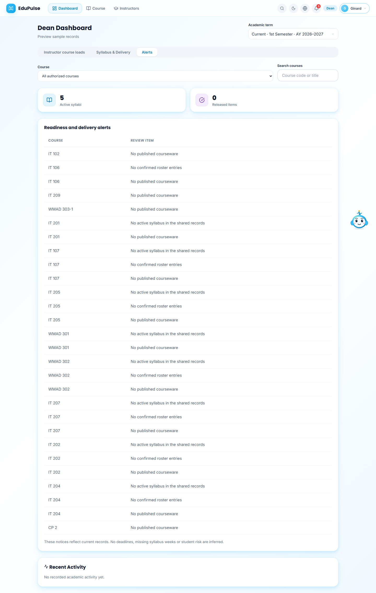
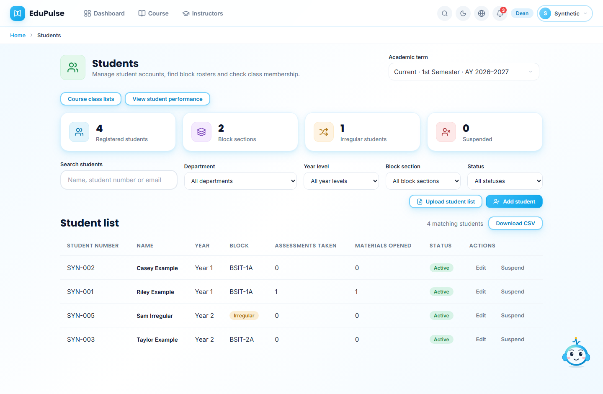

# 03 - Dean and Program Coordinator

Both roles open **Dashboard** to assign courses and monitor instructors in the selected academic term. **Course** manages the catalog, schedules and class lists. **Instructors** manages accounts and qualifications. The Dean reaches **Students** from **Course → Student directory**. The Program Coordinator can also open **Students** from the main navigation. Screenshots use synthetic account records or bundled preview samples. [Step-by-step guide](../../system-manual/36-dean-activity-records/README.md)

## 1. Dean dashboard

**Instructor course loads** lists the instructors and their saved assignments. Each assigned course shows its blocks, syllabus status, outline weeks, released items and opened or scheduled block weeks. Use **Assign course** beside an active instructor, **Edit load** beside a course, or **View course** to inspect its syllabus and delivery.

## 2. Course loads

**Course** lists catalog courses, their instructors and blocks, student counts and schedules. Its row Actions cover course assignment and class-list management. **Upload course load (Excel)** and **Upload class lists** open intake from the same page.

## 3. Instructors

**Instructors** shows qualifications, specialization, account status, course loads, syllabi and last sign-in. Select an instructor's name to return to their filtered Dashboard. The row menu contains account operations and authorized syllabus inspection.

## 4. Syllabus and delivery oversight

**Syllabus & Delivery** retains the term-wide charts, course filters and coverage table. Open **View course** on the instructor dashboard for the selected course's block delivery, roster, retained syllabus file and teaching contents. [Course delivery detail](../../system-manual/36-dean-activity-records/README.md#assign-and-review-courses-from-dashboard)

## 7. Alerts

The **Alerts** dashboard view lists course readiness gaps from the available records.

## 8. Course records

The catalog groups each course by its saved assignments. Select **Schedule** when a load has recorded times. Course search and the load filter apply to the same table.

## 9. Students

**Students** lists students and their recorded year, block and status. Department, year and block filters narrow the list. The Dean view also shows recorded assessment and material activity in scope.

## 11. Pulse guidance

Selecting **Guide this page** in the Pulse options opens the current Course page as guidance context.

## 12. Program Coordinator dashboard

The Program Coordinator follows the same assignment and course delivery workflow within their authorized records.

## 13. Performance access boundary

Direct Performance navigation returns the Program Coordinator to **Dashboard**. The Dean can use **Students → View student performance** for authorized read-only learner results. [Role and approval boundaries](../../backend-system/decisions/001-role-and-approval-boundaries.md)

### Teaching-load PDF review and term records - 17 November 2026

Course and Instructors include Academic term for current, next, previous and other recorded terms. Course PDF upload and Pulse attachments open a full page extraction review with source columns, checked totals, verified instructor/course/block mappings and explicit confirmation. Saved load details show schedules, units, lecture/lab, hours, room and source provenance. Student account selection/directory covers all six preserved departments. [Guide](../../system-manual/47-teaching-load-documents/README.md).

### Semester-scoped courses - 18 November 2026

The shared Academic term selection follows this account across dashboards and academic pages. Current and next semesters allow changes; previous and All terms are view-only. Add/Edit Course use code, title and units only. Dean course assignments have no block selector. The instructor adds actual block class lists from Course > Block sections, by upload or individual registered-student selection across departments. Class years follow their students. Each term keeps separate roster, source and learner history. See [Manual 46](../../system-manual/46-course-load-workspace/README.md).

### Department home blocks - 18 November 2026

The current directory includes all six departments and groups home blocks by program and recorded year, independently of course enrollment. Use Department to narrow the unified Students list and reveal its section cards. Department selection stays in the URL on reload. A block card shows its actual directory members even when it has no courses. The 2027-x-xxxx intake is Year 1; other IDs retain their recorded year. The owner-confirmed allocation places 2,286 existing active students into 109 blocks of at most 35. It creates no teaching load, course enrollment or learner activity.

The student Dashboard shows its own recorded home block and size before any syllabus or course is assigned. Individual registered students, including students from other blocks/departments, remain selectable by the assigned instructor. No nationality is inferred from IDs or names.

### Unified Students page - 18 November 2026

**Students** is one page for the complete authorized student directory across all departments. There are no Student list / Blocks / Sections tabs. The summary cards precede **Search students**, **Department**, **Year level**, **Block section** and **Status** filters. With **All departments** selected, the table includes every matching department; no section cards are shown yet.

Choose a department to display its section cards grouped by recorded year. Choose a card to filter the same Student list table, or use the Block section selector. Changing department or year clears the previous block filter. Search matches name, student number or email; the filters combine. **Clear filters** restores the full directory. Pagination shows 25 students per page; **Download CSV** exports the complete filtered set, including matches on other pages, with spreadsheet-formula escaping.

Department, year, block, search, status and page remain in the URL across reload. Student details recheck the current authorized records before restoration; withdrawn records show **Record unavailable**. Filtering and reload issue no account, enrollment or learner-activity writes. Current/next semester account/import actions and previous-semester viewing restrictions remain. Instructor class-list selection and students' own home-block summaries are unchanged.

The earlier screenshots in this guide are historical where they show separate tabs or block dialogs. Screenshot publication remains owner-paused; updated desktop/phone browser checks and capture assertions cover the unified page. [Release and validation](../../versions/2026-11-18-unified-students/README.md).

## Approved previous-semester CIT loads - 18 November 2026

The owner explicitly authorized a maintenance import of the approved revised Second Semester AY 2025-2026 teaching-load document. Select **Academic term > Previous - 2nd Semester - AY 2025-2026** on Course or Instructors. The archived catalog contains 21 courses and 37 instructor-course assignments, retaining all 66 printed schedule rows from 12 instructor forms. Source subject suffixes remain source labels, not guessed home blocks or class lists. Printed headcounts do not enroll students.

Three absent staff identities were added as historical instructor accounts with sign-in disabled and no current assignment. Existing Instructor, Dean and Program Coordinator identities were reused, including their teaching rows, without changing live account roles, passwords, bans or current qualifications. Historical teacher cards identify themselves as **Historical teaching record**. The degree and master's indicator in that view come from that semester's approved form; returning to Current restores the current staff profile. Current profile edits cannot rewrite these archived degrees. Current sign-in dates are not presented as historical facts.

Open an instructor and expand **retained source schedule rows** for the printed course code/title, time/days, room, units, lecture/lab units, listed/computed hours, headcount, program, degree, source page and row. Instructor-form totals retain both printed and summed values. On one form the rows total 15 units while the printed footer says 18; both remain visible. Missing AM/PM remains as printed and does not establish a delivery schedule.

Previous semesters stay view-only for every normal application role. This owner-requested backfill is a privileged PostgreSQL maintenance operation with no JWT, not an enabled historical import/edit button or an exception for a client role. It creates no current/next load, class membership, syllabus, courseware or learner activity. [Validation](../../versions/2026-11-18-historical-cit-loads/validation/results.md).

The teaching-load review offers editable schedule/source fields for selected rows in writable terms, day/degree suggestions, calculated hours and inline numeric validation. Every correction requires renewed comparison before confirmation. Historical source rows remain view-only. See [editable details](../../system-manual/47-teaching-load-documents/README.md#correct-extracted-schedule-and-source-details).
## Flat interface icons

Dean and Program Coordinator page headings, summary tiles, student-section cards and management dialogs use flat outline icons with theme-aware tints. Labels, filters, menus and permissions retain their existing behavior. [Current role examples and page audit](../../system-manual/53-flat-interface-icons/README.md).

Pending dialog actions, reads and file operations use the shared themed spinner or skeleton. Failed requests retain the existing input and error/retry flow; reduced motion keeps labels visible without animation. [Current desktop and phone examples](../../system-manual/57-loading-audit/README.md).

## System Admin support

A verified Admin can open the instructor-centered Dashboard for a selected Dean or Program Coordinator. The role label identifies the active support view. Course assignment and inspection use the selected account and current term. [Desktop and phone examples](../../system-manual/36-dean-activity-records/README.md#open-as-system-admin).
