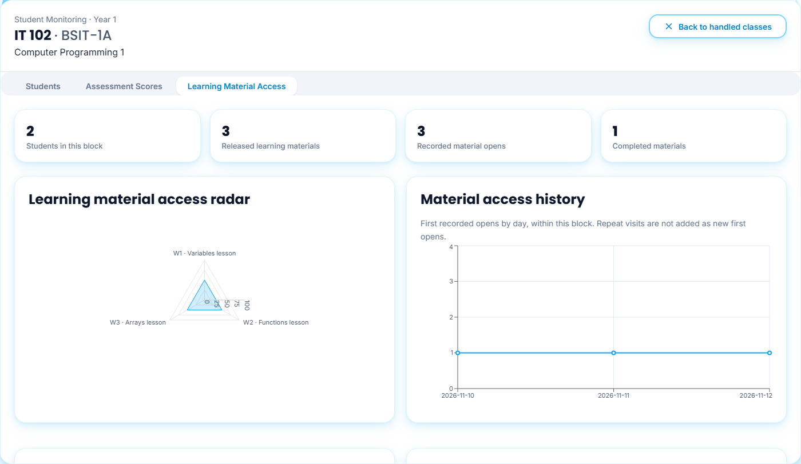
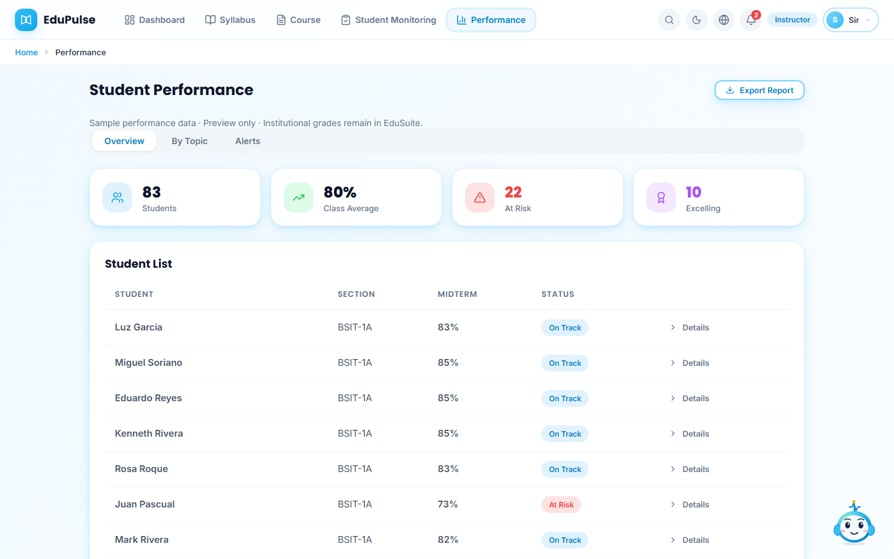
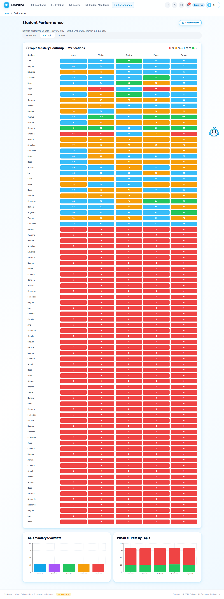
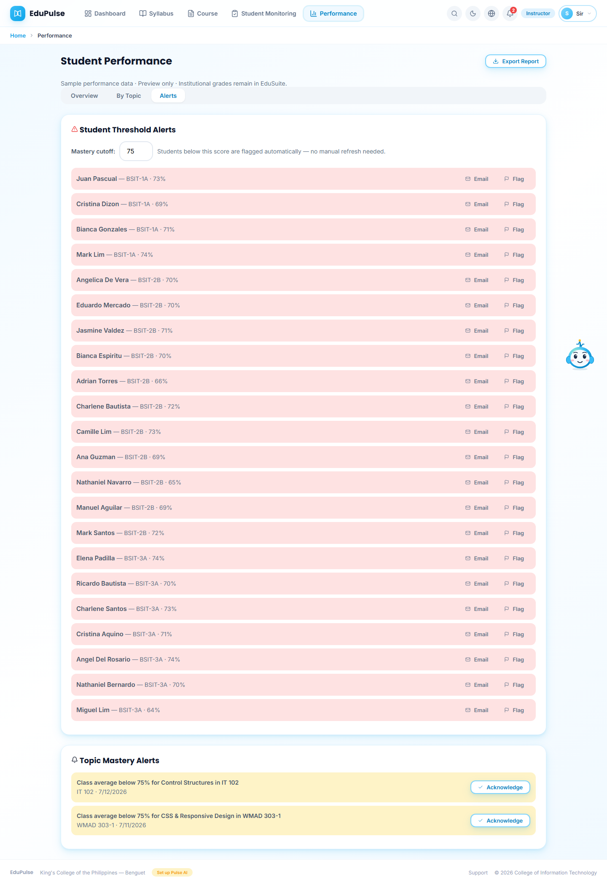

# 04 · Instructor

The [IT seed guide](../../system-manual/18-it-course-seed/README.md) shows the same interface populated with nine course blocks, a revised Programming draft and authored weekly material. Its fictional screenshot identities are separate from the aggregate hosted enrollment evidence.

Main tabs: **Dashboard**, **Syllabus**, **Course**, **Student Monitoring**, **Performance**. Page views use their own tabs. Duplicate left sidebars have been removed. Rows marked *Sample* are built-in examples; the instructor's own syllabi have no label. Task-by-task instructions for the syllabus and courseware flows are in [System Manual 2](../../system-manual/02-syllabus-lifecycle/README.md) and [3](../../system-manual/03-courseware-generation-and-review/README.md).

## 1. Instructor dashboard

- **Getting Started with EduPulse:** four onboarding steps with progress; each opens the right page.
- **Summary cards:** **My Courses** opens **Course**; **Active Syllabi** opens the active-only **My Syllabus** list; **Drafts to Review** and **Published Items** open course lists filtered to courses containing that content. These are keyboard-accessible links, including when a count is zero. [Manual 22](../../system-manual/22-dashboard-summary-navigation/README.md) shows the destinations and **Show all** controls.
- **Quick actions:** **Syllabus Builder**, **Generate Courseware**, **Student Monitoring**.
- **My Block Sections:** advisory blocks with a link to their monitoring page.
- **Score Snapshot**, **Recent Activity**, **My Courses — Syllabus Stations** and the **Courseware Review Queue**.

Signed-in instructor accounts see this same dashboard with their own data: the summary cards, syllabus stations and review queue come from their workspace; block sections, the Score Snapshot and Recent Activity come from their authorized records. An empty account shows zeros and empty-state lines, never these sample values ([account capture](../09-restored-role-pages/README.md#role-dashboards)).

*Changed in v0.4.0:* the Score Snapshot's topic chart averages only the students who have a score for that course (every bar previously showed about 29% because students from other courses were counted as zero) and names the course it shows. The Courseware Review Queue lists only drafts awaiting review, earliest outline week first, shows eight and states how many more there are (**View All** opens them in Courseware). It previously listed every courseware item, which made the dashboard over 16,000 pixels tall.

## 2–4. Syllabus

**My Syllabus** starts with **Upload syllabi** for approved PDF/DOCX copies, whether the list is empty or populated. Scan, view and check the outline, then explicitly select it for the course. The five-station indicator is removed; draft preparation and per-row version/approval/archive actions remain. See [Manual 30](../../system-manual/30-approved-syllabus-intake/README.md).

| Tab | Screenshot | What it holds |
| --- | --- | --- |
| My Syllabus |  | The lifecycle strip (1 Drafted → 2 Checked → 3 Out for Approval → *offline signatures* → 4 Approved — Uploaded → 5 Active) and every syllabus with status, version, extracted outline, the **next step** button for its status, and icons for **View Syllabus**, **Version History**, **Review recorded changes**, **Edit syllabus** for an owned non-sample record (including active; saving returns it to draft), **Copy for next term** and **Archive**. |
| Shared Repository |  | Sample syllabus library by curriculum course. Copy one as your own draft; private workspaces are not shared with other instructors. |

## 5–6. Syllabus Builder

The DOCX/PDF upload area accepts files up to 2 MB. Scanned PDFs use OCR on the device. Review **Extracted Sections Preview** before selecting **Use This Syllabus**. Invalid files show an error with **Try Again**; **Choose Different File** clears the preview. See the [import preview and retry steps](../../system-manual/02-syllabus-lifecycle/README.md#build-the-draft) for captured examples.

The seven-section template. Start by dropping an existing syllabus `.docx` or `.pdf` and accepting its extracted preview, by **Load curriculum outline**, or by selecting a course in Section 1, which auto-fills the locked course information and description. Required fields are marked with an asterisk.

Section 5, **Course Outline**, is the part that later drives courseware: one table with a row per week under a **Midterm** (Weeks 1–9) and a **Finals** (Weeks 10–18) heading, holding intended learning outcomes, topics (**Add Topic**), activities and teaching materials, and assessment details. On a desktop the section is wider than the page column so every column shows at once, and each text field grows to show its whole entry. Weeks 9 and 18 are fixed exam weeks; rows can be reordered with the drag handle and given attachments with the paper-clip.

Pulse can prepare a new syllabus draft for the course selected in Section 1. Its [review card and research-source screenshot](../../system-manual/09-pulse-actions/README.md#generate-a-syllabus-from-the-selected-course) show the editable fields, pending institutional rules and separate apply/save controls. Empty fields do not require an existing syllabus in the library; the instructor reviews all new teaching content.

## 7–8. Courseware

**Course** keeps **Upload syllabi** available above the populated list, and as the action in an empty course list. It opens the approved-file upload area in **My Syllabus**. The single list for active syllabi with status (*Not Started*, *In Progress*, *Complete*), generated/expected item counts, progress and teaching weeks. **Generate** opens an empty course's weekly workspace; **View** opens a course with saved items. The three-dot menu offers the outline and draft-review shortcuts. These preview rows remain sample data.

The weekly workspace combines the former viewing and builder actions. Existing weeks and items show **View**; empty teaching weeks show **Generate**. Three-dot menus contain generation, checking, publication, document/presentation and delivery actions at the relevant course, week or item. **Generate All Content** stays visible on an empty course. When no provider or on-device model is connected, the opened course says **Pulse AI is not set up yet** with **Set up Pulse AI** ([capture](../09-restored-role-pages/47-publication-delivery-settings.png)); a generation that cannot run stays on screen as **Generation did not finish** with its reason and **Dismiss**. The [current task captures](../../system-manual/03-courseware-generation-and-review/README.md) show the populated workspace and menus.

Opened materials and activities display Markdown emphasis as bold or italic text, with formatted lists, tables and code. **AI draft review** follows the final section and references; the assessment editor places it below the questions. The [document and assessment examples](../../system-manual/03-courseware-generation-and-review/README.md) show this order with synthetic saved content. **Edit** retains the original formatting text, and **Save** keeps it for later display.

*Changed in v0.4.0:* the teaching-weeks column is labelled as such (it excludes exam weeks) and counts read “1 week”, “1 item” in the singular.

## 9–10. Student Monitoring

| Tab | Screenshot | What it shows |
| --- | --- | --- |
| Assessment Scores |  | Pick a course; totals for students, missed activities, unopened files and students needing attention; the score grid per student and assessment with *Missed* markers and **Remind**; class average and completion charts. **Export CSV** for the full list. |
| Material Access |  | Which students opened each published material, with reminders for unopened files. |

## 11–13. Performance

The refreshed captures display **Sample performance data · Preview only · Institutional grades remain in EduSuite.** These charts demonstrate the preview persona. Signed-in instructors use the [authenticated records view](../08-authenticated-records/README.md), which reads only owned classes and saved attempts/material opens. It never substitutes these sample scores; empty accounts show **No authorized academic records yet**.

| Tab | Screenshot | What it shows |
| --- | --- | --- |
| Overview |  | Student count, class average, at-risk and excelling counts, and the student list with section, midterm score, status and **Details**. |
| By Topic |  | Mastery per syllabus topic across the instructor's classes. |
| Alerts |  | **Mastery cutoff** (default 75): students below it are listed automatically with **Email** and **Flag**; **Topic Mastery Alerts** for class averages below the cutoff, each with **Acknowledge**. |

## PDF and focused source updates

The builder previews wrapped PDF outline cells and keeps the accepted source available while the builder is open. **Download PDF draft** exports the current form; **Download for Approval** now exports PDF. A focused Pulse panel occupies its own desktop column and can propose corrections to the selected section using that source. The learning document viewer offers **Download PDF**. See the updated [syllabus steps](../../system-manual/02-syllabus-lifecycle/README.md) and [focused correction example](../../system-manual/09-pulse-actions/README.md#correct-the-selected-section-using-its-page-source).

## Restored signed-in sections

Signed-in instructors now have teaching quick actions, saved-work lifecycle/review sections, block summaries and account-derived assessment radar/history. Student Monitoring restores its scoring/access tabs, matrices, charts, filters and CSV; Performance restores its tabs and student detail dialog. These use owned authorized records, with explicit mapped-topic analytics and missing-data states. See the [current account screenshots](../09-restored-role-pages/README.md). Preview mastery illustrations above must not be interpreted as real account scores.

## Approved baseline workflows in signed-in accounts

The [current account guide](../09-restored-role-pages/README.md) includes question-to-syllabus-topic selection, delivery settings, written-response marking, confirmed in-app reminders and saved syllabus versions. Graded mapped responses now drive topic radar/history, heatmaps, status/counters and threshold alerts; historical unmapped responses remain explicit gaps. Generated or revised items still require instructor review before publication. Editing or restoring an active syllabus returns it to draft and withdraws affected publications; signatories remain offline. These workflows require the four new database migrations before hosted use.

## Selected-field drafting and the wider outline

The [Course Outline workspace](../../system-manual/14-pulse-and-outline-workspace/README.md) retains both terms, examination slots, resources and categorized selectors. Filters and an expanded view provide more working space. Move buttons and the grip swap teaching content without reordering calendar labels. Instructors can also target editable syllabus, document, slide or assessment wording with Pulse; previews preserve neighboring fields and existing metadata.

### Course students

**Student Monitoring → Students** contains the course/block roster, **Choose students**, optional **Import an EduSuite class list**, student search and paginated memberships. Three-dot menus provide **Change block** and **Remove from course**, both saved only after confirmation. Accounts and attempt history are retained. See [Manual 21](../../system-manual/21-automatic-records-and-course-rosters/README.md). The Syllabus page has only its three authoring tabs.

## Outline-driven weekly content

The existing Course workspace now derives its expected items from the actual week plan. Full lesson parts assemble into one document; discussion/lab/written guides and interactive assessments are included only when planned. Reviewed and manually authored work remain protected. The [current illustrated task](../../system-manual/26-outline-driven-courseware/README.md) shows a five-topic lesson plus discussion, with evaluation last and no unrequested quiz.

## Returning to an open Course

Course selection, week expansion, item selection and document/presentation preferences remain in the current account/role memory while navigating. Browser focus and reconnect do not reload the workspace. The [cache guide](../../system-manual/27-cached-workspaces/README.md) shows the retained reader and deliberate refresh controls; confirmed saves still use revision protection.

## Readable outline selectors

Week-specific teaching materials and assessment types open a viewport-bounded panel with **Search options...**, category headings, native checkboxes, selected count, **Clear selections** and **Done**. The popup sits outside the table scroll container, and its single list scrolls independently. [Manual 28](../../system-manual/28-outline-selectors/README.md) shows desktop/phone light and dark examples. Free-text activities and assessment details retain their own fields.

## Retained syllabus references

The weekly Course workspace shows a collapsed **Syllabus sources** panel when references are listed. Expand it to read links, attach readable book copies, inspect retained text and manage versions. Private saved copies are reused by generation, while unread references remain explicitly separate from passage evidence. The refreshed weekly screenshot above shows this additional panel; [Manual 31](../../system-manual/31-retained-syllabus-sources/README.md) shows every source state and action.
