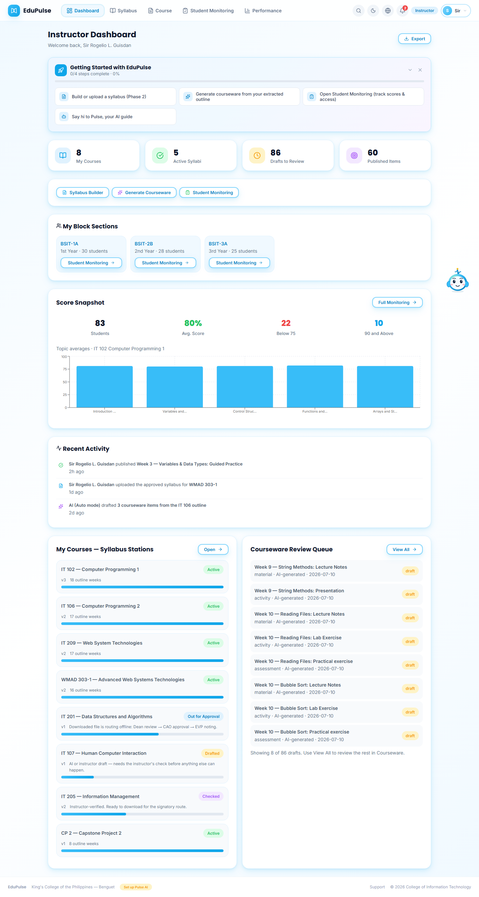
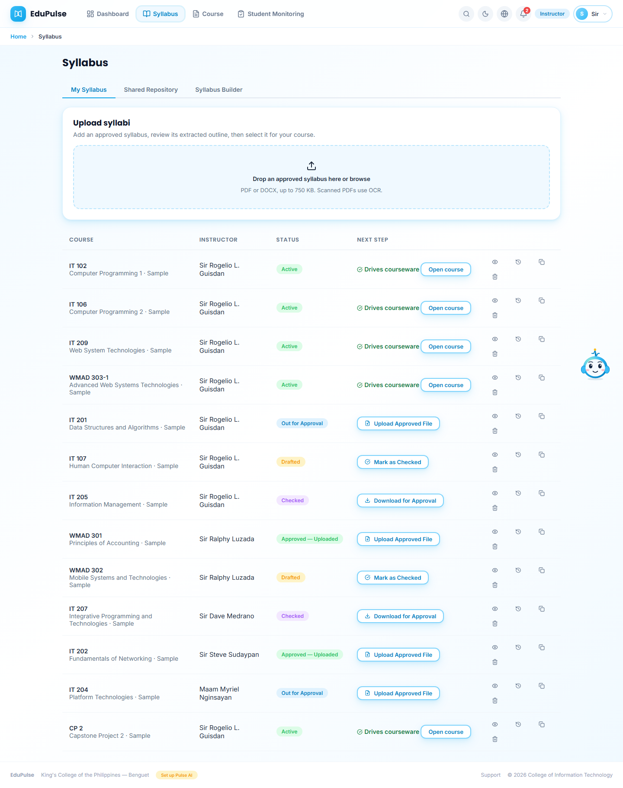
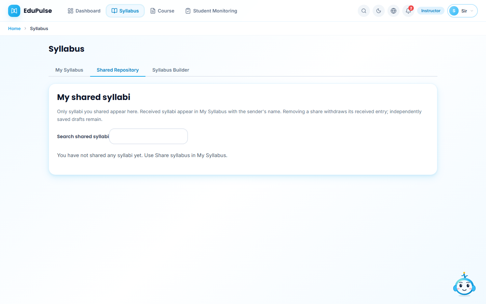
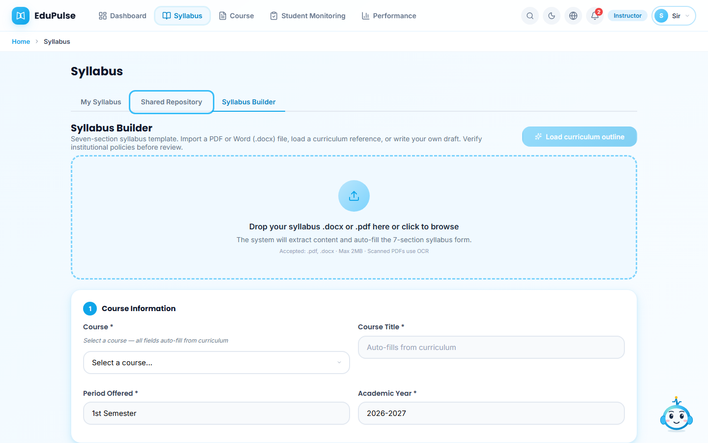
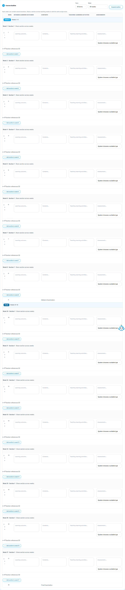
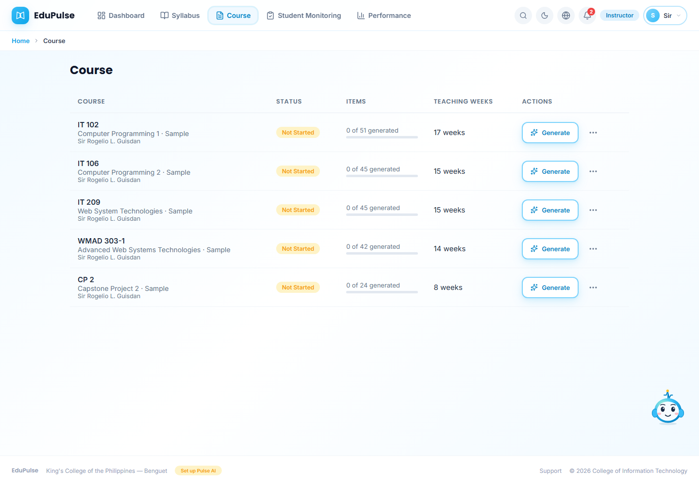
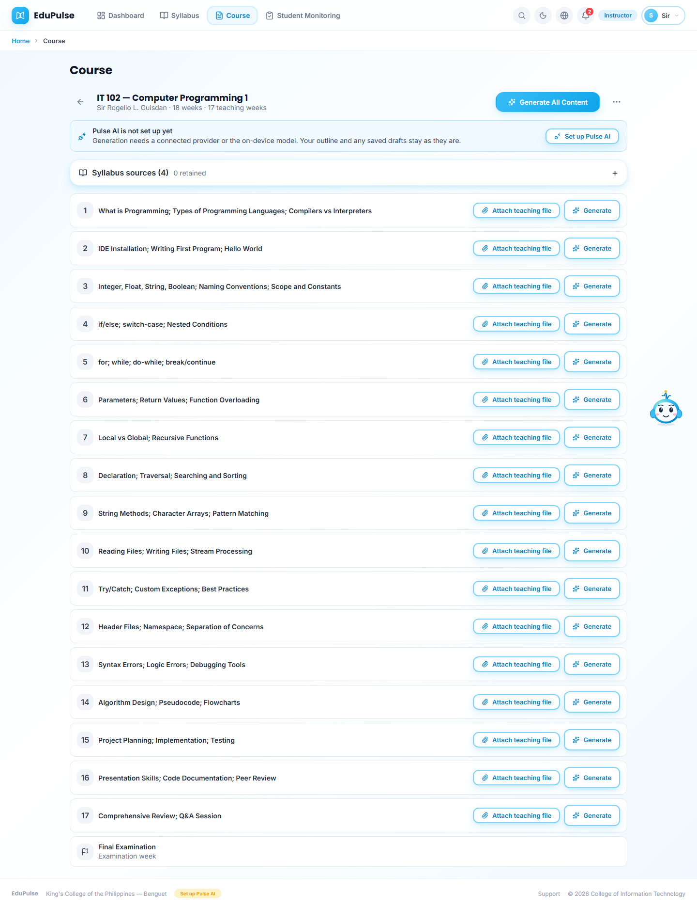
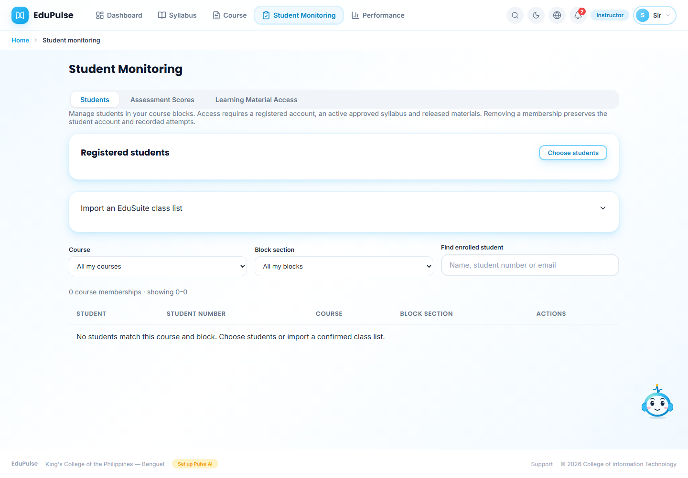
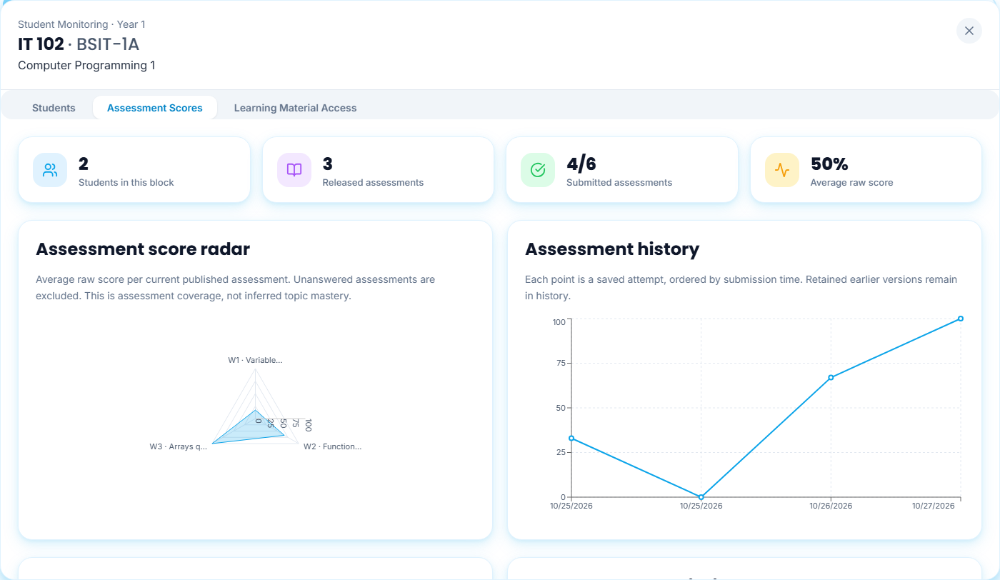

# 04 · Instructor

The [IT seed guide](../../system-manual/18-it-course-seed/README.md) shows the same interface populated with nine course blocks, a revised Programming draft and authored weekly material. Its fictional screenshot identities are separate from the aggregate hosted enrollment evidence.

Main tabs: **Dashboard**, **Syllabus**, **Course**, **Student Monitoring**. Page views use their own tabs. Duplicate left sidebars have been removed. Rows marked *Sample* are built-in examples; the instructor's own syllabi have no label. Task-by-task instructions for the syllabus and courseware flows are in [System Manual 2](../../system-manual/02-syllabus-lifecycle/README.md) and [3](../../system-manual/03-courseware-generation-and-review/README.md).

## 1. Instructor dashboard

- **Getting Started with EduPulse:** four onboarding steps with progress; each opens the right page.
- **Summary cards:** **My Courses** opens **Course**; **Active Syllabi** opens the active-only **My Syllabus** list; **Drafts to Review** and **Published Items** open course lists filtered to courses containing that content. These are keyboard-accessible links, including when a count is zero. [Manual 22](../../system-manual/22-dashboard-summary-navigation/README.md) shows the destinations and **Show all** controls.
- **Quick actions:** **Syllabus Builder**, **Generate Courseware**, **Student Monitoring**.
- **My Block Sections:** each card names its course and block, with a link to that course/block in monitoring.
- **Score Snapshot**, **Recent Activity**, **My Courses — Syllabus Stations** and the **Courseware Review Queue**.

Signed-in instructor accounts see this same dashboard with their own data: the summary cards, syllabus stations and review queue come from their workspace; block sections, the Score Snapshot and Recent Activity come from their authorized records. An account without marked scores shows a clear missing-results state; counts and recorded results come from its own records, never these sample values ([account capture](../09-restored-role-pages/README.md#role-dashboards)).

*Changed in v0.4.0:* the Score Snapshot's topic chart averages only the students who have a score for that course (every bar previously showed about 29% because students from other courses were counted as zero) and names the course it shows. The Courseware Review Queue lists only drafts awaiting review, earliest outline week first, shows eight and states how many more there are (**View All** opens them in Courseware). It previously listed every courseware item, which made the dashboard over 16,000 pixels tall.

## 2–4. Syllabus

**My Syllabus** starts with **Upload syllabi** for approved PDF/DOCX copies, whether the list is empty or populated. Scan, view and check the outline, then explicitly select it for the course. The five-station indicator is removed; draft preparation, offline approval, one history control, sharing and confirmed deletion remain. See [Manual 30](../../system-manual/30-approved-syllabus-intake/README.md).

| Tab | Screenshot | What it holds |
| --- | --- | --- |
| My Syllabus |  | Approved PDF/DOCX upload, a 750 KB retained-file limit, and saved syllabi with status and available row actions; Version and Outline columns are removed. There is no global lifecycle strip. Check the extracted course identity and weekly outline before selecting the approved copy for its course. |
| Shared Repository |  | Only copies this instructor sent. Received copies appear in My Syllabus with the sender name, and can be explicitly saved as an owned draft. Private workspace/source copies stay private. |

## 5–6. Syllabus Builder

The DOCX/PDF upload area accepts files up to 2 MB. Scanned PDFs use OCR on the device. Review **Extracted Sections Preview** before selecting **Use This Syllabus**. Invalid files show an error with **Try Again**; **Choose Different File** clears the preview. See the [import preview and retry steps](../../system-manual/02-syllabus-lifecycle/README.md#build-the-draft) for captured examples.

The seven-section template. Start by dropping an existing syllabus `.docx` or `.pdf` and accepting its extracted preview, or by selecting a course in Section 1, which auto-fills the locked course information and description. The curriculum-outline loading button is removed. After accepting an import, **Upload Different** remains available. Required fields are marked with an asterisk.

Section 5, **Course Outline**, is the part that later drives courseware: one table with a row per week under a **Midterm** (Weeks 1–9) and a **Finals** (Weeks 10–18) heading, holding intended learning outcomes, one multiline Contents field, Teaching-Learning Activities and Assessments for each section. A week may contain several sections, and a section can span teaching weeks. On a desktop the section is wider than the page column so every column shows at once, and each text field grows to show its whole entry. Weeks 9 and 18 are fixed exam weeks; rows can be reordered with the drag handle and given attachments with the paper-clip.

Pulse can prepare a new syllabus draft for the course selected in Section 1. Its [review card and research-source screenshot](../../system-manual/09-pulse-actions/README.md#generate-a-syllabus-from-the-selected-course) show the editable fields, pending institutional rules and separate apply/save controls. Empty fields do not require an existing syllabus in the library; the instructor reviews all new teaching content.

## 7–8. Courseware

**Course** keeps **Upload syllabi** available above the populated list, and as the action in an empty course list. It opens the approved-file upload area in **My Syllabus**. The single list for active syllabi with status (*Not Started*, *In Progress*, *Complete*), generated/expected item counts, progress and teaching weeks. **Generate** opens an empty course's weekly workspace; **View** opens a course with saved items. The three-dot menu offers the outline and draft-review shortcuts. These preview rows remain sample data.

The weekly workspace combines the former viewing and builder actions. Existing weeks and items show **View**; empty teaching weeks show **Generate**. Three-dot menus contain generation, checking, publication, document/presentation and delivery actions at the relevant course, week or item. **Generate All Content** stays visible on an empty course. When no provider or on-device model is connected, the opened course says **Pulse AI is not set up yet** with **Set up Pulse AI** ([capture](../09-restored-role-pages/47-publication-delivery-settings.png)); a generation that cannot run stays on screen as **Generation did not finish** with its reason and **Dismiss**. The [current task captures](../../system-manual/03-courseware-generation-and-review/README.md) show the populated workspace and menus.

Opened materials and activities display Markdown emphasis as bold or italic text, with formatted lists, tables and code. **AI draft review** follows the final section and references; the assessment editor places it below the questions. The [document and assessment examples](../../system-manual/03-courseware-generation-and-review/README.md) show this order with synthetic saved content. **Edit** retains the original formatting text, and **Save** keeps it for later display.

*Changed in v0.4.0:* the teaching-weeks column is labelled as such (it excludes exam weeks) and counts read “1 week”, “1 item” in the singular.

## Student Monitoring: handled classes and performance

Student summaries appear first, then search/year/course filters and year-level categories containing course cards labelled by block section. Select a card to open the full-page class dialog with **Students**, **Assessment Scores** and **Learning Material Access** tabs. Confirmed empty blocks remain visible.

Each tab has its own summary cards. Assessment charts show the selected block's radar, history, average and submission rate. Student rows show starts, submissions, average and progress; a popover breaks down the student's assessments and final raw average. Mapped-topic analytics, instructor marking, cutoff review, acknowledgments and reminders remain under the assessment tab.

Material charts show access radar, first-open history, class access and confirmed first-to-last-section completion, followed by student progress and the filtered roster. Popovers show each material's section progress. Completion requires explicit sequential confirmations in the student's Document reader; an open alone does not establish completion. The instructor's former Performance page is removed; its links redirect here. Student and Dean Performance remain.

The Students tab supports roster edits, directory/file registration, suspension/resumption and removal only after suspension. It changes this course's membership, not the authentication account or official directory profile. Account/assessment/reading history is retained. Course and nested student/roster dialogs restore from bounded references after fresh authorization, without replaying a write. See [Manual 37](../../system-manual/37-instructor-monitoring/README.md) for the complete task and phone captures.

## PDF and focused source updates

The builder previews wrapped PDF outline cells and keeps the accepted source available while the builder is open. **Download PDF draft** exports the current form; **Download for Approval** now exports PDF. A focused Pulse panel occupies its own desktop column and can propose corrections to the selected section using that source. The learning document viewer offers **Download PDF**. See the updated [syllabus steps](../../system-manual/02-syllabus-lifecycle/README.md) and [focused correction example](../../system-manual/09-pulse-actions/README.md#correct-the-selected-section-using-its-page-source).

## Restored signed-in sections

Signed-in instructors now have teaching quick actions, saved-work lifecycle/review sections, block summaries and account-derived assessment radar/history. Student Monitoring combines the instructor scoring, access, topic and follow-up content in a selected course/block dialog. These use owned authorized records, with explicit mapped-topic analytics and missing-data states. See the [current account screenshots](../09-restored-role-pages/README.md). Preview mastery illustrations above must not be interpreted as real account scores.

## Approved baseline workflows in signed-in accounts

The [current account guide](../09-restored-role-pages/README.md) includes question-to-syllabus-topic selection, delivery settings, written-response marking, confirmed in-app reminders and saved syllabus versions. Graded mapped responses now drive topic radar/history, heatmaps, status/counters and threshold alerts; historical unmapped responses remain explicit gaps. Generated or revised items still require instructor review before publication. Editing or restoring an active syllabus returns it to draft and withdraws affected publications; signatories remain offline. These workflows require the four new database migrations before hosted use.

## Selected-field drafting and the wider outline

The [Course Outline workspace](../../system-manual/14-pulse-and-outline-workspace/README.md) retains both terms, examination slots, resources and categorized selectors. Filters and an expanded view provide more working space. Move buttons and the grip swap teaching content without reordering calendar labels. Instructors can also target editable syllabus, document, slide or assessment wording with Pulse; previews preserve neighboring fields and existing metadata.

### Course students

Course rosters now live inside a handled course/block's **Students** tab. **Remove** requires a saved suspension first. Directory selection, file import and explicit revision-checked saves remain. [Manual 37](../../system-manual/37-instructor-monitoring/README.md) supersedes the former unscoped roster steps.

## Outline-driven weekly content

The existing Course workspace now derives its expected items from the actual week plan. Full lesson parts assemble into one document; discussion/lab/written guides and interactive assessments are included only when planned. Reviewed and manually authored work remain protected. The [current illustrated task](../../system-manual/26-outline-driven-courseware/README.md) shows a five-topic lesson plus discussion, with evaluation last and no unrequested quiz.

## Returning to an open Course

Course selection, week expansion, item selection and document/presentation preferences remain in the current account/role memory while navigating. Browser focus and reconnect do not reload the workspace. The [cache guide](../../system-manual/27-cached-workspaces/README.md) shows the retained reader and deliberate refresh controls; confirmed saves still use revision protection.

## Readable outline selectors

Each section offers seven assessment types through one selector, with a system-selected default. The teaching-material selector is removed. [Manual 28](../../system-manual/28-outline-selectors/README.md) shows desktop/phone light and dark examples. Free-text activities and assessment details retain their own fields.

## Retained syllabus references

The weekly Course workspace shows a collapsed **Syllabus sources** panel when references are listed. Expand it to read links, attach readable book copies, inspect retained text and manage versions. The source dialog formats extracted headings, emphasis, lists and tables; **Source details** exposes the original bibliography and checksum. **Download PDF** creates a formatted reading copy, while **Download retained copy** preserves the original. Private saved copies are reused by generation, while unread references remain explicitly separate from passage evidence. The refreshed weekly screenshot above shows this additional panel; [Manual 31](../../system-manual/31-retained-syllabus-sources/README.md) shows every source state and action.

## Progressive outline preparation

The syllabus builder now places validated weekly chunks directly in the requested draft fields while Pulse prepares the next week. Completed fields remain after an interruption. Same-course sequence references still inform generation. Placement preserves unrelated/manual work and does not save or publish. [Manual 34](../../system-manual/34-progressive-outlines/README.md) shows desktop and mobile examples.

## Reference link/file intake

**Syllabus Builder → References** accepts a source link or readable file and lists extracted citation details. Available copies can be viewed and indexed for authorized private search; unavailable metadata stays absent. Saving the syllabus remains explicit. [Manual 35](../../system-manual/35-reference-intake/README.md) shows loading, indexing retry, missing metadata and phone/dark states.

Older saved source listings now show a metadata-only exclusion in **Course ? Syllabus sources**. They remain reviewable but cannot ground a new lesson or enter teaching-content indexing. [Example](../../system-manual/35-reference-intake/README.md#older-retained-listings).

## Saved courseware parts

**Course** shows validated parts in an unfinished read-only preview while generation continues. **Stop generation**, failed content checks and deliberate reload preserve acknowledged parts. **Resume** requests only missing compatible parts. Unfinished drafts cannot be checked or published; older saved work remains intact until complete replacement. [Manual 26](../../system-manual/26-outline-driven-courseware/README.md#save-parts-and-resume) shows the progress, reload, reader, phone and dark states.

## Scoped outline and source-based courseware update

The Course Outline has multiline Contents, Teaching-Learning Activities and Assessments. Each week can contain several sections; shared sections update together across teaching weeks. Seven assessment formats replace the former broad catalog, and the teaching-material dropdown is removed. [Manual 28](../../system-manual/28-outline-selectors/README.md) shows desktop and phone controls. Course groups documents/files under Teaching-Learning Activities and separately lists Assessments. Files can be attached as private drafts; selected generated text opens its retained source basis and an explicit Pulse explanation ([Manual 31](../../system-manual/31-retained-syllabus-sources/README.md)).

## Instructor dashboard and syllabus updates

[Manual 36](../../system-manual/36-instructor-syllabi/README.md) shows course-labelled blocks, recorded assessment rows, the single history dialog, confirmed deletion and actual sender/recipient sharing. Its controlled account captures complement the preview role screens above. Short tables fit their containers; wide matrices scroll only when needed.

### Targeted syllabus drafting

Pulse resolves **Week 1 Section 1** against the mounted outline. Validated values are placed directly; optional Review changes shows before/now content, including shared changes across linked teaching weeks. [Manual 38](../../system-manual/38-targeted-outline-edits/README.md) contains current desktop and phone captures. Generation does not save; explicit Save as Drafted and revision checks remain required.

## Directly authored Weeks 1–5

[Manual 39](../../system-manual/39-authored-weeks/README.md) shows original Java teaching text, three Draft items per week, phone reading and the direct-authoring disclosure. The saved packs require instructor checking and normal publication; written responses require marking. Newly filled draft syllabi retain their offline approval path. No source-support percentage, paid-provider run or learner activity is invented.

The Syllabus page no longer displays the **Confirmed course loads** summary. Its tabs and upload/builder controls remain; assigned course loads and roster matching are unchanged.

Instructor assessment and teaching-material editors use wider screen containers (up to 1200 px) and growing multiline fields. Questions, options, material headings, slide headings and slide points wrap without clipping. Long bodies retain their auto-growing fields. Presentation editing scrolls vertically for longer slides. Document reading, PDF export and print page sizing remain unchanged.

## Primary teaching set and practice delivery

The primary **My Syllabus** list contains four own entries and two complete drafts, with two received entries under **Shared with me**. **Show all syllabi** reveals the remaining assignments. Prepared content for nonactive owned syllabi is visible under **Course**, labelled **Awaiting syllabus approval**, with publication disabled. [Manual 40](../../system-manual/40-teaching-sets/README.md) shows the list, complete-draft fields, received sender labels and phone view. The separately authorized live demonstration uses Pipeline test provenance; later assessments remain available for manual trials.

Dashboard entry, reload and **Refresh records** read the current authorized snapshot without running a workspace synchronization command. Saved workspace changes still project normally. See the [read-only dashboard example](../../system-manual/23-account-support-and-pulse-context/README.md#dashboard-loading).

Student Monitoring uses the bounded saved allocation: 5-10 course/block classes per named active instructor, with distinct enrolled-student totals. This corrects generated assignments in the database rather than limiting displayed cards. [Manual 37](../../system-manual/37-instructor-monitoring/README.md#bounded-teaching-assignments) shows the desktop and phone examples.

### Reference continuation repair and catalog search

The course **Syllabus sources** panel separates readable retained text from catalog-only records. **Search and read sources** processes books and links one at a time, retaining results and indexing readable text. Titles wrap; author/year/publisher fields are separated. The original imported citation and year discrepancies remain inspectable; catalog metadata is excluded from generated-content evidence. See [the repaired reference and formatted review captures](../../system-manual/31-retained-syllabus-sources/README.md#repaired-citations-and-online-lookup).

## Shared syllabus adoption and safe removal

My Syllabus now selects registered instructors from a dropdown. Received copies offer **Use as draft** and **Use approved copy** with explicit acknowledgment and a matching retained approved file. **Suspend syllabus** precedes **Delete syllabus**; Resume does not republish content. Version History and Copy for next term are removed. [Manual 36](../../system-manual/36-instructor-syllabi/README.md) shows the current desktop/phone actions and reload behavior.

The later owner correction caps student subjects instead of instructor classes. The previous 5-10-class instructor ceiling is superseded; current classes can exceed ten while maintaining the 35-student block maximum. Monitoring uses the saved allocation and retains labelled demonstration activity for every student. Independent student results stay separate from self-practice. [Current guide](../../system-manual/41-student-learning/README.md).

Test badges, the activity-origin selector and the Activity column are removed from score/access monitoring and review choices. Saved values and current/earlier versions remain; audit provenance stays stored. [Current progress guide](../../system-manual/33-pipeline-progress/README.md).

## Direct syllabus draft workspace

Validated generated syllabus fields are placed directly in the mounted builder; **Review changes** is optional. **Open editable syllabus** resolves an owned saved target, and **Save as Drafted** stays in the builder. Explicit weeks override stale field selections; **Week 2 then** and **Complete remaining weeks** continue the same syllabus task. Checking, approval, activation and publication remain separate. [Manual 42](../../system-manual/42-editable-syllabus-workspace/README.md) shows desktop/phone captures and reload boundaries.

## Monitoring consistency and independent progress

Student Monitoring uses the Dashboard SummaryCard component for its hub and each class tab. Cards lead to the relevant memberships, charts, delivery status or course; the roster uses three-dot menus for short Edit/Suspend/Resume/Remove actions. These menus and filters restore against the current authorized class without replaying writes. Assessment and access statistics exclude scripted/Admin demonstrations. An unreleased or Checked syllabus explains why delivery is not active, while genuine missing results stay unrecorded. [Current controls and status examples](../../system-manual/37-instructor-monitoring/README.md).
