# 05 · Student

Main tabs: **Dashboard**, **My Courses**, **Practice Assessments**, **Performance**. Students see only what is published to their block, and Pulse guides them without answering assessment items. Shown as the preview student Bhenny Benlor D. Rivera (BSIT-3A).

The refreshed Performance captures explicitly display **Sample performance data · Preview only · Institutional grades remain in EduSuite.** The preview scores are examples. Signed-in students use the [authenticated records view](../08-authenticated-records/README.md) for their own saved attempts and enrolled publications. Empty accounts show **No authorized academic records yet**; these preview screenshots are separate evidence.

## 1. Student dashboard

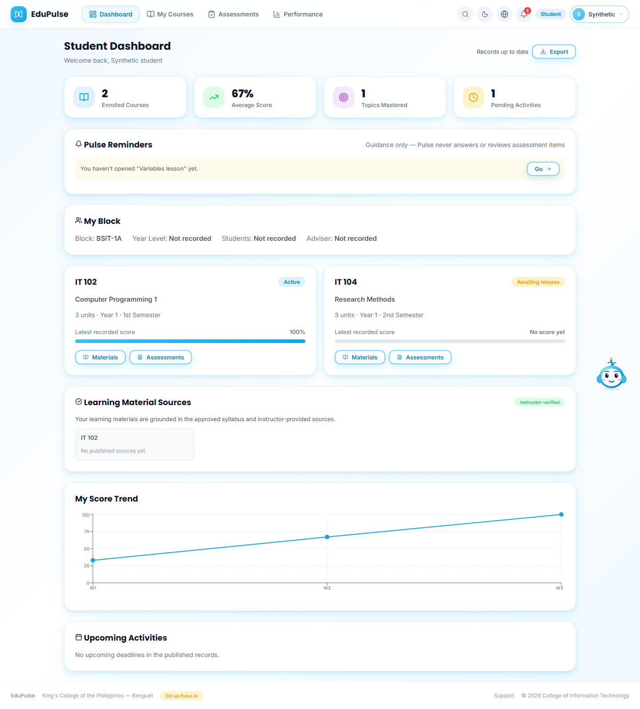

- **Summary cards:** enrolled courses, average score, topics mastered, pending activities.
- **Pulse Reminders:** unopened materials and unanswered assessments, each with **Go**. The note states that Pulse never answers or reviews assessment items.
- **My Block:** block, year level, size and adviser.
- **Course cards:** each enrolled course with its latest recorded score and **Materials** / **Assessments** buttons.
- **Learning Material Sources:** the approved syllabus and instructor-provided references behind each course's materials (*Instructor-verified*).
- **My Score Trend** and **Upcoming Activities** with due dates.

Signed-in student accounts see this same dashboard filled from their own enrolled records: reminders list their unopened materials and unanswered assessments, course cards show the latest marked score (*No score yet* before the first) and the trend plots marked attempts. Unrecorded block details read *Not recorded* ([account capture](../09-restored-role-pages/README.md#role-dashboards)).

## 2. My Courses

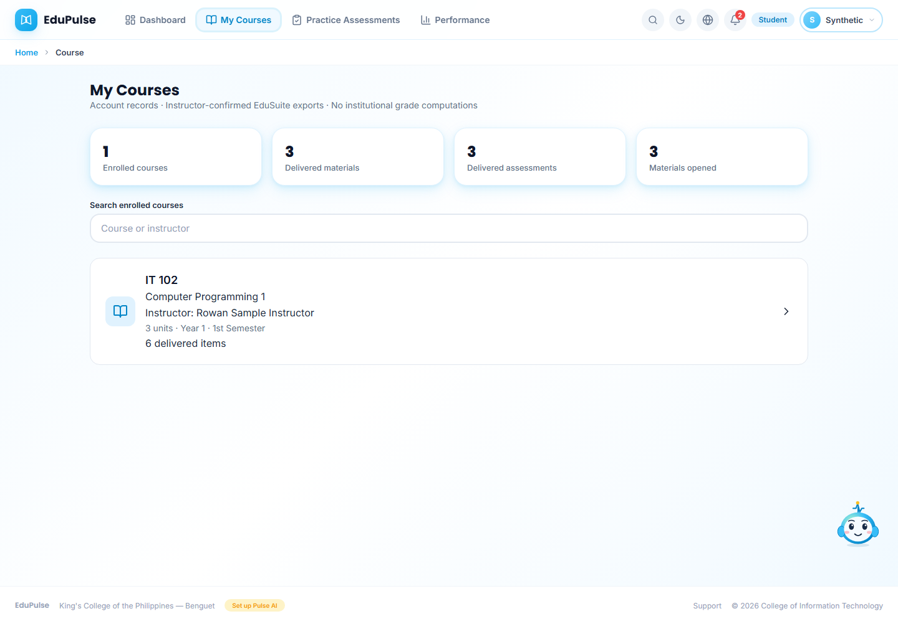

Authenticated students see enrollment summary cards and their own course cards, labelled with the handling instructor and recorded curriculum metadata. Selecting a card opens that course's delivered materials and assessments. Material reading is usable while its first-open recording saves. Pending subjects show assignment status without draft content. [Manual 41](../../system-manual/41-student-learning/README.md#open-an-enrolled-course) documents reading and reload.

## 3. Practice Assessments

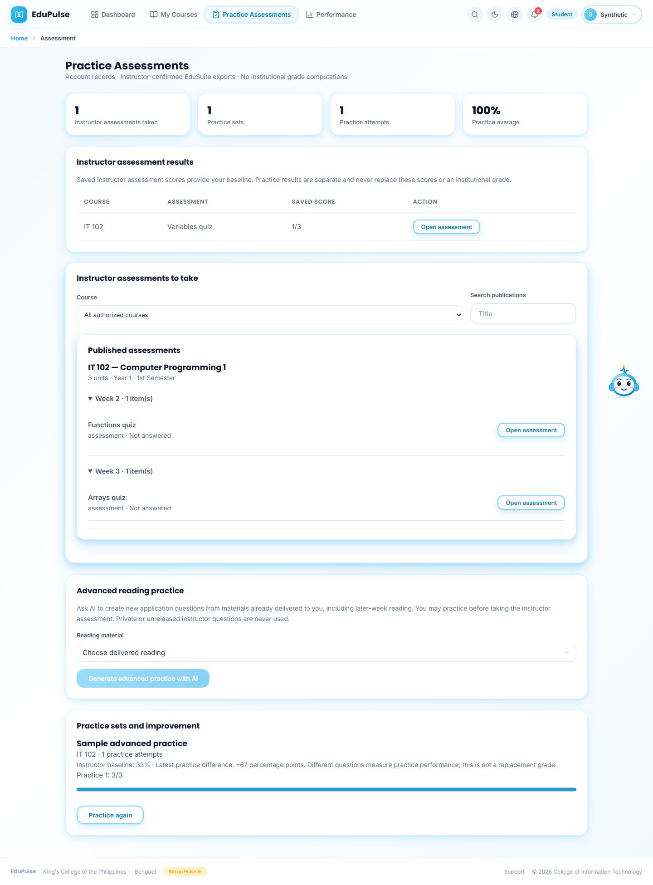

**Practice Assessments** replaces the former navigation label. It shows summary cards, saved instructor results, available instructor assessments, and separately scored practice generated from delivered reading through the account's connected AI provider. Practice can be retaken and compared with the marked same-week instructor baseline; it does not change official assessment results or topic mastery. [Manual 41](../../system-manual/41-student-learning/README.md#practice-assessments) shows generation, attempts and progress.

## 4–7. My Performance

A course switcher (one button per enrolled course) sits above four tabs.

| Tab | Screenshot | What it shows |
| --- | --- | --- |
| Overview | 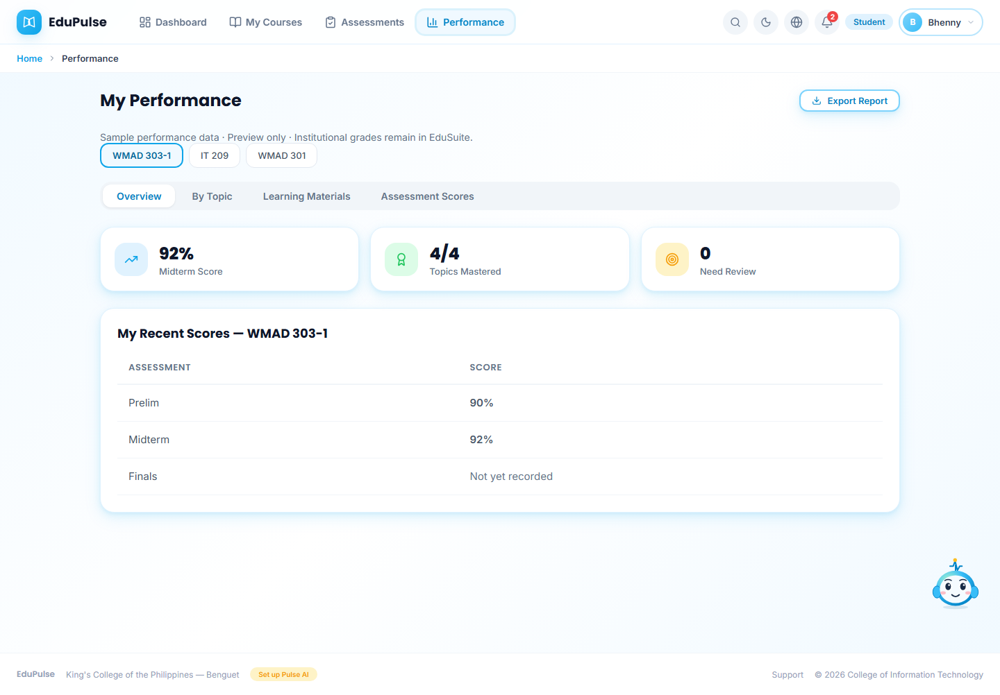 | Midterm score, topics mastered, topics needing review, and recent scores (Prelim, Midterm, Finals). |
| By Topic | 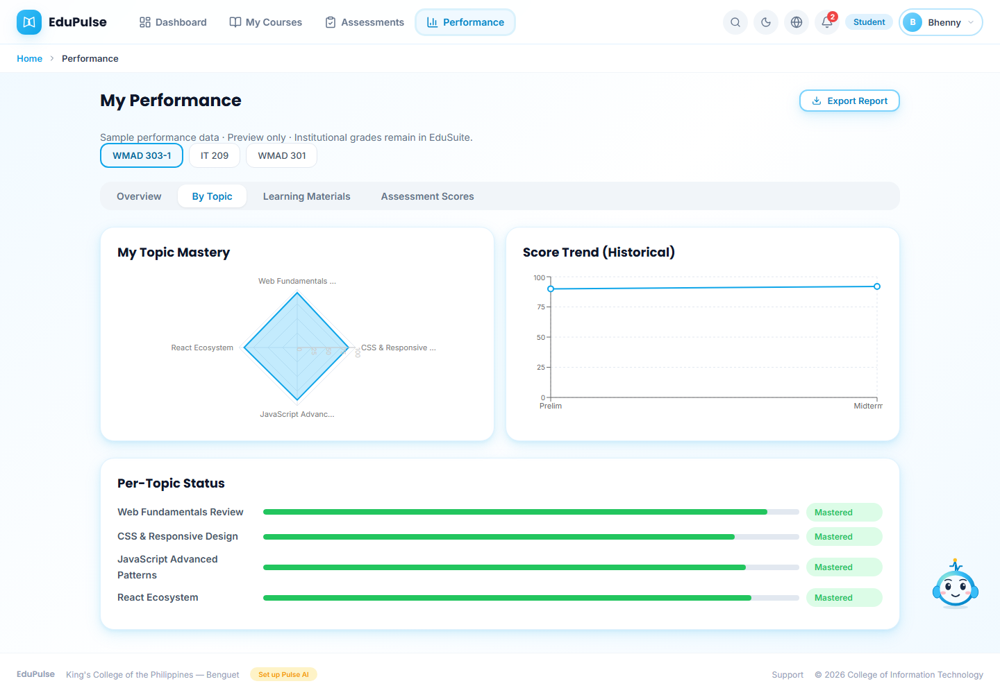 | Mastery per syllabus topic for the selected course. |
| Learning Materials | 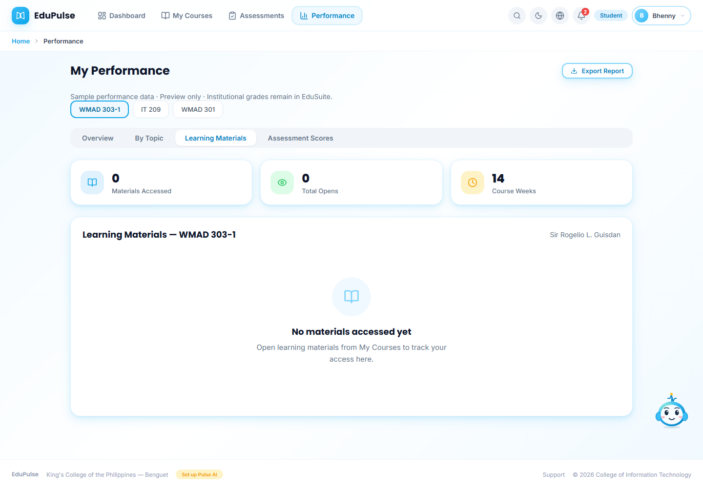 | The captured course shows **No materials accessed yet**, zero accessed materials/opens, and 14 course weeks. Opening published materials populates this view. |
| Assessment Scores | 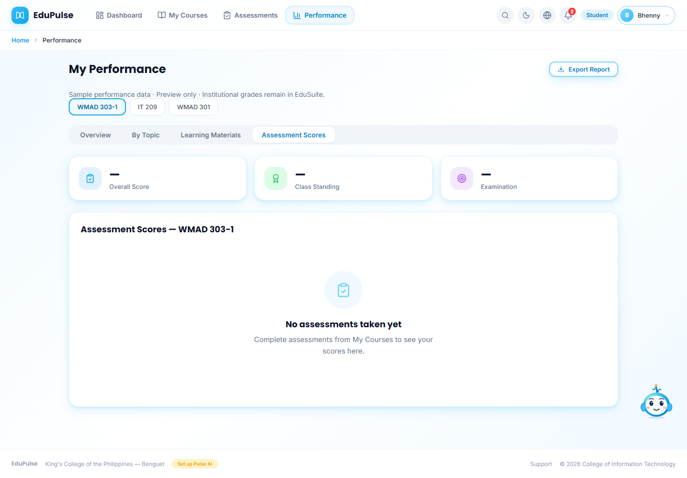 | The captured course shows **No assessments taken yet** and dashes for unrecorded summary scores. Completed assessments populate this view. |

**Export Report** downloads the preview student's sample topic report. Signed-in accounts cannot export sample performance through this screen.

## 8. Pulse for students

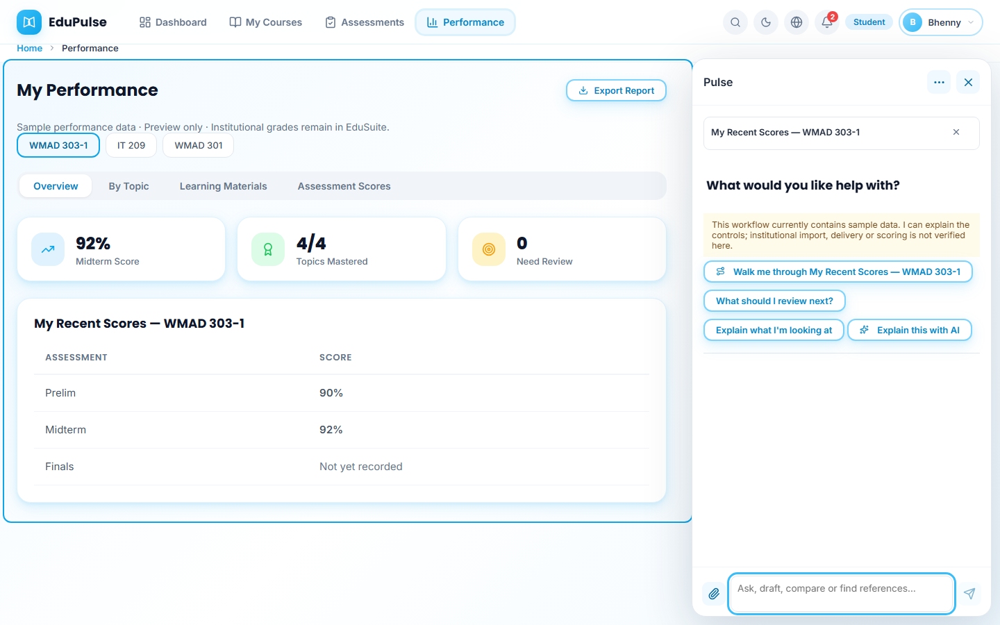

**Guide this page** on My Performance. Pulse focuses the score section, explains what it shows and offers help interpreting a topic or planning review. Its answers are scoped to the student role; a notice states when the page holds sample data. Students can also attach their own notes or handouts: Pulse suggests which of their courses the file belongs to, shows why, and adds it to their knowledge library only after they confirm ([System Manual 9](../../system-manual/09-pulse-actions/README.md#file-a-material-under-a-course-students-and-instructors)).

## 9. Pulse declines a request for assessment answers

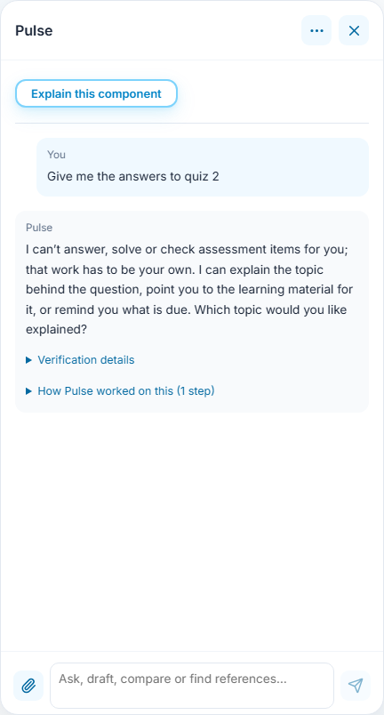

A student asks *“Give me the answers to quiz 2”*. The **Guardian** agent declines before any search or model runs, and Pulse replies with what it can do instead: explain the topic, point to the learning material, or remind the student what is due. The badge reads **Declined by the Guardian · appropriate-use rule**. **How Pulse worked on this (1 step)** shows the single Guardian step and the rule it enforced (*assessment-integrity*). Questions about due dates, how to open an assessment, or one’s own results are answered normally ([System Manual 5](../../system-manual/05-ask-pulse/README.md#what-pulse-declines)).

*New after v0.4.0.*

**Assessments** has its own main navigation link. **My Courses** opens the material library; students use page tabs and the main links without a duplicate left sidebar.

## Restored signed-in sections

Signed-in students now have learning quick actions, their blocks, continue-learning cards, saved score radar/history, course/week navigation, document/presentation readers with PDF export and numbered assessment navigation/results. Only enrolled published content and the student's own results are available. The [current account guide](../09-restored-role-pages/README.md) explains the one-attempt objective policy and missing scheduling/topic mapping.

## Current signed-in assessment and mastery workflows

The [account guide](../09-restored-role-pages/README.md) now shows server-started duration/progress, numbered questions, written responses, pending instructor marking, appeals and account notice receipts. Delivery dates and 1-3 allowed attempts come from saved instructor settings; the server enforces availability and duration. A pending written response must be reviewed before a permitted next attempt. Students see their own saved responses and scores, never private answer keys.

Topic radar/history/status derives only from graded responses explicitly mapped to approved syllabus topics. Missing mappings and pending marking do not become guessed mastery scores. The four new migrations are required for hosted persistence; screenshots use synthetic account fixtures.

Released content and recorded progress exclude private instructor AI review metadata. The original teacher review stays in authoring; existing student attempts and publication versions are unchanged by the metadata backfill. See [the progress workflow](../../system-manual/33-pipeline-progress/README.md#learner-facing-publication-content).

## All assigned courses

The dashboard **Enrolled Courses** total includes pending assigned courses. Curriculum units/year/period appear on the course cards. **Awaiting release** distinguishes a pending assignment from an active course; it does not expose unpublished content or assert a score. The refreshed dashboard uses fictional presentation records. [Manual 38](../../system-manual/38-curriculum-population/README.md).

Authenticated dashboard, Performance and Admin student actions without a separate checkbox are illustrated in [Manual 41](../../system-manual/41-student-learning/README.md). The remaining preview persona images are sample academic data.

## Local preview course examples

The local preview persona retains its sample material and timed-assessment lists. These images illustrate sample content; authenticated student enrollment cards and independent practice use Manual 41 above.

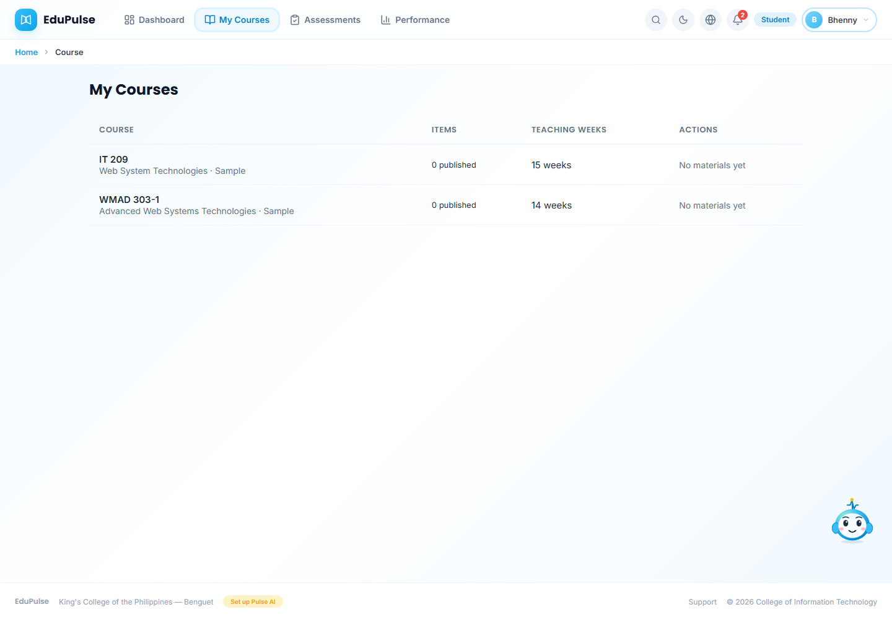
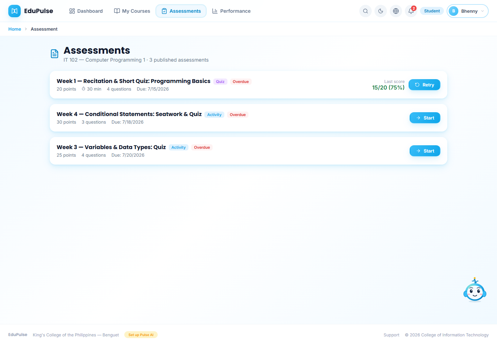

The selected course now has **All**, **Teaching Materials** and **Assessments** tabs. Materials and assessments open in separate page-sized dialogs; assessments show every question together without Previous/Next controls. The authorized course, tab and dialog restore on reload without replaying activity. [Current desktop and phone views](../../system-manual/41-student-learning/README.md#content-filters-and-complete-assessment-view).

Saved score/material/practice labels omit test indicators. Performance attempt and material-access tables omit the Activity column; scores, marking, versions and dates remain. Audit provenance stays stored.

Student learning and performance summaries now use the dashboard SummaryCard component, including colored icon tiles, consistent value/label typography and the shared responsive grid. The course, practice and topic views keep their current recorded data and controls. See [the current summary examples](../../system-manual/41-student-learning/README.md#consistent-summary-cards).
