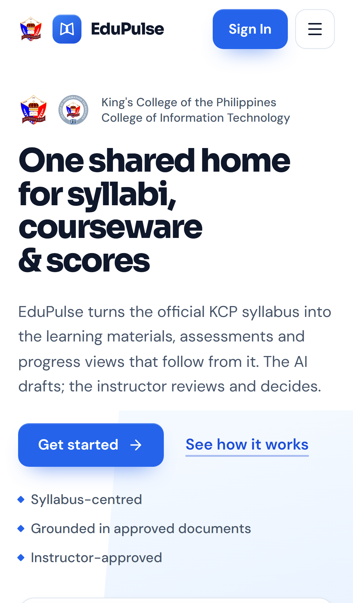
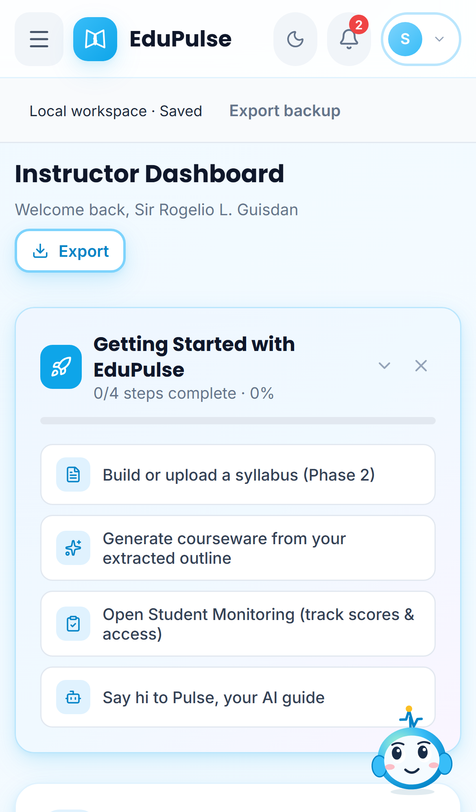
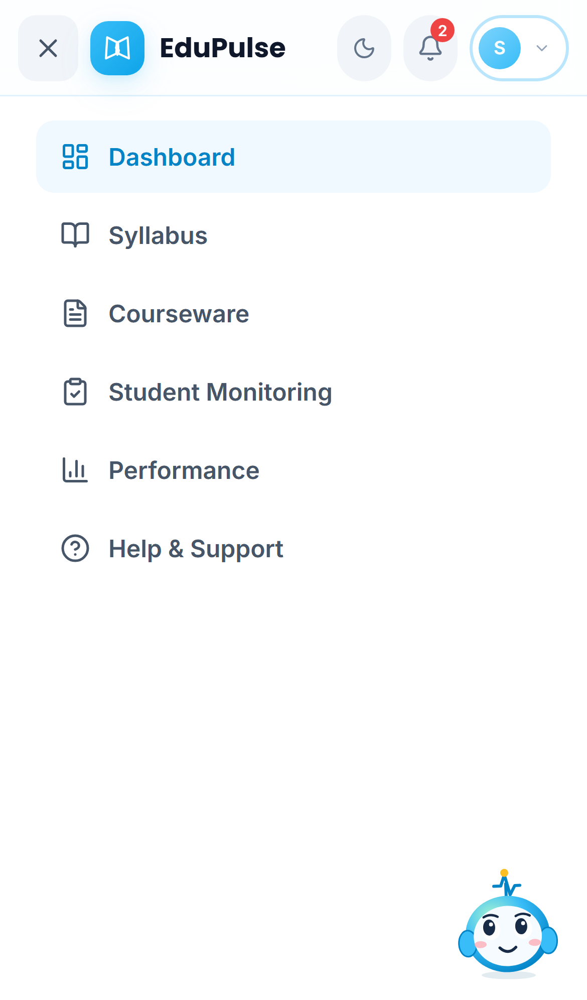
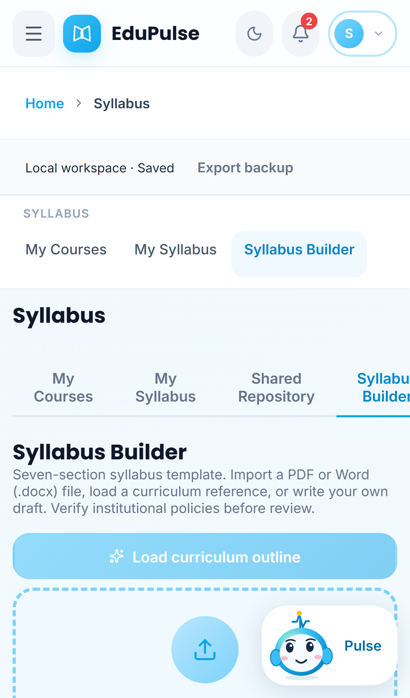
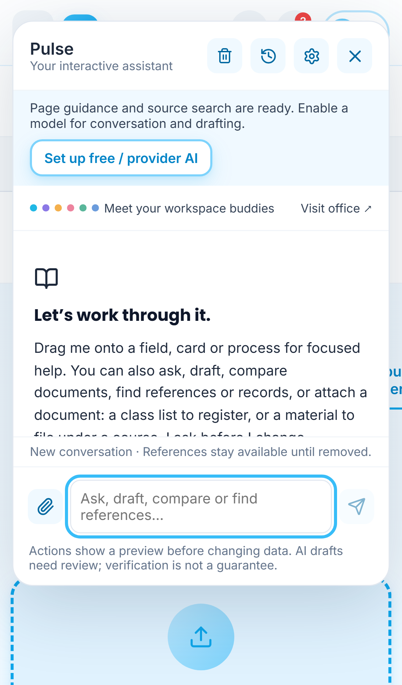
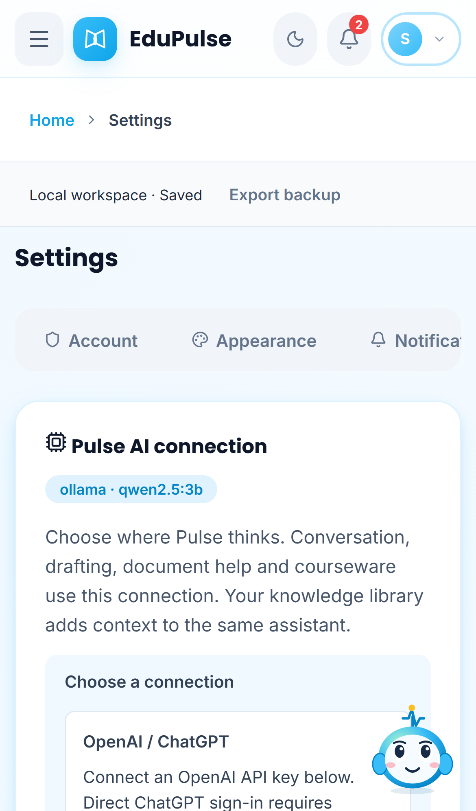
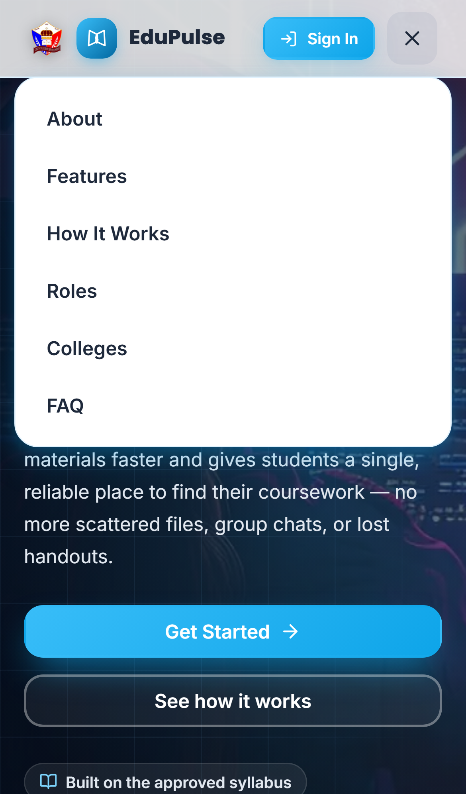

# 06 · Mobile (390 px)

The same application on a phone-sized screen (iPhone 13 viewport, captured at 3× pixel density). Nothing is hidden behind a separate mobile app; the layout reflows.

The mobile recaptures record the mobile suite centrally in [capture-run evidence](../../capture-runs/README.md). In the visible Pulse state, page guidance and source search are ready while conversation/drafting requires model setup. **Set up free / provider AI** opens connection settings. The settings image shows **Pulse AI connection**, **Set up Pulse AI** and the first **OpenAI / ChatGPT** connection choice. Claude, OpenRouter and the provider selector continue below this viewport. [Manual 8](../../system-manual/08-ai-connections/README.md) includes the full mobile connection card with a synthetic saved credential and model-test controls.

| # | Screenshot | What changes on a phone |
| --- | --- | --- |
| 1 |  | The landing hero stacks in one column: crest, logo, **Sign In** and the round ☰ menu button in the bar, then the KCP crest and CIT seal (the institution name is left out on phones), the headline, the summary, **Get started** and **See how it works**, and the first note. The arch photograph and its caption follow below the screen. Every later section also stacks in one column, and the phase timeline runs down the left. Captured with reduced motion, as on the desktop (see [01 · Public site](../01-public-site/README.md)). |
| 2 |  | The top bar keeps the menu button, logo, dark-mode, notifications and account; the other tools move into the menu. The role badge is not shown on a phone. The account menu shows the role, and for the owner admin it also offers **Switch view**. Cards stack in one column and the Pulse dock stays bottom-right. |
| 3 |  | **Open menu** (☰) shows the role's tabs; Help & Support and Keyboard Shortcuts are in Settings; the button becomes **Close menu** (×). |
| 4 |  | Page sub-views appear as a horizontal strip under the breadcrumb, and every control is at least 44 px tall for touch. |
| 5 |  | The Pulse panel uses the screen width and hides the dock while open; dragging Pulse works with touch (see [System Manual 7](../../system-manual/07-pulse-guidance/README.md)). |
| 6 |  | Settings tabs scroll sideways; the AI connection, pipeline and knowledge library cards stack. |
| 7 |  | On the landing page, **Open menu** (☰) drops a card listing **Why EduPulse**, **Features**, **How It Works**, **Roles**, **Impact**, **Colleges** and **FAQ** in large serif type. The bar turns frosted, **Sign In** turns dark and the menu button becomes **Close menu** (×). Choosing a link, pressing Escape or **Close menu** closes it. |

*Changed in v0.4.0:* the breadcrumb no longer splits “Home” and the current page onto different lines (the 44 px touch-target rule had made the link taller than its row), and the menu button announces whether it opens or closes the menu.

## Pulse context controls

The mobile Pulse panel retains its bottom-sheet layout. **Pulse options** opens **Conversations and memory**, guidance, workspace buddies and AI settings. The conversation has a compact selection chip and no persistent technical footer. Focused help uses a shorter panel, and the page remains scrollable above it. Edit previews and history scroll inside the panel. See [Manual 9](../../system-manual/09-pulse-actions/README.md) for the same confirmed actions and memory controls.

## Workspace buddies

Open **Pulse options → Workspace buddies**. The optional 3D office has six named desks, domain-specific conversations, real request/review states, a pause control and reduced-motion support. Mobile users scroll from the office to the buddy chat. See [the illustrated office guide](../../system-manual/11-workspace-buddies/README.md).

Unique page destinations stay in the main navigation: **Records** for Dean/Associate Dean and **Assessments** for students. Mobile users find the same links under **Open menu**. Page tabs provide subviews without duplicate left navigation.

## Restored account pages on phones

Account charts stack, Performance/Monitoring tabs scroll and wide score/material matrices stay within their own scroll region. Shared dark surfaces use solid fills. See the [three current mobile captures](../09-restored-role-pages/README.md#dark-and-mobile-views).

## Restored mobile account workflows

The [current account guide](../09-restored-role-pages/README.md) adds mobile topic radar/history/heatmap and confirmed loading proposals, alongside the earlier performance, reader and solid-dark dashboard scenes. Filters and proposal forms stack; wide data matrices scroll within their panels. These scenes use synthetic role fixtures rather than real institutional records.

The [current mobile field, outline and Settings examples](../../system-manual/14-pulse-and-outline-workspace/README.md#smaller-screens) show selected-field proposals, a horizontally scrollable table and the new Settings tabs.
