# 06 · Mobile (390 px)

## Sign-in icons

The password eye is a 44-pixel touch control at the right of the field. **Show password** reveals the entered value; **Hide password** masks it without submitting or clearing it. The Google mark remains beside **Sign in with Google**, including while that action is disabled during sign-in. These component crops hide the fixed public bar and capture-only preview controls; their example input and authentication transport are synthetic.

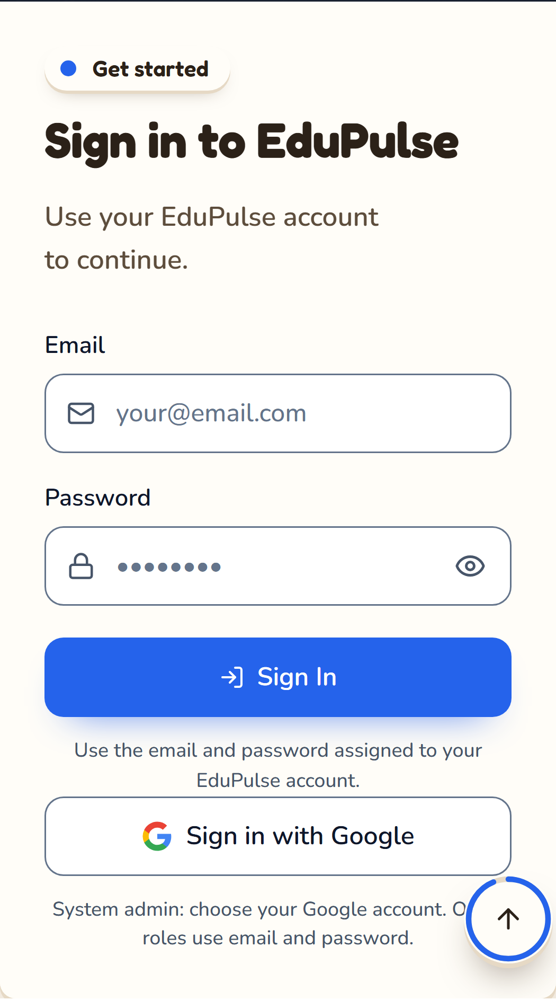

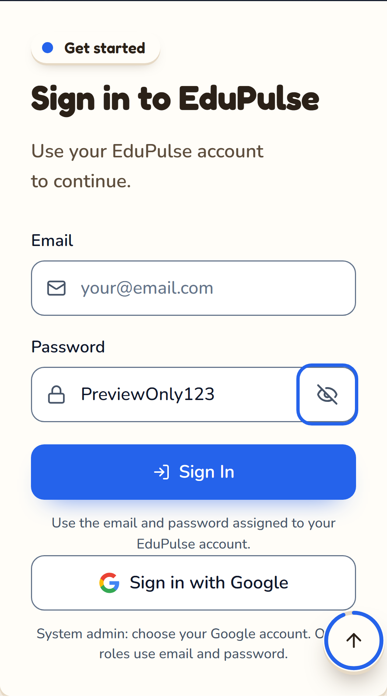

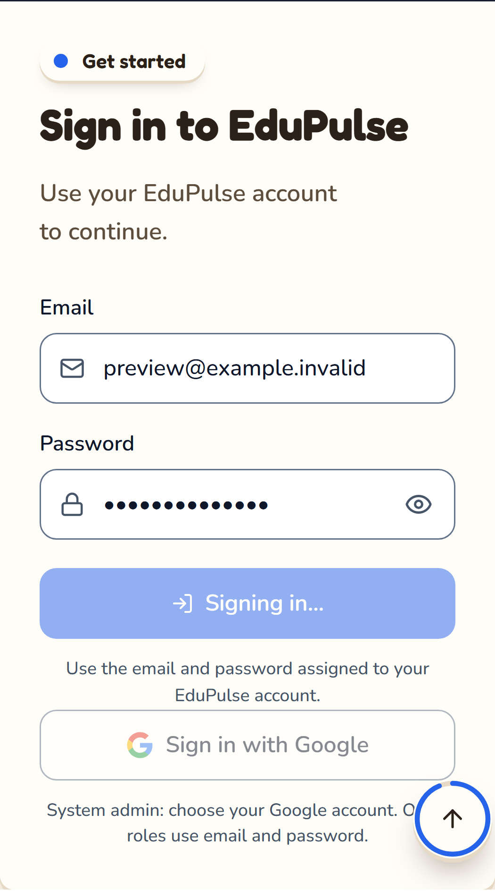

An admin-selected student remains selected after browser reload on a phone. Authorization runs before the academic view reopens; service failure retains the current URL with retry and explicit admin-exit controls. See the [mobile restored view and recovery captures](../../system-manual/23-account-support-and-pulse-context/README.md#reload-the-selected-account-without-returning-to-dashboard). The mobile navigation surface also reopens after reload and closes when a destination is chosen.

The same application on a phone-sized screen (iPhone 13 viewport, captured at 3× pixel density). Nothing is hidden behind a separate mobile app; the layout reflows.

The Syllabus Builder header no longer contains the curriculum-outline loading button. Its upload area remains the entry point for PDF/DOCX import; **Upload Different** appears after accepting a file.

The instructor's four summary cards are tappable links. [Manual 22](../../system-manual/22-dashboard-summary-navigation/README.md#keyboard-dark-mode-and-mobile) shows their mobile layout and the draft-course destination, including **Show all courses**.

The mobile recaptures record the mobile suite centrally in [capture-run evidence](../../capture-runs/README.md). In the visible Pulse state, page guidance and source search are ready while conversation/drafting requires model setup. **Set up free / provider AI** opens connection settings. The settings image shows **Pulse AI connection** with compact provider logos, names and **Connect** actions, including **Gemini**. The provider selector and pipeline continue below the viewport. [Manual 8](../../system-manual/08-ai-connections/README.md) shows the full connection card.

| # | Screenshot | What changes on a phone |
| --- | --- | --- |
| 1 |  | The home page hero stacks in one column: the EduPulse logo, the sun and moon switch, the blue **Sign In** button and the ☰ menu button in the bar, then the institution name on two lines, the headline on three lines, **Get started** and **See how it works**, and the emblem: the blue ring around the KCP crest and the CIT seal. The KCP building picture shows along the bottom. Every later section also stacks in one column. Captured with reduced motion, as on the desktop; with motion, the 3D school stays behind the page while the sections scroll in front of it (see [01 · Public site](../01-public-site/README.md)). |
| 2 | 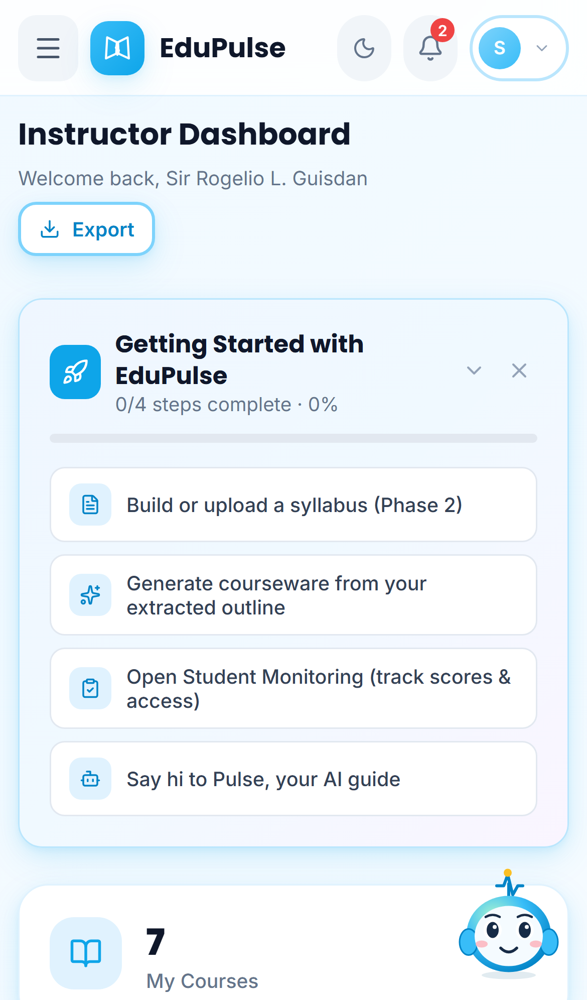 | The top bar keeps the menu button, logo, dark-mode, notifications and account; the other tools move into the menu. The role badge is not shown on a phone. The account menu shows the role, and for the owner admin it also offers **Switch view**. Cards stack in one column and the Pulse dock stays bottom-right. |
| 3 | 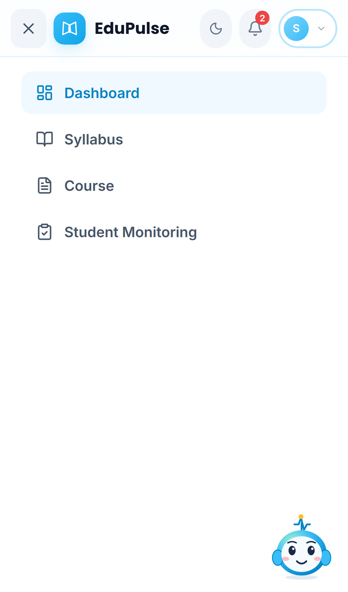 | **Open menu** (☰) shows the role's tabs; Help & Support and Keyboard Shortcuts are in Settings; the button becomes **Close menu** (×). |
| 4 | 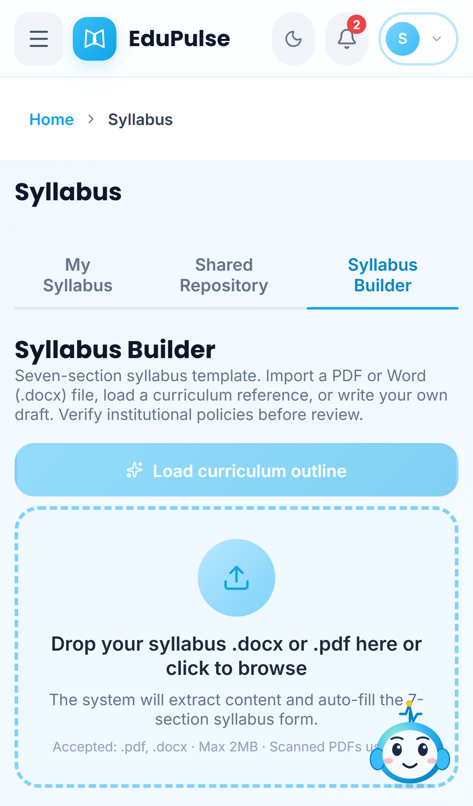 | Page sub-views appear as a horizontal strip under the breadcrumb, and every control is at least 44 px tall for touch. |
| 5 | 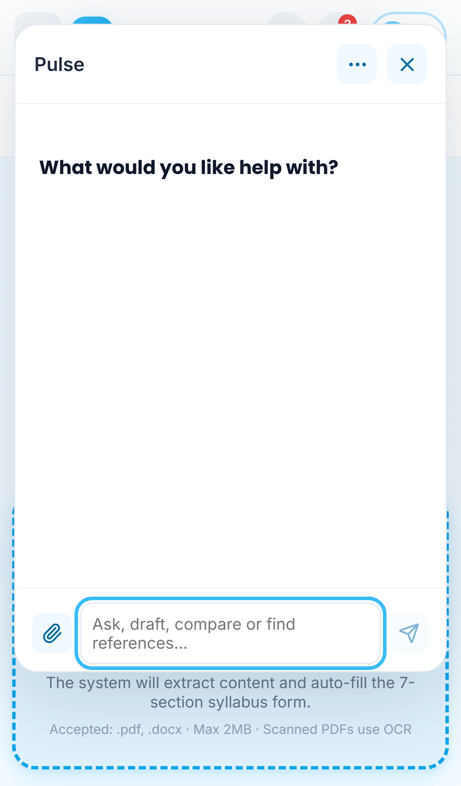 | The Pulse panel uses the screen width and hides the dock while open; dragging Pulse works with touch (see [System Manual 7](../../system-manual/07-pulse-guidance/README.md)). |
| 6 | 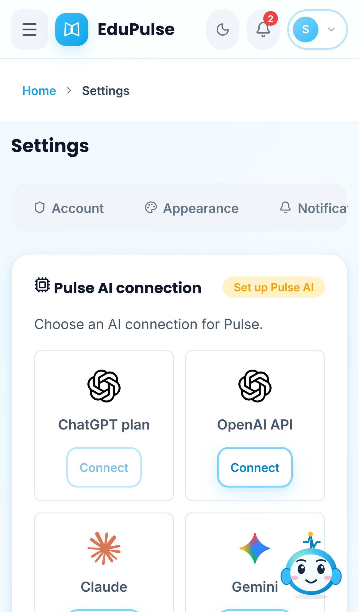 | Settings tabs scroll sideways; provider cards wrap into compact columns above the pipeline; the settings Knowledge library panel is removed. |
| 7 | 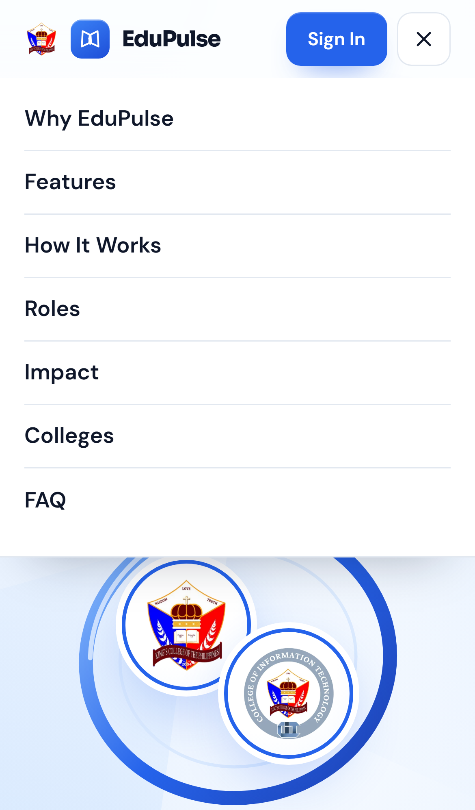 | On the public site, **Open menu** (☰) drops a panel under the bar listing **Home** and the eight pages, **Features**, **How It Works**, **Roles**, **Pulse**, **Impact**, **Colleges**, **Play** and **FAQ**, in large type, separated by thin rules; the page you are on (here **Home**) has a blue dot before it. The sun and moon switch and **Sign In** stay in the bar, and the menu button becomes **Close menu** (an X). Choosing a page, pressing Escape or **Close menu** closes it. |
| 8 | 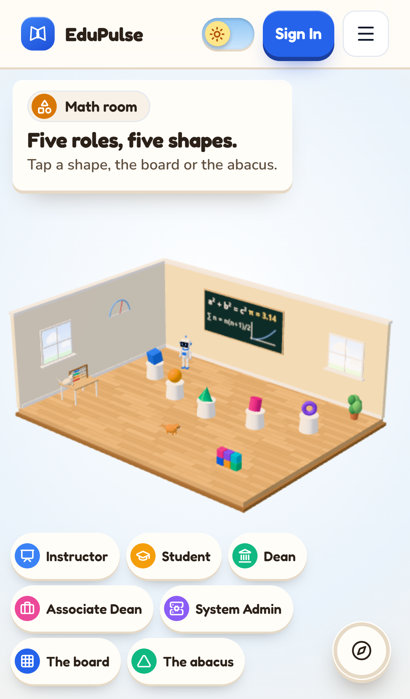 | A public page is still one room that does not scroll: the room's title card at the top, the room in the middle, a chip under it for each thing in the room (here **Instructor**, **Student**, **Dean**, **Program Coordinator**, **System Admin**, **The board** and **The abacus**) and the round compass button at the lower right. A finger drags to look around and two fingers pinch to zoom. |
| 9 | 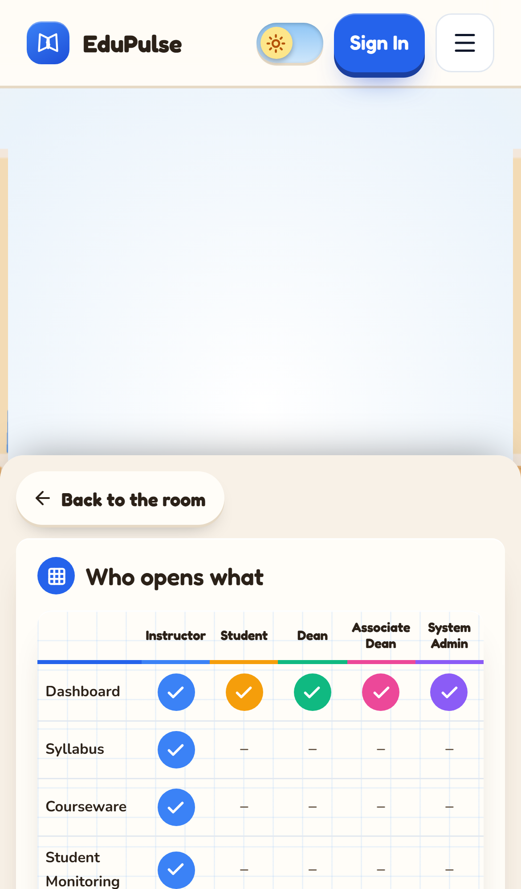 | Tapping a chip (here **The board**) flies the camera in and raises the thing's card from the bottom as a sheet, under **Back to the room**. The grid of who opens what shows all five roles across the top, **Instructor**, **Student**, **Dean**, **Program Coordinator** and **System Admin**, with the pages down the side; the sheet scrolls for the rest. |

*Changed in v0.4.0:* the breadcrumb no longer splits “Home” and the current page onto different lines (the 44 px touch-target rule had made the link taller than its row), and the menu button announces whether it opens or closes the menu.

## Pulse context controls

The mobile Pulse panel retains its bottom-sheet layout. **Pulse options** opens **Conversations and memory**, guidance, workspace buddies and AI settings. The conversation has a compact selection chip and no persistent technical footer. Focused help uses a shorter panel, and the page remains scrollable above it. Edit previews and history scroll inside the panel. See [Manual 9](../../system-manual/09-pulse-actions/README.md) for the same confirmed actions and memory controls.

## Workspace buddies

Open **Pulse options → Workspace buddies**. The optional 3D office is the same cosy studio as the agent workspace on the public landing page, with six named desks, name tags, domain-specific conversations, real request/review states, a pause control and reduced-motion support. Mobile users scroll from the office to the buddy chat. See [the illustrated office guide](../../system-manual/11-workspace-buddies/README.md).

Unique page destinations stay in the main navigation: **Records** for Dean/Program Coordinator and **Assessments** for students. Mobile users find the same links under **Open menu**. Page tabs provide subviews without duplicate left navigation.

## Restored account pages on phones

Account charts stack, Performance/Monitoring tabs scroll and wide score/material matrices stay within their own scroll region. Shared dark surfaces use solid fills. See the [three current mobile captures](../09-restored-role-pages/README.md#dark-and-mobile-views).

## Restored mobile account workflows

The [current account guide](../09-restored-role-pages/README.md) adds mobile topic radar/history/heatmap and confirmed loading proposals, alongside the earlier performance, reader and solid-dark dashboard scenes. Filters and proposal forms stack; wide data matrices scroll within their panels. These scenes use synthetic role fixtures rather than real institutional records.

The [current mobile field, outline and Settings examples](../../system-manual/14-pulse-and-outline-workspace/README.md#smaller-screens) show selected-field proposals, a horizontally scrollable table and the new Settings tabs.

## Local models on a phone

The model selector, source links and download controls wrap within the connection panel. Hardware compatibility still applies; these controlled captures do not establish mobile GPU inference.

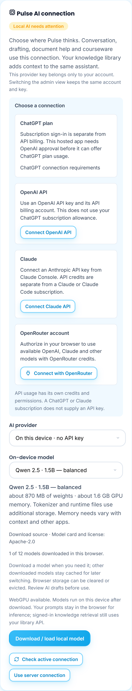

The selected cached model survives reload. Cache status is checked rather than inferred from the selection.

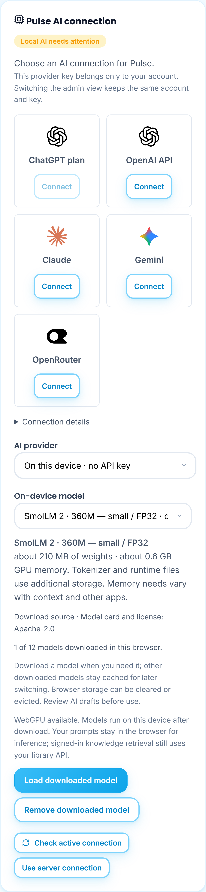

Removing the selected cached model updates the count and restores the download action.

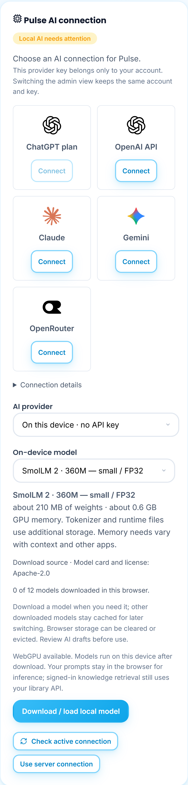

## Conditional horizontal scrolling

Shared academic tables and charts use available container width. Short phone tables no longer reserve a 420-pixel minimum, and charts retain their measured width without forcing a minimum. Horizontal scrolling appears only for genuinely wider content. All five roles retain their existing data permissions. [Manual 36](../../system-manual/36-instructor-syllabi/README.md) shows the related instructor controls and cross-role layout verification.

## Instructor class dialogs

Handled classes are grouped by recorded year and labelled with course/block. Each class opens a full-screen phone dialog with Students, Assessment Scores and Learning Material Access. Nested student progress and roster confirmations scroll within their own surface and restore on reload. [Manual 37](../../system-manual/37-instructor-monitoring/README.md) contains the current phone captures; the separate instructor Performance page is removed.

## Curriculum loads and pending courses

Student course lists include units, year, period and pending-release labels on phones. Wide Dean course-load/roster tables retain native horizontal scrolling; navigation tabs scroll within their own strip. No forced page-wide scrollbar is added. [Manual 38](../../system-manual/38-curriculum-population/README.md) links the current task images and distinguishes actual hosted allocations from fictional capture records.
