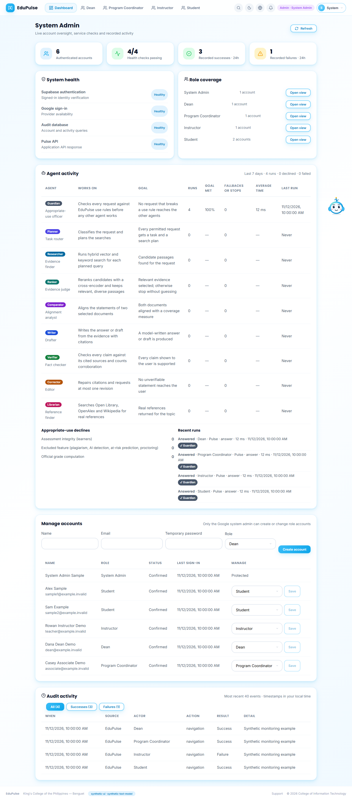
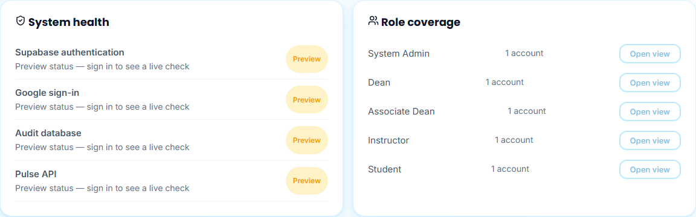
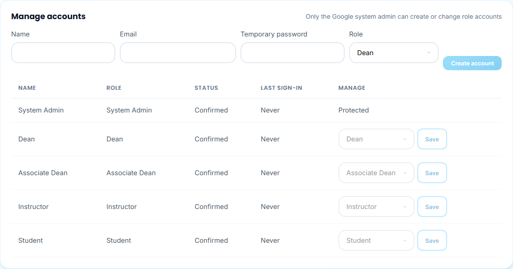
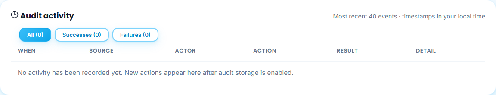
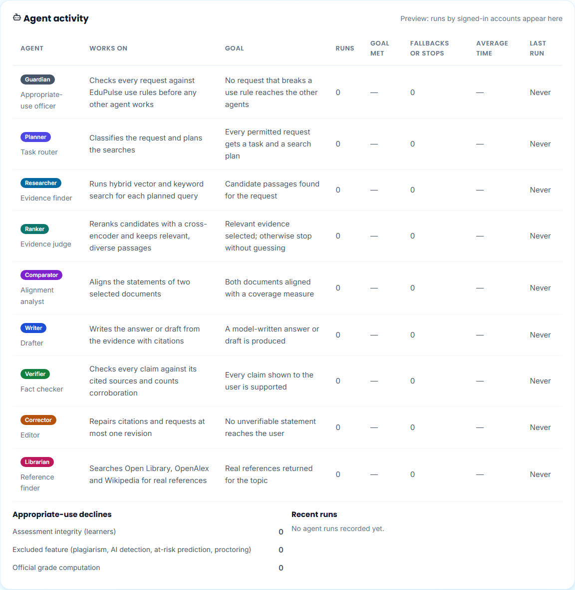
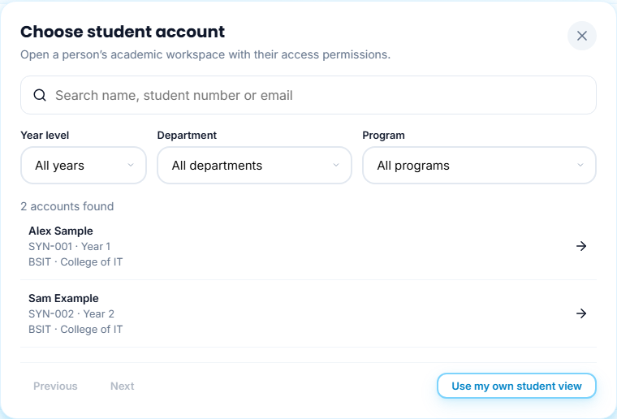
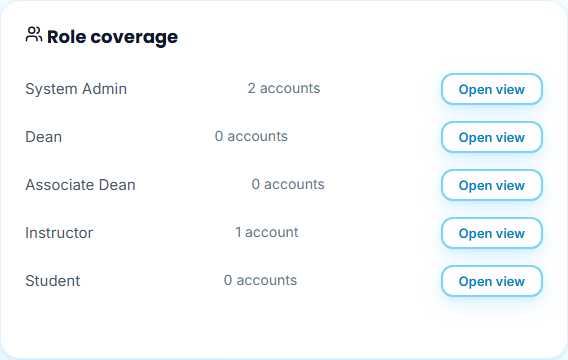
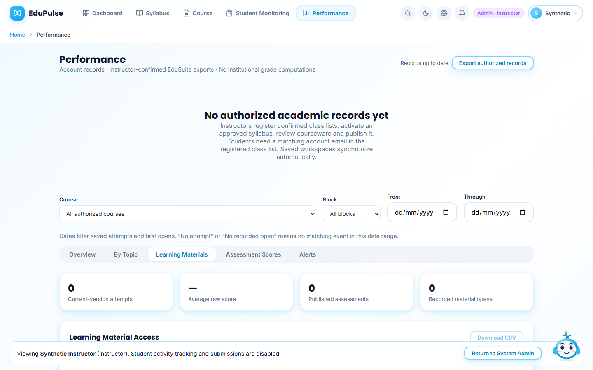

# 07 · System Admin

Browser reload preserves an admin-selected person and the current protected page/tab. Fresh admin and target checks complete before the view renders; a failed check keeps that URL with explicit retry/exit controls. The account picker and header popovers can also reopen without choosing an account or replaying an action. See the four role captures and recovery screens in [Manual 23](../../system-manual/23-account-support-and-pulse-context/README.md#reload-the-selected-account-without-returning-to-dashboard).

**New after v0.4.0.** The system admin is a separate role from the Dean and Program Coordinator. It runs the system: accounts, service health and the audit trail. Academic work (course loading, monitoring, records) belongs to the Dean and Program Coordinator.

The system admin signs in with Google, and the two explicitly designated Google-linked accounts are accepted as admin. The admin's dashboard (`/dashboard`) is the system console, and its top bar shows only **Dashboard** plus the shared tools.

These screenshots come from the documentation capture build and show **preview sample data**. A preview session cannot change accounts, so its controls are disabled. In a signed-in admin session, the same screen loads:
* live Supabase accounts;
* service checks;
* recorded activity.

## 1. System console

From top to bottom: four summary cards, **System health** and **Role coverage**, **Agent activity**, **Manage accounts**, and **Audit activity**. **Refresh** repeats every check and reloads the accounts and events.

The summary cards show:
* authenticated accounts;
* health checks passing;
* recorded successes in the last 24 hours;
* recorded failures in the last 24 hours.

## 2. System health and role coverage

**System health** runs four live checks, and each one reads **Healthy** or **Needs attention**. They show *Preview* in this capture.

| Check | What it verifies |
| --- | --- |
| **Supabase authentication** | The signed-in identity verifies against Supabase Auth |
| **Google sign-in** | The Google provider is enabled for the project |
| **Audit database** | The admin overview query (accounts and activity) succeeds |
| **Pulse API** | The application API responds |

**Role coverage** counts the accounts in each of the five roles: System Admin, Dean, Program Coordinator, Instructor and Student.
* **Open view** opens an account picker for that role. Search and filter the actual accounts, then choose the person to inspect.
* The admin sign-in, AI key, private history and knowledge library remain with the admin. Academic records and permitted saves belong to the selected account; support changes are audited.
* The view can also be changed from the top bar (*Admin · <view>*) or, on a phone, from **Switch view** in the account menu.

## 3. Manage accounts

To create an account:
1. Enter **Name**, **Email**, a **Temporary password** of at least 12 characters, and a **Role** (Dean, Program Coordinator, Instructor or Student).
2. Choose **Create account**, then give the credentials to that person securely.

To change an existing account's role, choose the new role in its **Manage** column and select **Save**. The person signs in again to receive the new role.

Both system admin accounts show **Protected** and cannot be reassigned. A protected Supabase Edge Function (`admin-accounts`) checks the admin's Google-verified identity before every change, and records each change in the audit log.

## 4. Audit activity

The table lists the 40 most recent events, newest first. It combines EduPulse actions with Supabase Auth events and shows when, source, actor role, action, result and detail. The filter buttons switch between **All**, **Successes** and **Failures**, and each button shows how many events it holds.

EduPulse records these actions:
* sign-in and sign-out;
* view switches;
* page visits;
* workspace saves;
* AI provider connections;
* role changes.

The records never contain passwords, tokens, provider keys, prompts or the system admin's email address. This preview has no events yet, so the table shows its empty message.

## 5. Agent activity

This section is how the admin monitors Pulse’s named agents. Each row shows:
* an agent, its job title (for example the **Guardian**, *Appropriate-use officer*), the task it works on and the goal it must achieve;
* for the last 7 days: **Runs**, **Goal met** (the share of runs in which it achieved its goal), **Fallbacks or stops**, **Average time** and **Last run**.

The goals are measured from each run’s result, not taken from the agent’s own report. For example, the Verifier’s goal counts as met only when no claim shown to the user was unsupported. The Ranker’s goal is not met when no relevant evidence existed: those runs point to gaps in the knowledge library.

Below the table:
* **Appropriate-use declines** counts the Guardian’s declines by rule: assessment integrity, excluded features and official grade computation.
* **Recent runs** lists the latest runs by role, workflow, task, outcome and time. Each agent appears as a chip marked ✓ (goal met) or ✗ (not met).

Runs are recorded for signed-in accounts in the hosted system once the agent-run migration is applied ([Backend System · Supabase](../../backend-system/supabase.md)). Until then, the live console shows a notice instead of counts. A record holds the task, outcome, timing and goal results, never the question, the answer or document text. The admin sees roles, not the people behind them. This capture is a preview session, so every count is zero.

*New after v0.4.0* (FR-AGENT-01–04).

Initial overview, role/account counts, agent activity and audit reads now show skeletons while pending. Later **Refresh** retains loaded data and shows a spinner; account creation/role saves also show pending spinners. [Manual 19](../../system-manual/19-loading-and-saved-connections/README.md) captures the initial console request.

## Account picker and support boundaries

Search by name, student number or email. Student filters include **Year level**, **Department** and **Program**. Choose a row to enter that person's academic view. The banner names the selected person and offers **Return to System Admin**. Support previews do not create learner access/completion events, assessment attempts or appeals. Only named accounts can be selected. The former own-account view option is removed. See [Manual 23](../../system-manual/23-account-support-and-pulse-context/README.md) for filtered, selected-account, dark and mobile captures. These are synthetic UI examples; native and rolled-back hosted checks separately verify row-level boundaries.

## Two designated Google admins

**Role coverage** counts both registered admin accounts. **Manage accounts** marks each **Protected**; neither can be reassigned through the ordinary role selector. Either Google-verified admin can use the existing academic account picker. Provider connections, conversations, workspaces and reload hints remain scoped to the actual signed-in admin.

On a phone the same [role coverage](mobile-06-two-admins.png) and [restored support view](mobile-07-second-admin-reloaded-view.png) remain available. These captures use synthetic admin identities and an invented instructor. They verify rendering and reload behavior, not live Google consent or access to a real person's records. A newly registered Google-only account is counted before its first sign-in; registration is not evidence of a completed Google session.

The active student directory is limited to **College of Information Technology**. The department selector contains only CIT, with year/program filtering retained. Non-CIT profiles and the four legacy role placeholders are retired from active use, with their records preserved. Student profile count after retirement is 417.
