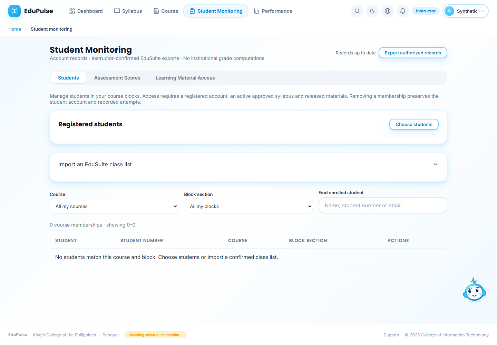
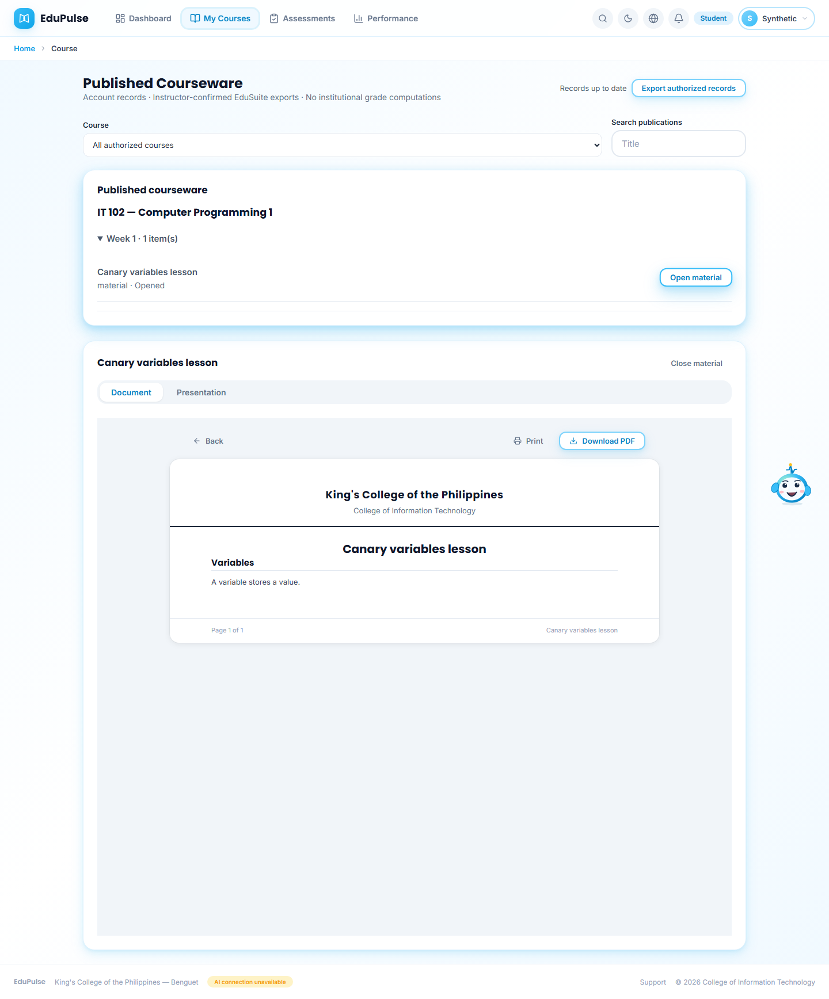
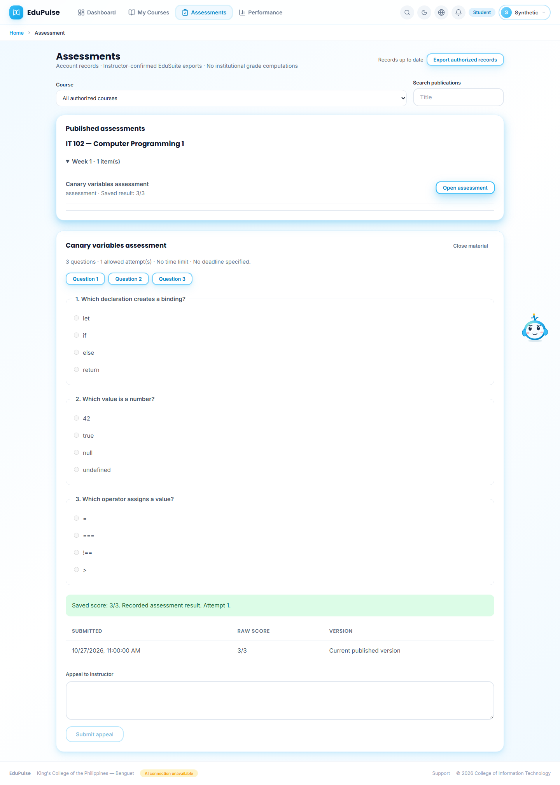
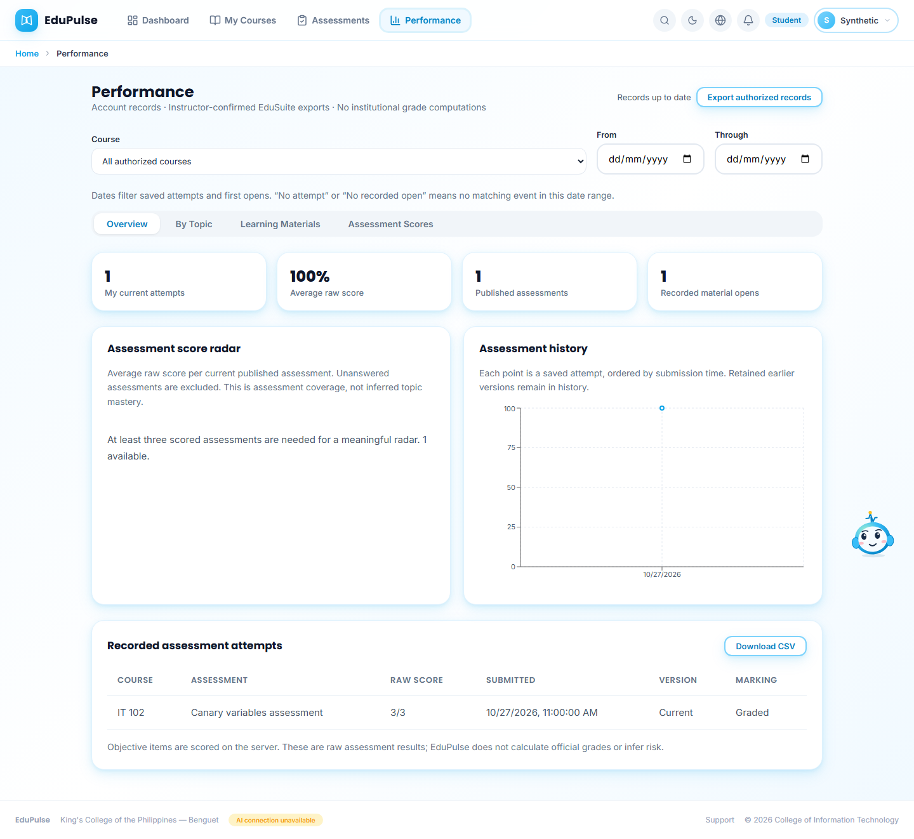
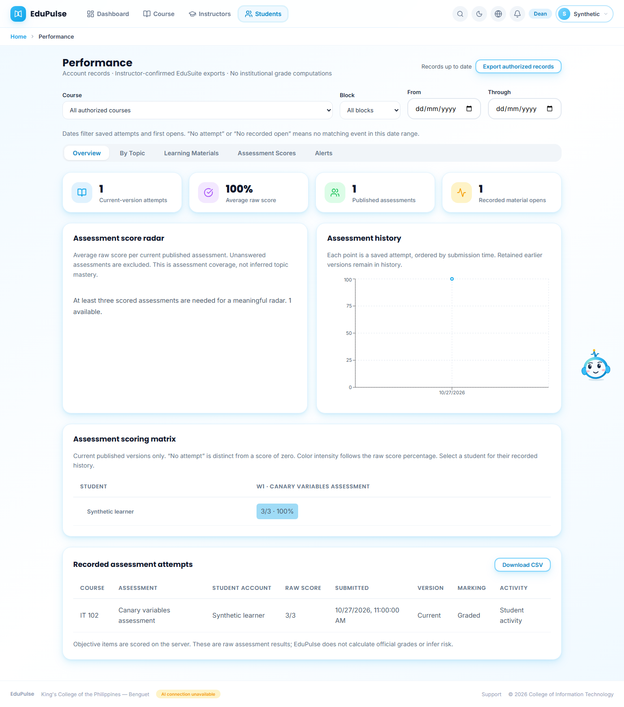
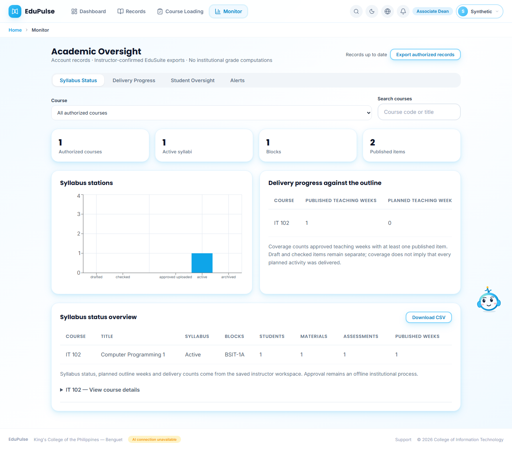
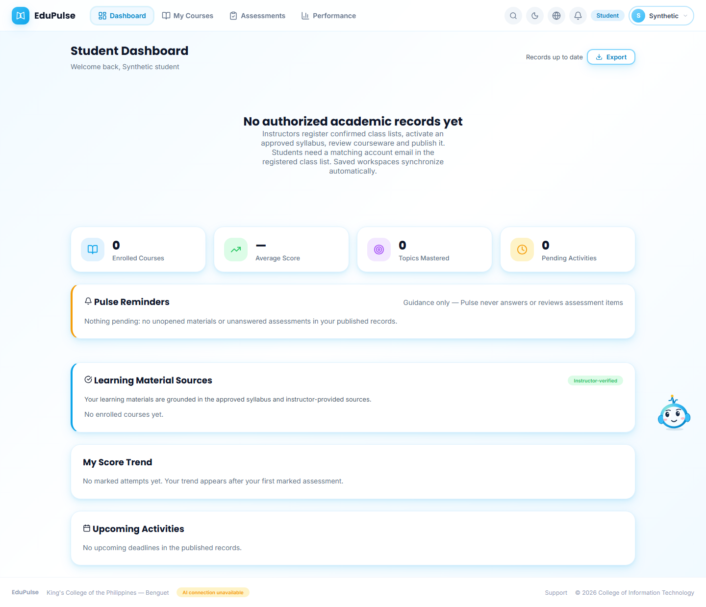

# 08 · Authenticated academic records

Labelled pipeline activity appears in both student progress and instructor monitoring. **Activity records** includes all recorded progress by default, with separate student-only and pipeline-test filters. The **Activity** column and student saved-result text retain **Pipeline test**. [Manual 33](../../system-manual/33-pipeline-progress/README.md) shows these additions with synthetic captures and distinguishes them from hosted seed evidence.

These current layout captures use synthetic academic responses and a browser-only account fixture. They show the authenticated interface without creating a hosted account. They do not prove server authorization, database permissions, persistence or scoring. Earlier hosted canary evidence is retained in the linked release record below and must not be inferred from these refreshed images.

| View | Capture | Visible behavior |
| --- | --- | --- |
| Instructor monitoring |  | **Students** is selected beside **Assessment Scores** and **Learning Material Access**. This fixture shows an empty owner roster, **Choose students**, the optional class-list importer, course/block/search filters and **Export authorized records**. A compact status reports automatic refresh. [Manual 21](../../system-manual/21-automatic-records-and-course-rosters/README.md) shows populated memberships and confirmations. |
| Student material |  | **Published Courseware**, the canary material and its text after **Open material**, with **Opened** returned by the synthetic transport. |
| Student assessment |  | Multiple-choice items and the fixture's **Saved score: 3/3**. Answer keys/explanations are absent. This image does not establish live server scoring or persistence. |
| Student performance |  | Own-record tabs, history chart and saved result. With only one assessment, the radar explains its three-assessment minimum. No sample scores or institutional grades. |
| Dean performance |  | Read-only college results under the written role requirements. No authoring or approval controls. |
| Associate Dean oversight |  | **Syllabus & Delivery**, **Student Oversight** and **Alerts**, readiness counters and expandable courses; no assessment-attempt table or scores. Direct Performance navigation redirects to Dashboard. |
| Unenrolled student |  | The student dashboard with **No authorized academic records yet**: zero counts, a dash for the average score, and empty-state lines under **Pulse Reminders**, **Learning Material Sources** (*No enrolled courses yet.*), **My Score Trend** and **Upcoming Activities**. No sample roster or score fallback. |

The workspace remains owner-scoped. The additive projection shares only enrolled published content and role-authorized results. A student account's verified email must match the instructor-confirmed class list. Instructors keep syllabus/courseware authoring in the existing screens; a checked draft must finish saving before **Publish** becomes available. Editing published content requires review again. Offline syllabus signatures remain outside EduPulse.

The earlier hosted run used runtime `74191de`: five tests passed and seven images were captured. Temporary accounts were subsequently deleted and stale access was rejected. [Deployment and cleanup evidence](../../session-generated/2026-10-24-release-completion/deployment.json) records the verified release separately from real institutional results.

## Approved baseline extension - 28 October

This earlier authenticated-records overview is supplemented by the [50-scene role guide](../09-restored-role-pages/README.md) and [ADR-002](../../backend-system/decisions/002-feature-preservation-baseline.md). Shared imports/loading/enrollment projection, explicit mapped topic analytics, timed/multiple/written assessments and marking/appeals, scheduled releases, account notices/read receipts, saved syllabus restoration and the Dean offline inbox have implementation. Institutional records, academic events, notices and assessment sessions use RLS and role-checked RPCs. Current migration and hosted-canary evidence is recorded in the [automatic-records release](../../versions/2026-11-07-automatic-records-and-course-rosters/validation/results.md); screenshots alone do not certify hosted state.

The refreshed Associate Dean image uses the current controlled two-course fixture and the combined tab. It is a UI regression capture, not a new hosted sign-in or authorization canary. See [Manual 29](../../system-manual/29-combined-oversight/README.md) for exact coverage and role limits.
