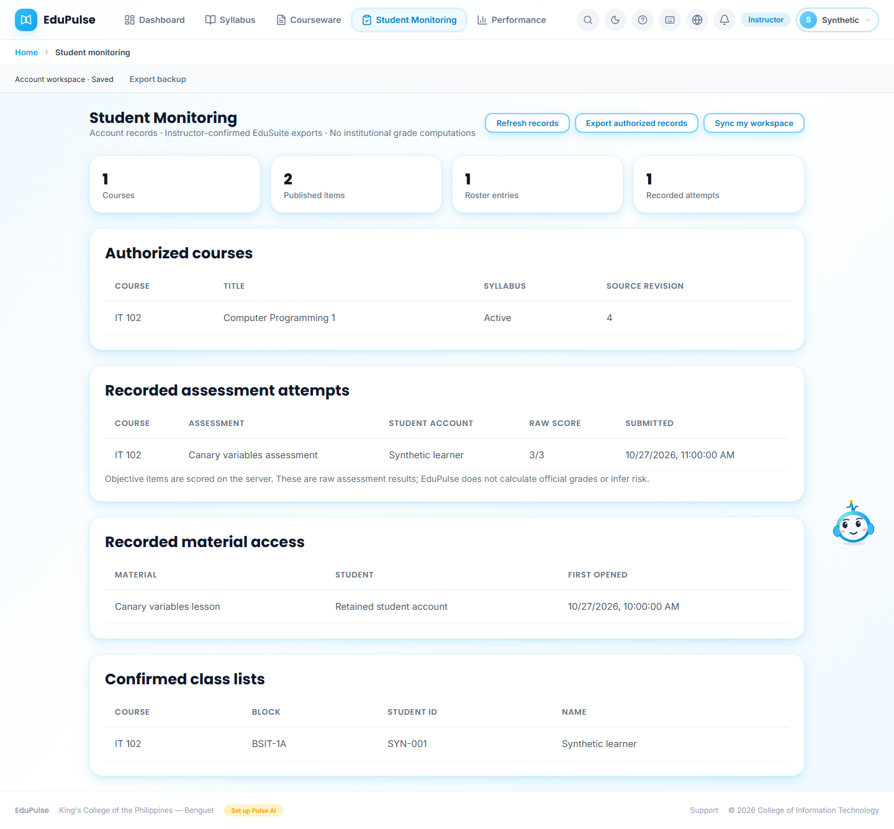
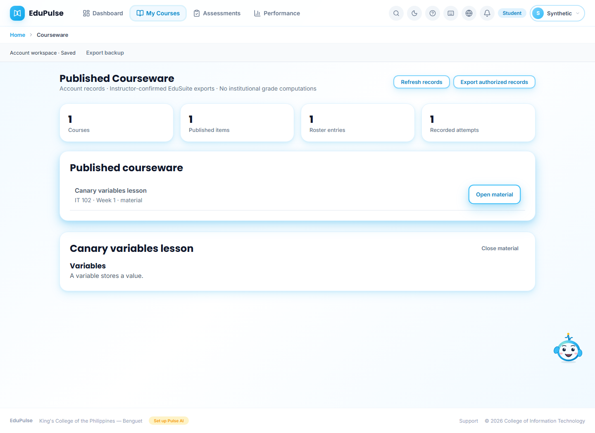
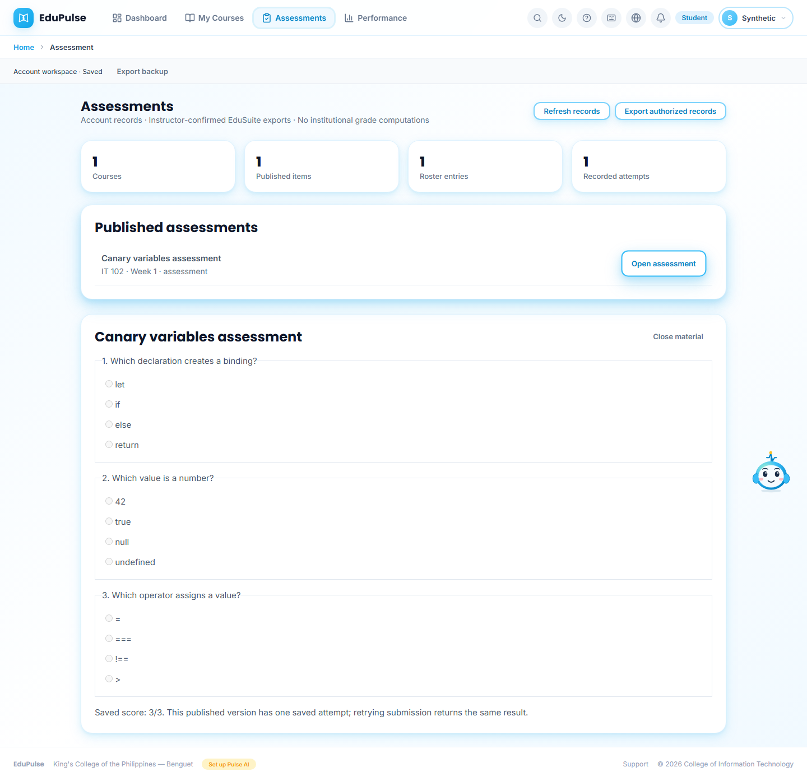
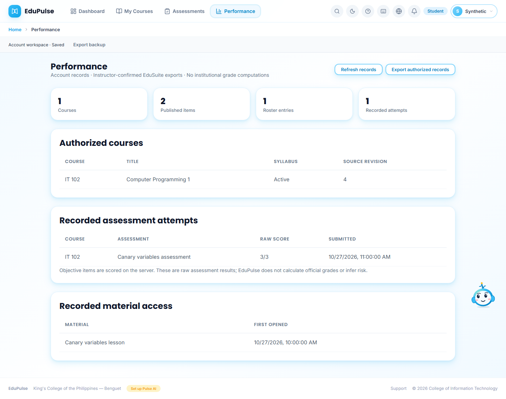
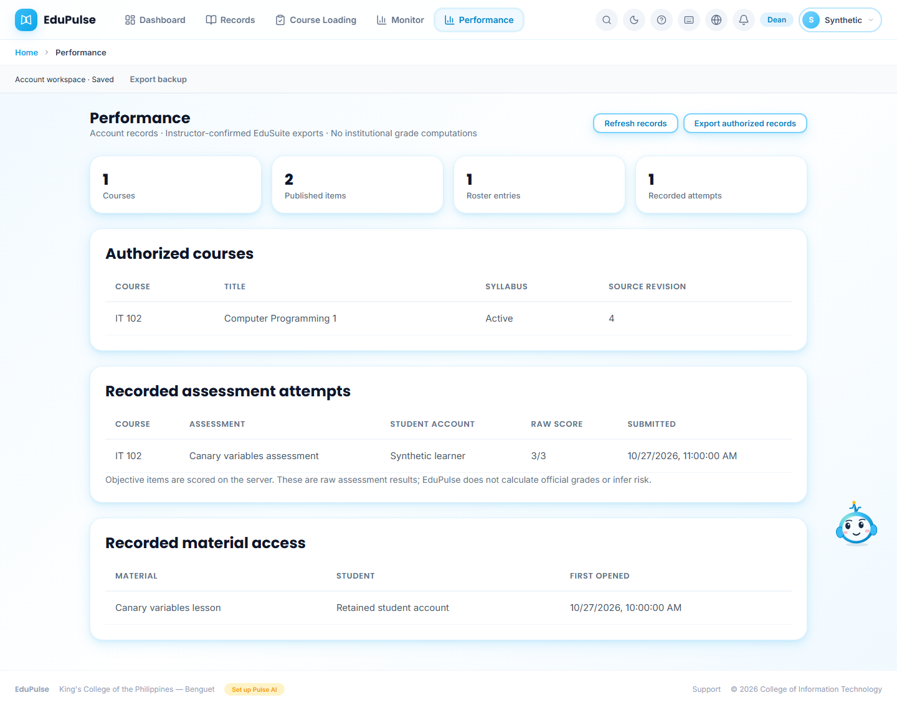
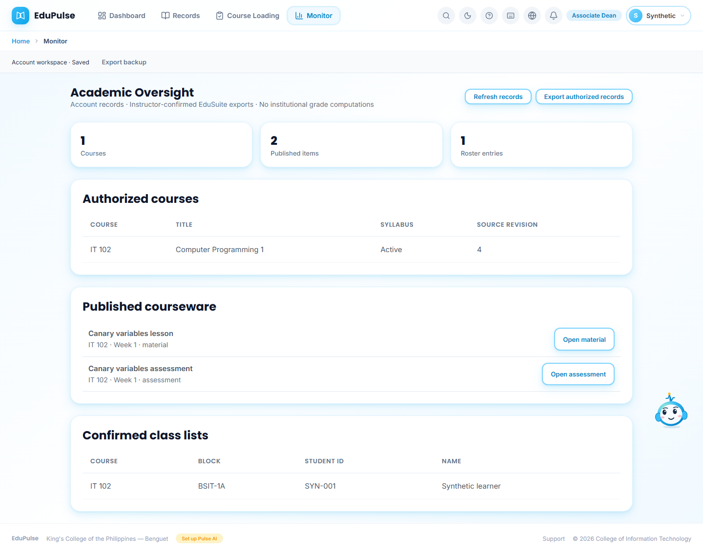
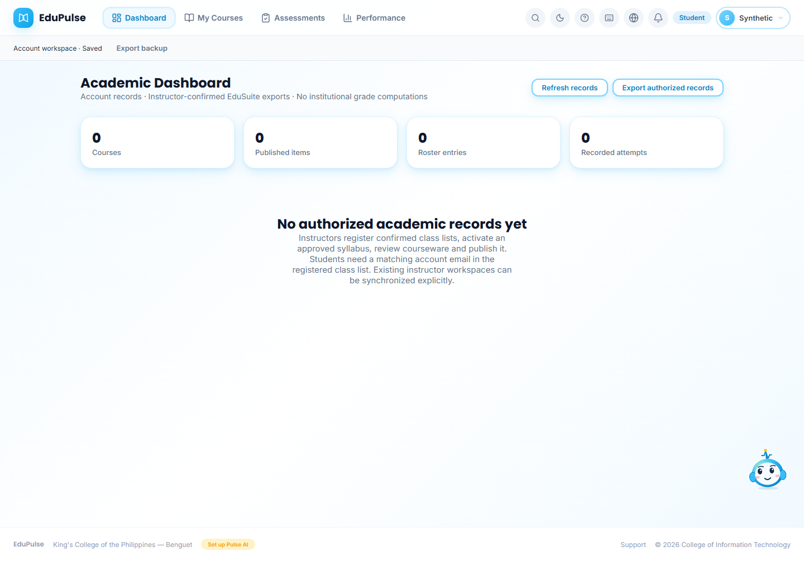

# 08 · Authenticated academic records

These current layout captures use synthetic academic responses and a browser-only account fixture. They show the authenticated interface without creating a hosted account. They do not prove server authorization, database permissions, persistence or scoring. Earlier hosted canary evidence is retained in the linked release record below and must not be inferred from these refreshed images.

| View | Capture | Visible behavior |
| --- | --- | --- |
| Instructor monitoring |  | **Account records**, authorized courses, **Recorded assessment attempts**, raw score **3/3**, **Recorded material access**, student labels and **Confirmed class lists**. **Export authorized records** downloads this projection as JSON. **Refresh records** reloads the API; **Sync my workspace** refreshes the owner's projection. |
| Student material |  | **Published Courseware**, the enrolled canary material and its text after **Open material**. Opening is recorded persistently. |
| Student assessment |  | Published multiple-choice items and **Saved score: 3/3** after server scoring. Answer keys/explanations are absent. One attempt is saved per published version; retries return that attempt. |
| Student performance |  | The student's own recorded assessment result, without preview/sample charts or computed institutional grades. |
| Dean performance |  | Read-only college results under the written role requirements. No authoring or approval controls. |
| Associate Dean oversight |  | Authorized courses, published courseware and confirmed rosters; no assessment-attempt table or scores. Direct Performance navigation redirects to Dashboard. |
| Unenrolled student |  | **No authorized academic records yet**, with truthful zero counts. No sample roster or score fallback. |

The workspace remains owner-scoped. The additive projection shares only enrolled published content and role-authorized results. A student account's verified email must match the instructor-confirmed class list. Instructors keep syllabus/courseware authoring in the existing screens; a checked draft must finish saving before **Publish** becomes available. Editing published content requires review again. Offline syllabus signatures remain outside EduPulse.

The earlier hosted run used runtime `74191de`: five tests passed and seven images were captured. Temporary accounts were subsequently deleted and stale access was rejected. [Deployment and cleanup evidence](../../session-generated/2026-10-24-release-completion/deployment.json) records the verified release separately from real institutional results.
