# Restored account pages — 28 October 2026

These screenshots exercise the authenticated components with synthetic account, API and workspace responses. Names, email addresses and scores are fixtures. They verify presentation and interactions, not hosted authentication, production RLS, real grading or model quality. The earlier preview screens remain demonstrations; this guide describes the restored account interface.

## Role dashboards

| Role | Capture | Sections |
| --- | --- | --- |
| Instructor |  | **Your teaching workspace**, **Quick actions**, saved syllabus lifecycle, courseware review queue, assessment radar/history, **My Block Sections**, readiness, courses and recent publications. Getting-started progress, topic mastery, stations and saved activity are restored. Empty private syllabus/draft lists are intentional in this fixture. |
| Student |  | **Your learning workspace**, enrolled course counts, **My blocks**, **Continue learning**, saved score charts, score snapshot and publications. Recorded deadlines appear under Upcoming activities; missing dates remain explicit. |
| Dean |  | Management quick actions, **College Performance** link, college course/block readiness and **Faculty overview**. |
| Associate Dean |  | Records/loading/oversight links and readiness. No Performance link or score panel. |

## Performance and instructor monitoring

**Course**, **Block**, **From** and **Through** filter authorized records. Dates apply to attempts and first opens. A missing event in a filtered view does not establish a missed deadline. Empty states retain the sections and never substitute preview scores.

| View | Capture | Behavior |
| --- | --- | --- |
| **Overview** |  | **Assessment score radar**, **Assessment history**, colored raw-score matrix and saved attempts. Radar requires three scored current assessments; unanswered assessments are excluded. It measures assessment results, not topic mastery. |
| **By Topic** |  | Mapped topic radar, per-topic history/status, learner heatmap, class averages and mastery/needs-review counts. Unmapped and pending marks are excluded. |
| **Learning Materials** |  | Student-by-material open matrix, access chart and dated first-open records. An open is not proof of completed reading. |
| **Assessment Scores** |  | Current-version scoring matrix and historical attempts. **Download CSV** exports the displayed table. Earlier versions are labelled separately. |
| **Alerts** |  | Adjustable **Review scores below (%)** filter and unanswered assessments against the confirmed roster. The threshold is local review guidance, not an official pass mark or risk prediction. |
| Student detail |  | Select a learner in the matrix to open their radar, recorded history and attempts. **Escape** closes the dialog. |
| **Assessment Scores** in Student Monitoring |  | Raw-score charts, **Class average per assessment**, **Assessment submission rate**, matrix and attempts. `/scoring-sheet` reaches this same working view. |
| **Learning Material Access** |  | Open/unopened records, chart and CSV. **No recorded open** remains distinct from reading completion. |

Students receive only their own result/access records. The Dean's view is read-only. Associate Dean navigation to Performance returns to Dashboard; the backend continues to exclude attempts and accesses from that role.

## Oversight and course loading

| View | Capture | Sections |
| --- | --- | --- |
| **Syllabus Status** |  | Saved syllabus stations, planned/published teaching-week coverage, readiness counts and expandable course details. Approval remains offline. |
| **Delivery Progress** |  | Material/assessment bars by course, publication counts, represented weeks and titles. Coverage counts planned teaching weeks with published content; it does not prove every planned item was delivered. |
| **Student Oversight** |  | Block/enrollment summary and **Confirmed class lists**, with CSV export and role scope. |
| **Alerts** |  | Actual inactive-syllabus, missing-roster or missing-publication gaps; no scheduled deadline is assumed. |
| **Course Monitoring** |  | Search/course filter, readiness KPIs, course table, CSV and expandable publication/roster details. |
| **Instructors** |  | Expandable instructor account/course summaries. Confirmed shared load rows supply names and optional qualifications. Provisioned instructor accounts support reviewed loading proposals; missing qualifications are explicit. |

## Records and confirmed shared file intake

| View | Capture | Behavior |
| --- | --- | --- |
| **Blocks / Sections** |  | Select a block card to filter confirmed roster entries; select it again to show all blocks. Counts deduplicate learners. |
| **Courses** |  | Authorized course identity, active status and source revision. |
| CSV preview |  | Expected headers, valid/rejected counts, first ten accepted rows and rejection reasons. **Confirm Import (1 records)** saves only the valid row. |
| Saved intake |  | Persistence receipt and **Shared academic records** table with CSV download. This fixture simulates the shared import command. |
| **Course Loads** |  | Separate load CSV preview/save panel and saved rows. |
| **Student Class Lists** |  | Separate roster CSV preview/save panel and saved rows. |
| **Templates** |  | Three real CSV header-template downloads. |
| **History** |  | Confirmed filename/result/time from the saved shared event history. |

File intake accepts CSV up to 1 MB and 1,000 rows per request. Quoted commas/newlines and optional qualification/adviser columns are supported. Invalid/duplicate rows are reported; confirmation saves valid shared course, load or roster rows atomically. Courses precede loads; loads use provisioned instructor IDs; matching blocks and verified student emails feed enrollment. Earlier private intake stays in the owner backup for explicit re-import. No direct EduSuite synchronization is claimed.

## Student readers and assessment results

| View | Capture | Behavior |
| --- | --- | --- |
| Course/week navigation |  | Course/title search and expandable weeks for enrolled published materials. |
| **Document** |  | Read-only styled lesson; **Download PDF**, print and back controls use the existing document viewer. Opening records access before displaying the material. |
| **Presentation** |  | Title/section slides, previous/next, slide selector and fullscreen controls. |
| Assessment result |  | Numbered question navigation, disabled question controls and raw score receipt. This fixture has a saved objective result. Configured duration, deadline and 1-3 attempts are enforced by the server; written responses await instructor marking. No answer key is released. |
| Account notices |  | Record-derived notices and account/device-scoped **Mark All Read**. The fixture explicitly removes its last saved attempt and refreshes the account data to show **Unanswered assessment: Arrays quiz**. Persisted academic notices use account read receipts; derived reminders retain device read state. No email/push service is claimed. |

## Dark and mobile views

| View | Capture | Behavior |
| --- | --- | --- |
| Dark performance |  | Solid body/cards/controls, readable muted and semantic text, themed chart grid/axes/tooltips. |
| Mobile performance |  | Charts stack; page tabs remain scrollable and wide matrices stay in their own scroll region. |
| Mobile monitoring |  | Course/date controls, material matrix and chart fit the phone viewport. |
| Mobile dark dashboard |  | Role quick actions and dashboard sections on solid dark surfaces. |

The System Admin console remains separate: account/role management, health, audit and agent activity were retained. The verified owner's view switching preserves the original account identity; restored academic screens do not grant ordinary users that capability.

## Baseline workflows restored after owner confirmation

The following scenes use the additional synthetic baseline fixture. SQL integration tests separately exercise the real migrations and role policies; these screenshots do not certify hosted authentication.

| View | Capture | Visible behavior |
| --- | --- | --- |
| Topic mastery | 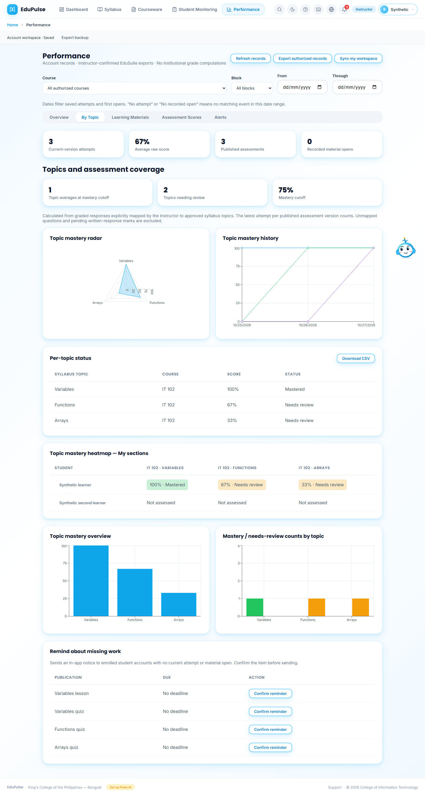 | Three mapped topics, separate topic history/status, learner heatmap, class average and mastered/needs-review counts. No assessed result is invented for the second learner. |
| Instructor marking | 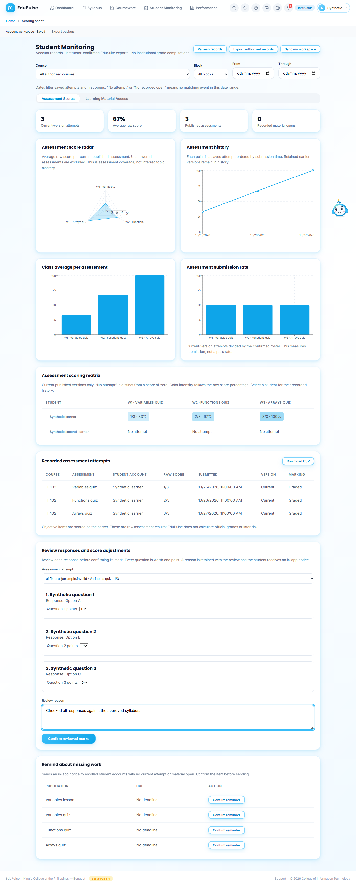 | Select a saved attempt, review each response and 0/1 mark, enter a reason and confirm. |
| In-app reminder | 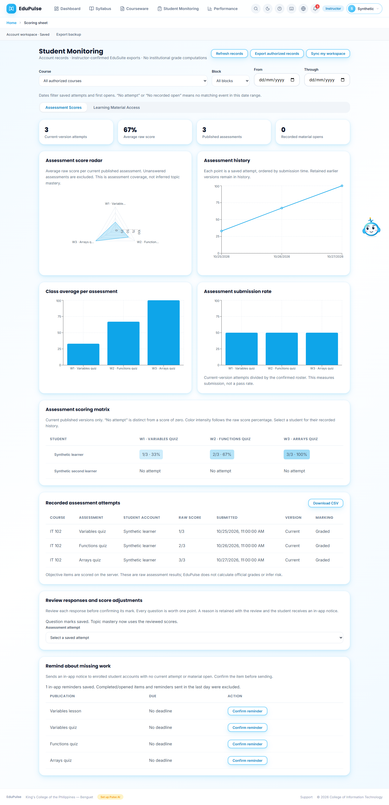 | Reviewed marks receipt and one saved reminder receipt; duplicate/day and completed-work exclusions are stated. |
| Loading proposals | 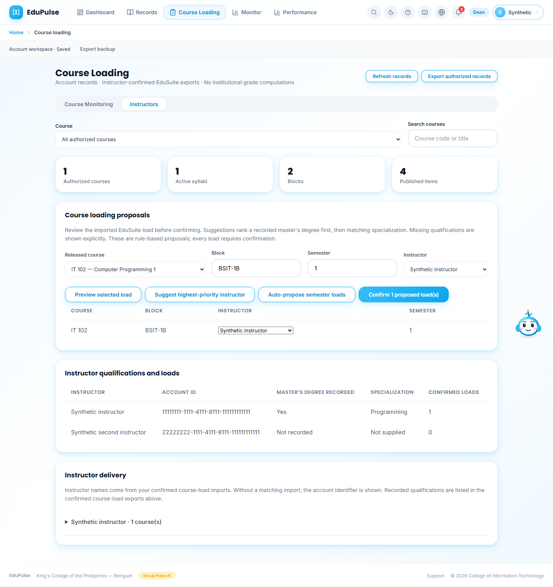 | Imported course, block/semester, provisioned instructor list, degree/specialization records, preview/auto proposals and confirmation. |
| Block correction | 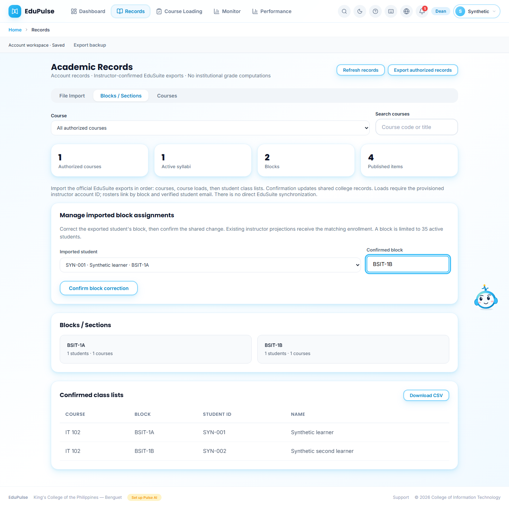 | Select imported student and confirmed block, then confirm the shared correction. |
| Offline review inbox | 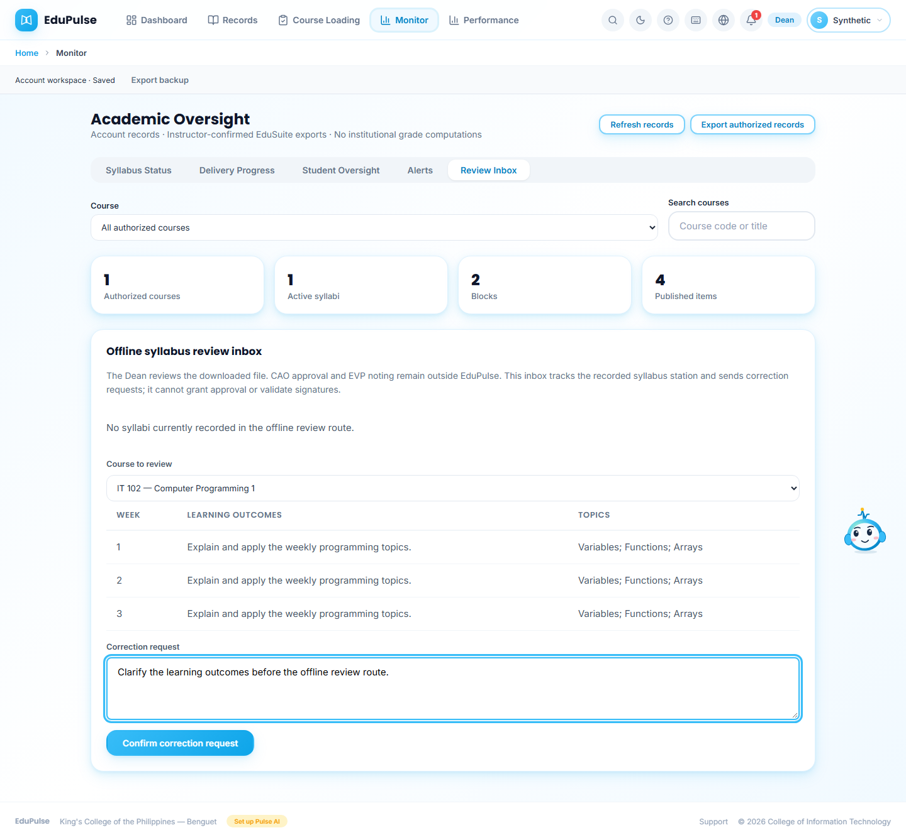 | Recorded stations, selected course outline and correction request. There is no electronic approval action. |
| Timed written assessment | 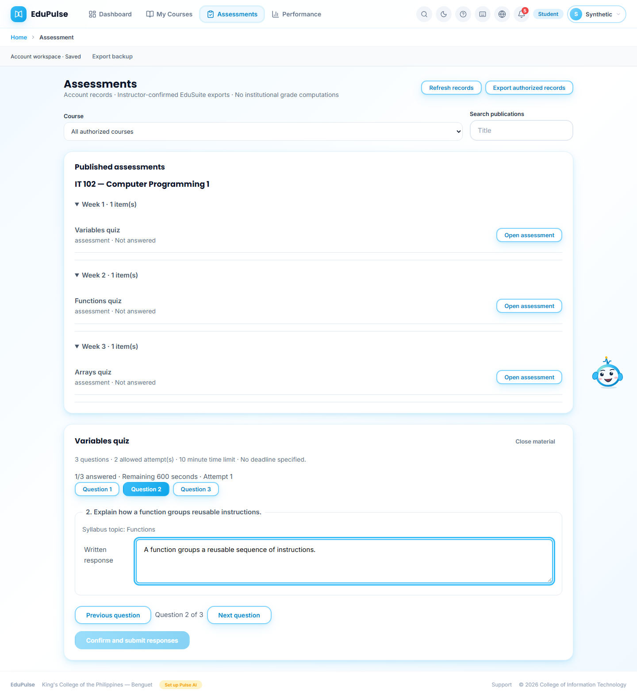 | Server-started session, remaining time, topic names, one visible written question, Previous/Next and numbered navigation. |
| Saved result and appeal | 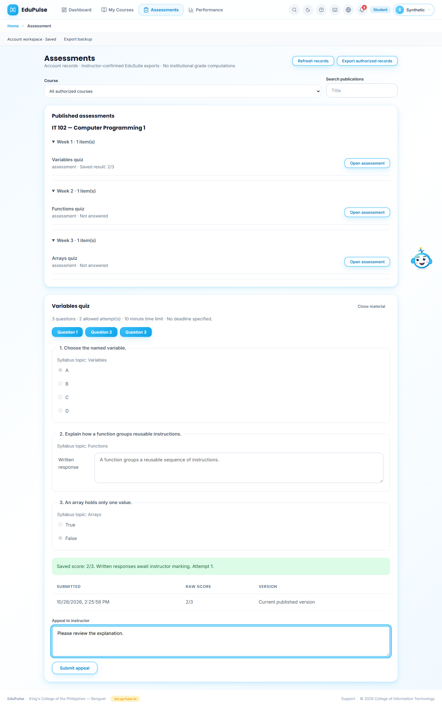 | Objective subtotal, pending written-response marking and appeal form. |
| Persisted notices | 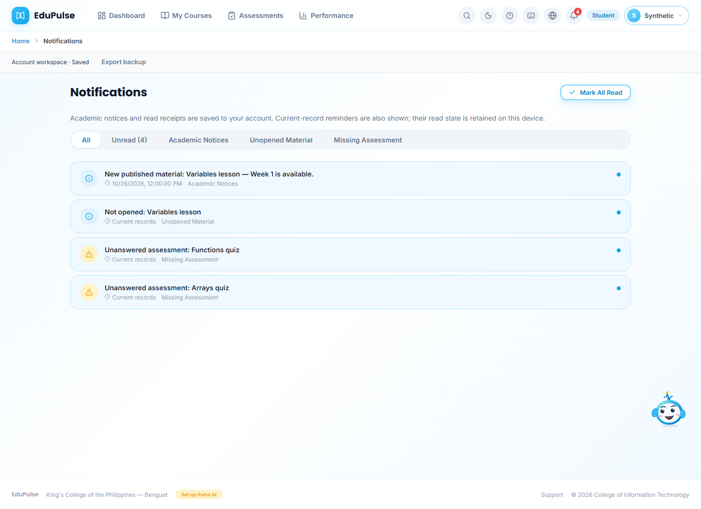 | Persisted publication notice plus derived current-work reminders; account and device receipt behavior is disclosed. |
| Saved versions | 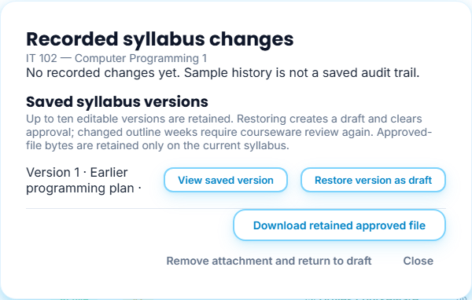 | Historical editable version can be viewed or restored as a new draft; approval must be repeated. |
| Question topic mapping | 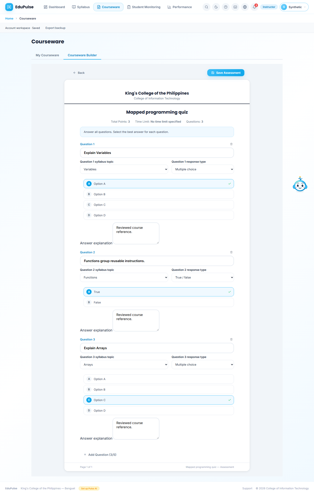 | Each question maps to an approved outline topic and selects multiple choice, True/False or instructor-marked response type. |
| Delivery settings | 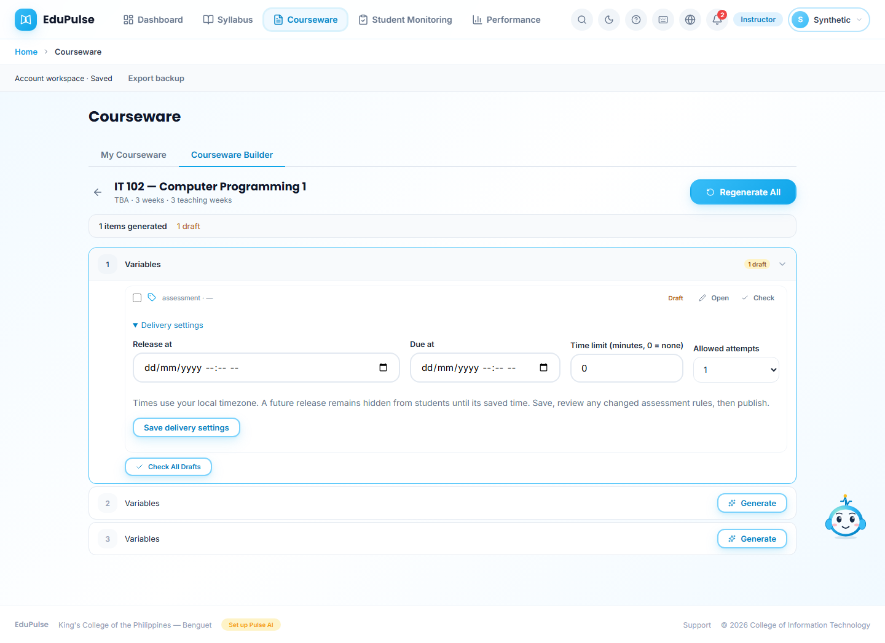 | Release/deadline, duration and allowed attempts saved before review/publication. |
| Mobile topics |  | Stacked topic charts/status and scrollable matrices. |
| Mobile loading | 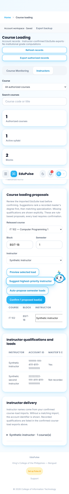 | Responsive proposal controls and qualification/load tables. |

See [Manual 13](../../system-manual/13-restored-account-sections/README.md), [ADR-002](../../backend-system/decisions/002-feature-preservation-baseline.md) and the [baseline release record](../../versions/2026-10-28-baseline-workflows/README.md). The four new migrations were applied to EduPulse System on 28 October 2026; other installations must apply them before serving this version.

## Pulse account guidance

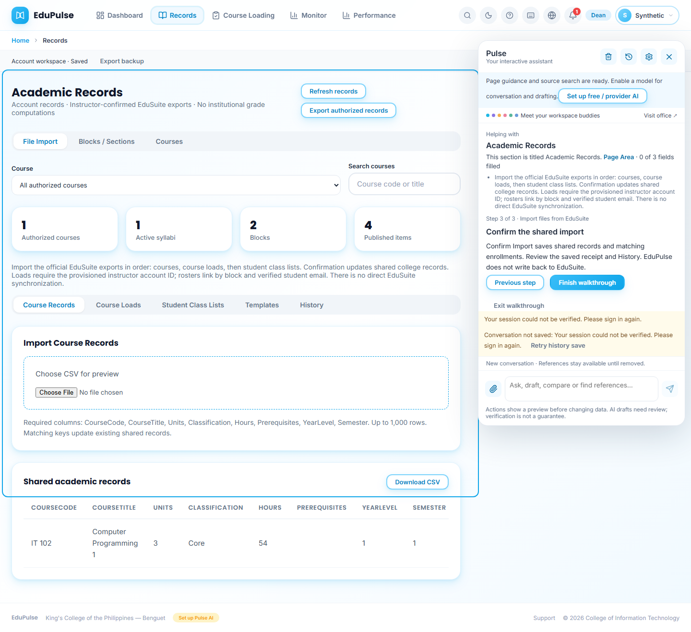

Authenticated Records and Course Loading again expose their page guidance targets. Pulse distinguishes saved account records from preview samples, describes confirmed shared imports and enrolled publication, and keeps the Dean guidance read-only. The displayed final import instruction explains the saved receipt; it does not claim that an import occurred. Preview personas keep their sample-data disclosure.

The Pulse capture uses a synthetic account transport, so the separate conversation service shows a session-verification/read-history warning. Authored page guidance remains available; this image is not a successful hosted session or a saved conversation. The page target is named Academic Records rather than concatenating dropdown options into its heading.
